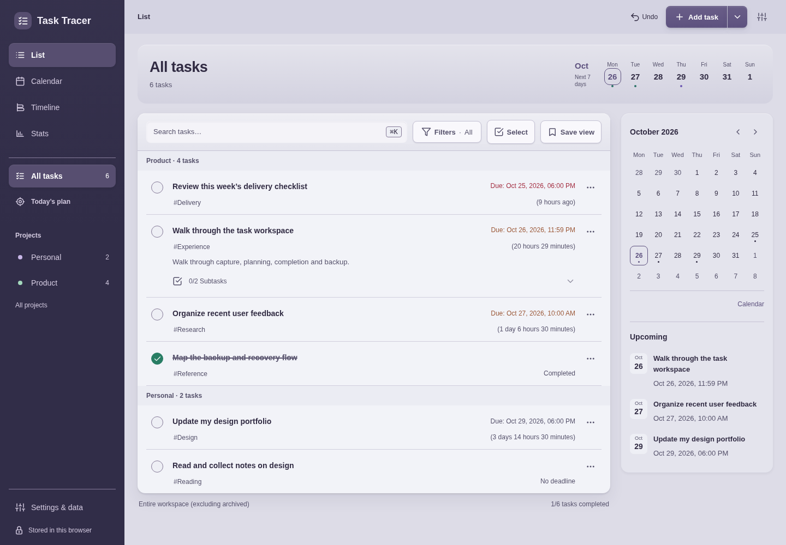
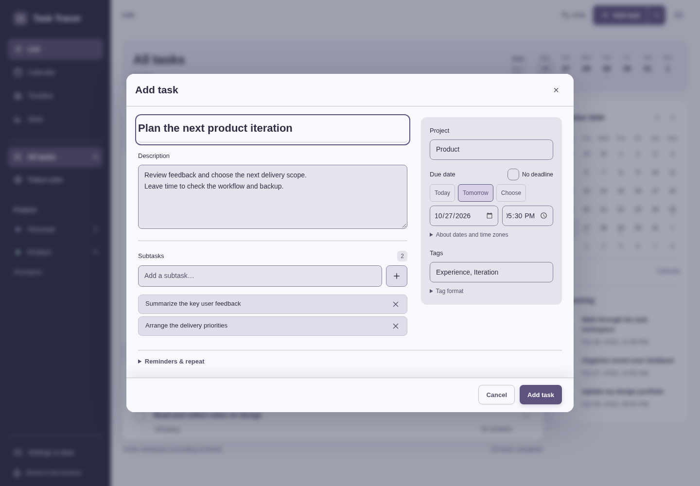

# Task Tracer

A local-first task workspace. Capture work, plan your day and review progress—without an account.

[Open app](https://todo.muquew.com/) · [Download](https://todo.muquew.com/downloads/task-tracer-4.15.1.zip) · [简体中文](README_zh_cn.md)

## Features

- **Capture:** quick text entry, descriptions, subtasks and due dates.
- **Organize:** projects, tags, search and saved views.
- **Plan:** today's plan, recurring tasks, reminders and snooze.
- **Review:** list, calendar, timeline and seven-day completion statistics.
- **Manage:** batch actions, archives and Undo.
- **Back up:** JSON export, import preview, merge, recovery history and CSV reports.
- **Personalize:** four themes, light/dark appearance, Chinese and English.
- **Use anywhere:** responsive layout, keyboard controls and offline PWA support.

| Workspace | Task editor |
| --- | --- |
|  |  |

## Start

1. Choose **Add task** in the top bar. Its arrow opens Quick capture, for example `tomorrow 20:00 Read #study /Personal`.
2. Organize with projects and tags; switch views or pick tasks for **Today's plan**.
3. Use **Settings & data → Backups & transfer** to download task JSON and a separate saved-views JSON.

- Tasks stay in this browser profile. Keep backups outside the browser before clearing site data or moving devices.
- Task JSON restores tasks; saved views use their own export. CSV is a report.
- Offline use needs an initial online visit. Installation and notifications depend on the browser and OS; closed-app reminders are not guaranteed.

## Run locally

From the repository folder or extracted release:

```bash
python3 -m http.server 8080 --bind 127.0.0.1
```

Open [localhost:8080](http://127.0.0.1:8080/). No build or backend is required.

## Documentation

- [User guide](SUPPORT.md) — settings, updates and data recovery.
- [Development](CONTRIBUTING.md) — setup, checks and release commands.
- [Security](SECURITY.md) — data boundaries and vulnerability reporting.

## License

[Personal non-commercial use](LICENSE). Commercial use requires prior written permission from **muquew**.

Release: **4.15.1**. [Checks](https://github.com/muquew/Task-Tracer/actions/runs/40238448977) · [Release and verification record](https://github.com/muquew/Task-Tracer/blob/bafbf1663c4d36836774a6a5319fbcef20c8cbfc/docs/stable-delivery.md).
