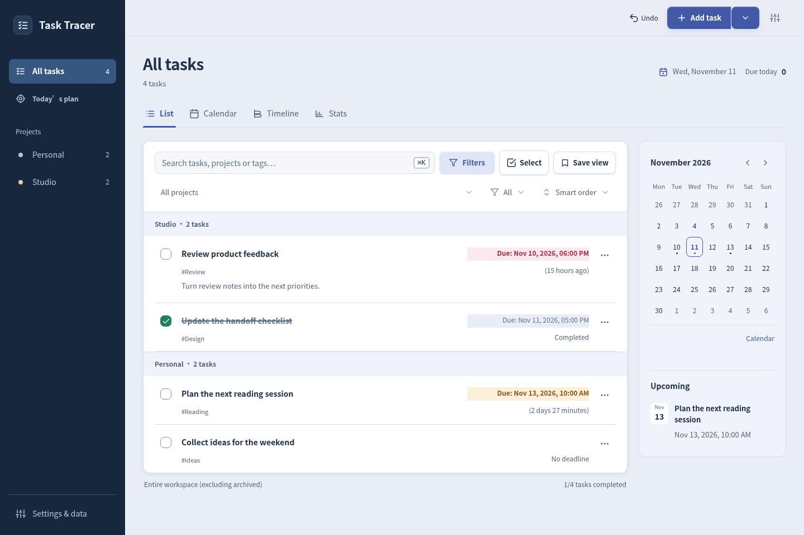
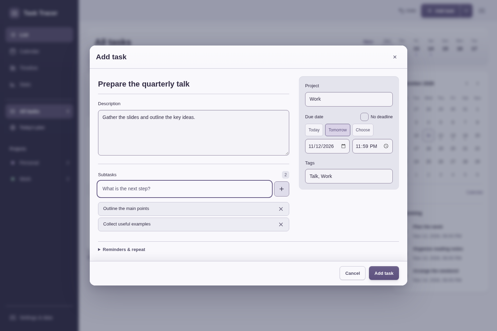

# Task Tracer

A local-first task workspace for capturing work, planning your day and reviewing progress. No account required.

[Open app](https://todo.muquew.com/) · [Download](https://todo.muquew.com/downloads/task-tracer-5.0.1.zip) · [Releases](https://github.com/muquew/Task-Tracer/releases) · [简体中文](README_zh_cn.md)

| Workspace | Task editor |
| --- | --- |
|  |  |

## Features

- **Today:** choose a daily plan, finish tasks and review urgent work waiting to be scheduled.
- **Tasks:** list, calendar and timeline with search, tags, saved views, batch actions and archives.
- **Projects:** real workloads, completed and archived counts, project search and upcoming tasks.
- **Review:** completion, overdue work and seven-day activity, with direct links to the relevant tasks.
- **Capture:** quick text entry, descriptions, subtasks, due dates, reminders and recurring tasks.
- **Back up:** JSON export, import previews, merge, recovery history and CSV reports.
- **Personalize:** four themes, light/dark appearance, Chinese and English, keyboard controls and responsive layouts.
- **Work offline:** browser-local storage and optional PWA installation.

## Get started

1. Choose **Add task** in the top bar. The adjacent arrow opens Quick capture, for example `tomorrow 20:00 Read #study /Personal`.
2. Plan in **Today**, organize in **Tasks** and **Projects**, and check progress in **Review**.
3. Open **Settings & data** at the bottom of the sidebar for appearance, backups, reminders, installation and updates.

## Back up and restore

- Tasks stay in the current browser profile; there is no account or automatic cross-device sync.
- Under **Settings & data → Backups & transfer**, export **task JSON** and a separate **saved-views JSON**. Keep downloaded copies outside the browser before clearing site data, changing devices or downgrading.
- Task JSON excludes saved views, appearance preferences and recovery history. CSV is a report and cannot restore tasks.
- To restore, inspect the import preview and choose merge or replace. Export the current tasks before replacing them; import saved views separately.
- Local recovery history shares browser storage. Confirm your downloaded files exist; drafts and recovery history do not replace an external backup.

## Common questions

- **Update the app:** open **Settings & data → Help & about → Check for updates**. Save pending work, wait until the update is ready, then refresh and close older app windows.
- **Missing tasks:** check project, search, status and archive filters, then confirm the browser profile and site address.
- **Cannot save:** copy important text or download the available emergency backup/draft before adjusting storage permissions or retrying. Unsaved forms and Quick capture may be lost on refresh; draft files are not task backups.
- **Offline and installation:** visit online first and let caching finish. After browser storage is cleared, reconnect to cache the app again. Installation depends on browser/OS support.
- **Reminders:** check app settings and browser permissions. Delivery after closing the app is not guaranteed.

## Run locally or deploy

Download and extract the complete archive, or use this repository. No build or backend is required:

```bash
python3 -m http.server 8080 --bind 127.0.0.1
```

Open [localhost:8080](http://127.0.0.1:8080/). Serve through HTTP rather than opening `index.html` as a file.

- For hosting, deploy the complete app to a dedicated HTTPS origin. On Vercel, retain `vercel.json` so its security headers are applied.
- Keep the service worker, language files and icons together. A different domain or port has separate browser storage; transfer tasks with JSON backups.
- For downloaded releases, compare the ZIP against its accompanying SHA-256 file before use.

## Development and contributions

Use Python 3.12+ and Node.js 22+ in a **source checkout**. Development tools are not included in the downloadable app:

```bash
python3 -m venv .venv
. .venv/bin/activate
python -m pip install -r requirements-dev.txt
npm ci --ignore-scripts
python -m playwright install --with-deps chromium firefox webkit
python tools/check.py --static-only
```

- After editing `styles/workspace.css`, run `npm run styles`; use `npm run styles:check` before committing the generated stylesheet.
- Run the full checks with `python tools/check.py --keep-going --report dist/check-results.json`; use `python tools/browser_matrix.py --browser all --keep-going --report dist/browser-matrix.json` for changes requiring all engines.
- Review interface changes in Chinese and English, with keyboard navigation and a narrow screen. Test imports and recovery using disposable profiles and synthetic data.
- After inline-script changes, regenerate CSP with `python tools/security_policy.py --write`. After translation changes, run `python tools/translation_fallback.py --write` before regenerating CSP.
- Build a distribution with `python tools/build_release.py`; output goes to `dist/`. Preserve published downloads and their checksums.

## Feedback and license

- [Report a bug or suggest a feature](https://github.com/muquew/Task-Tracer/issues/new/choose): include the app version, browser/OS and steps to reproduce. Diagnostic downloads are available under **Help & about**; review them before sharing and never post personal backups or drafts.
- Report vulnerabilities privately using [Security reporting](https://github.com/muquew/Task-Tracer/blob/main/SECURITY.md).
- [LICENSE](LICENSE) permits personal non-commercial use. Commercial use requires prior written permission from **muquew**. Preserve [third-party notices](THIRD_PARTY_NOTICES.md) when redistributing permitted copies.
