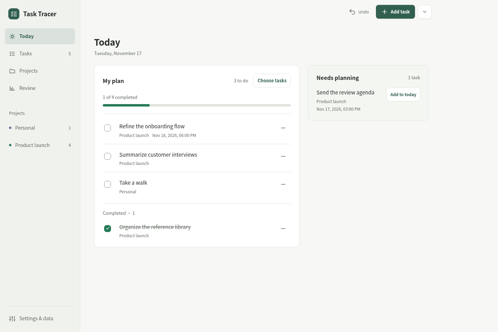
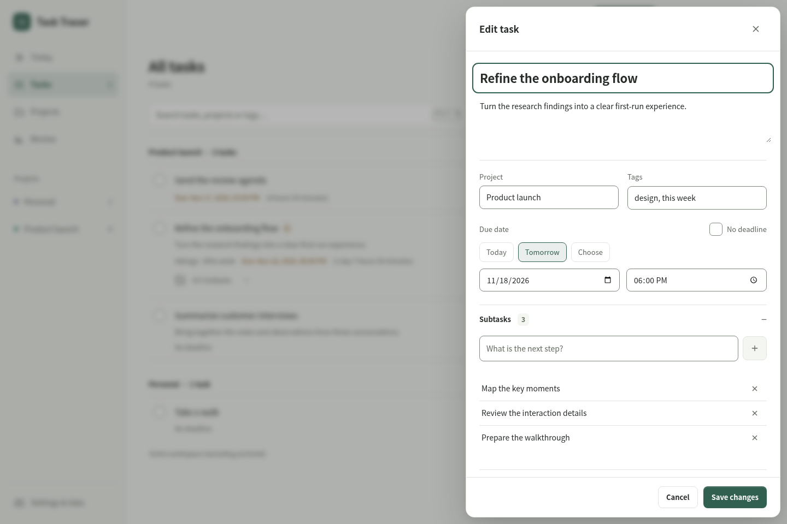

# Task Tracer

A local-first task workspace for capturing work, planning your day and reviewing progress. No account required.

[Open app](https://todo.muquew.com/) · [Download](https://todo.muquew.com/downloads/task-tracer-5.0.1.zip) · [Releases](https://github.com/muquew/Task-Tracer/releases) · [简体中文](README_zh_cn.md)

| Workspace | Task editor |
| --- | --- |
|  |  |

## Features

- **Today:** choose a daily plan, finish tasks and find unfinished earlier plans alongside urgent work waiting to be scheduled.
- **Tasks:** list, calendar and timeline with search, reusable tags, saved views, batch actions and archives. Open a task directly from its title.
- **Projects:** real workloads, completed and archived counts, project search and upcoming tasks.
- **Review:** completion, overdue work and seven-day activity. Open a completion total or day bar to revisit the matching tasks, then return to the same review.
- **Capture:** quick text entry, descriptions, subtasks, due dates, reminders and recurring tasks.
- **Back up:** JSON export, import previews, merge, recovery history and CSV reports.
- **Personalize:** four themes, light/dark appearance, Chinese and English, keyboard controls and responsive layouts.
- **Work offline:** browser-local storage and optional PWA installation.

## Get started

1. Choose **Add task** in the top bar. The adjacent arrow opens Quick capture, for example `tomorrow 20:00 Read #study /Personal`.
2. Plan in **Today**, organize in **Tasks** and **Projects**, and check progress in **Review**.
3. Open **Settings & data** at the bottom of the sidebar for appearance, backups, reminders, installation and updates.

Quick capture accepts dates, times, `#tags` and `/projects`. Reuse existing names with spaces, or quote a new name: `Read /"Personal learning" #"Deep work"`. In task search, use `project:"Personal learning" tag:"Deep work"` to find those exact names; ordinary words still search across task text.

Search completed work with `completed:week` for the last seven local calendar days, including today, or `completed:2026-11-17` for one day. These conditions also include completed archive records; explicit status and project filters still apply.

## Back up and restore

- Tasks stay in the current site's browser storage; there is no account, server backup, automatic cross-device sync or shared workspace. Another browser profile, domain or port has separate data.
- Under **Settings & data → Backups & transfer**, export **task JSON** and a separate **saved-views JSON**. Keep downloaded copies outside the browser before clearing site data, changing devices or downgrading.
- Task JSON excludes saved views, appearance preferences and recovery history. CSV is a report and cannot restore tasks.
- To restore, inspect the import preview and choose merge or replace. Export the current tasks before replacing them; import saved views separately.
- Local recovery history shares browser storage. Clearing site data, private browsing sessions ending or browser storage cleanup can remove it along with your tasks. Confirm your downloaded files exist; drafts and recovery history do not replace an external backup.

## Common questions

- **Update the app:** open **Settings & data → Help & about → Check for updates**. Save pending work, wait until the update is ready, then refresh and close older app windows.
- **Missing tasks:** check project, search, status and archive filters, then confirm the browser profile and site address.
- **Cannot save:** copy important text or download the available emergency backup/draft before adjusting storage permissions or retrying. Unsaved forms and Quick capture may be lost on refresh; draft files are not task backups.
- **Offline and installation:** visit online first and let caching finish. After browser storage is cleared, reconnect to cache the app again. Installation depends on browser/OS support.
- **Reminders:** check app settings and browser permissions. Delivery after closing the app is not guaranteed.

## Run locally or deploy

Download and extract the complete archive, or open a source checkout. Run this command **inside the extracted app or repository directory**. No Node.js packages, build or backend are needed to use the app:

```bash
python3 -m http.server 8080 --bind 127.0.0.1
```

Open [localhost:8080](http://127.0.0.1:8080/). Serve through HTTP rather than opening `index.html` as a file. On Windows, use `py -3 -m http.server 8080 --bind 127.0.0.1` if `python3` is unavailable. Stop the server with Ctrl+C.

- For hosting, deploy the complete app to a dedicated HTTPS origin. On Vercel, retain `vercel.json` so its security headers are applied.
- Keep the service worker, language files and icons together. A different domain or port has separate browser storage; transfer tasks with JSON backups.
- For downloaded releases, compare the ZIP against its accompanying SHA-256 file before use.

## Development and contributions

Use Python 3.12+ and Node.js 22+ in a **source checkout**. Development tools are not included in the downloadable app. Run the following from the repository root in a POSIX shell:

```bash
python3 -m venv .venv
. .venv/bin/activate
python -m pip install -r requirements-dev.txt
npm ci --ignore-scripts
python -m playwright install --with-deps chromium
npm run check
```

- In Windows PowerShell, create the environment with `py -3 -m venv .venv` and activate it with `.venv\Scripts\Activate.ps1`, then run the remaining setup commands. The npm wrappers expect `python3`; if that command is unavailable, run the underlying command from `package.json` with the activated environment's `python`, for example `python tools/check.py --static-only`.
- Run `npm run dev` or `npm run preview` and open [localhost:8080](http://127.0.0.1:8080/). Both serve the current app files without compilation or hot reload. After editing, refresh the page; if a service worker still serves an earlier copy, use the browser's development tools to unregister it for this local origin and reload. Keep test data separate from personal tasks.
- After editing `styles/workspace.css`, run `npm run styles`; use `npm run styles:check` before committing `resources/workspace.css`.

| Command | Scope and output |
| --- | --- |
| `npm run check` | Static consistency, release/security contracts, syntax and date semantics; no browser launch. |
| `npm test` | Full registered checks, including Chromium workflows; stops after a failure. |
| `npm run test:report` | Full registered checks, continues after failures and writes `dist/check-results.json`; failures still return a nonzero exit code. |
| `npm run test:browsers` | Registered Chromium, Firefox and WebKit workflows; writes `dist/browser-matrix.json` and per-program logs. |
| `npm run test:a11y` | Dedicated accessibility and language audit using Chromium and the local axe-core dependency. |

- Before running all engines, install them with `python -m playwright install --with-deps chromium firefox webkit`. For a targeted run, use `npm run test:browsers -- --browser chromium --group capture --report dist/capture-chromium.json`; list the selected scope without launching browsers by adding `--list`.
- For local Chromium checks, select an installed executable with `export TASK_TRACER_BROWSER_EXECUTABLE=/absolute/path/to/chromium` (PowerShell: `$env:TASK_TRACER_BROWSER_EXECUTABLE = 'C:\path\to\chrome.exe'`), then run the checks. This affects Chromium only; CI installs the browsers pinned by Playwright. Synthetic browser viewports do not replace testing on real phones or Safari/iOS.
- Compatibility checks and the Today carryover/selection, mobile filters, input names, direct task opening, tag suggestions and review-history checks also accept `TASK_TRACER_CHROMIUM_EXECUTABLE`, `TASK_TRACER_FIREFOX_EXECUTABLE` or `TASK_TRACER_WEBKIT_EXECUTABLE` for their selected engine. The Chromium-specific value takes precedence over the older `TASK_TRACER_BROWSER_EXECUTABLE` alias. Supply any native-library paths required by a custom executable in the test process environment.
- Review interface changes in Chinese and English, with keyboard navigation and a narrow screen. Test imports and recovery using disposable profiles and synthetic data.
- After inline-script changes, regenerate CSP with `python tools/security_policy.py --write`. After translation changes, run `python tools/translation_fallback.py --write` before regenerating CSP.
- Build a distribution with `npm run build`; the ZIP and SHA-256 checksum go to `dist/`, with `integrity.json` inside the ZIP. The build checks static files and CSP; it does not run the browser suite, publish or deploy. Run the relevant checks before packaging and preserve published downloads and their checksums.

## Feedback and license

- [Report a bug or suggest a feature](https://github.com/muquew/Task-Tracer/issues/new/choose): include the app version, browser/OS and steps to reproduce. Diagnostic downloads are available under **Help & about**; review them before sharing and never post personal backups or drafts.
- Report vulnerabilities privately using [Security reporting](https://github.com/muquew/Task-Tracer/blob/main/SECURITY.md).
- [LICENSE](LICENSE) permits personal non-commercial use. Commercial use requires prior written permission from **muquew**. Preserve [third-party notices](THIRD_PARTY_NOTICES.md) when redistributing permitted copies.
