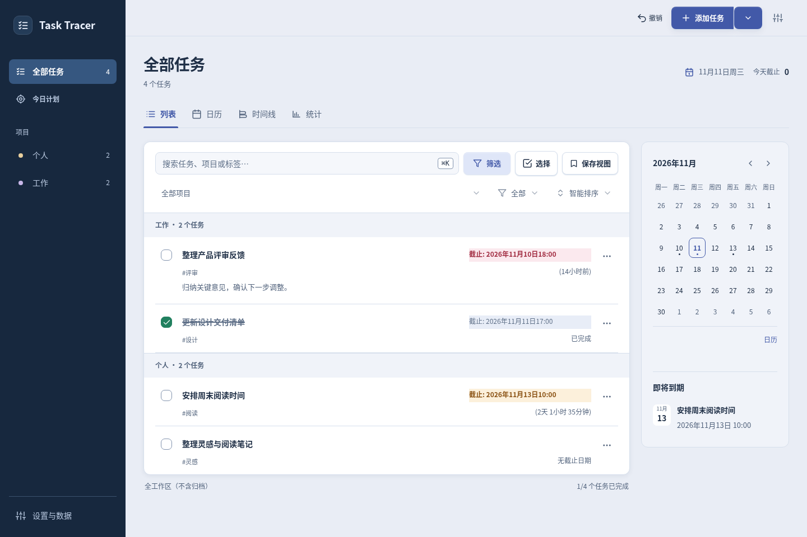
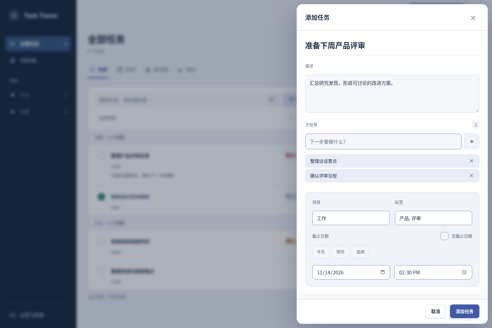

# Task Tracer · 任务跟踪器

一个本地优先的个人任务工作台，用来记录、安排和回顾日常工作，无需账号。

[打开应用](https://todo.muquew.com/) · [下载发行包](https://todo.muquew.com/downloads/task-tracer-4.17.0.zip) · [版本发布](https://github.com/muquew/Task-Tracer/releases) · [English](README.md)

| 工作区 | 任务面板 |
| --- | --- |
|  |  |

## 功能

- **快速记录：** 文本输入、描述、子任务和截止日期。
- **整理任务：** 项目、标签、搜索、保存视图、批量操作与归档。
- **安排日常：** 今日计划、重复任务、提醒和稍后提醒。
- **查看进展：** 列表、日历、时间线与近七天完成统计。
- **备份数据：** JSON 导出、导入预览、合并、恢复历史和 CSV 报表。
- **选择外观：** 四套主题、浅色／深色模式、中英文界面、键盘操作与响应式布局。
- **离线使用：** 数据保存在浏览器中，可按需安装为 PWA。

## 开始使用

1. 点击顶栏 **添加任务**。旁边的箭头打开快速记录，例如 `明天 20:00 阅读 #学习 /个人`。
2. 用项目与标签整理任务，切换视图，或把任务加入 **今日计划**。
3. 打开 **设置与数据**，调整外观语言、备份迁移、提醒与安装。

## 备份与恢复

- 任务保存在当前浏览器配置中，没有账号或自动跨设备同步。
- 在 **设置与数据 → 备份与迁移** 分别导出 **任务 JSON** 与 **保存视图 JSON**。清理站点数据、换设备或降级前，将下载文件保存在浏览器之外。
- 任务 JSON 不包含保存视图、外观偏好和恢复历史；CSV 是报表，不能恢复任务。
- 恢复时先检查导入预览，再选择合并或替换。替换前导出当前任务；保存视图需单独导入。
- 本地恢复历史与任务共用浏览器存储。确认下载文件已保存；草稿和恢复历史不能代替外部备份。

## 常见问题

- **更新应用：** 打开 **设置与数据 → 帮助与关于 → 检查更新**，先保存未提交内容，待更新准备好后刷新，并关闭旧应用窗口。
- **任务不见了：** 检查项目、搜索、状态及归档筛选，再确认浏览器配置和网站地址。
- **无法保存：** 先复制重要文字，或下载可用的紧急备份／草稿，再调整存储权限并重试。刷新可能丢失未保存表单和快速记录；草稿文件不能作为任务备份导入。
- **离线与安装：** 首次使用需联网完成缓存；浏览器清理存储后需重新联网。安装方式取决于浏览器与系统支持。
- **提醒：** 检查应用设置与浏览器权限；应用关闭后不保证系统级准时投递。

## 本地运行与部署

下载并完整解压发行包，或使用本仓库，无需构建或后端服务：

```bash
python3 -m http.server 8080 --bind 127.0.0.1
```

打开 [localhost:8080](http://127.0.0.1:8080/)。通过 HTTP 服务访问，直接打开 `index.html` 文件不能提供完整体验。

- 部署时将完整应用放在独立的 HTTPS 站点；使用 Vercel 时保留 `vercel.json`，以应用其中的安全响应头。
- 保留 service worker、语言文件和图标。域名或端口改变后，浏览器存储也会独立，需要通过 JSON 备份迁移。
- 使用下载的发行包前，对照配套 SHA-256 文件校验 ZIP。

## 开发与贡献

在 **源码仓库** 中使用 Python 3.12+、Node.js 22+；下载的应用发行包不包含开发工具：

```bash
python3 -m venv .venv
. .venv/bin/activate
python -m pip install -r requirements-dev.txt
npm ci --ignore-scripts
python -m playwright install --with-deps chromium firefox webkit
python tools/check.py --static-only
```

- 修改 `styles/workspace.css` 后运行 `npm run styles`，提交前用 `npm run styles:check` 核对编译后的样式。
- 完整检查使用 `python tools/check.py --keep-going --report dist/check-results.json`；需要多浏览器验证时，运行 `python tools/browser_matrix.py --browser all --keep-going --report dist/browser-matrix.json`。
- 界面修改同时检查中英文、键盘操作和窄屏；导入与恢复使用独立测试配置和示例数据。
- 修改内联脚本后运行 `python tools/security_policy.py --write` 更新 CSP；修改翻译后先运行 `python tools/translation_fallback.py --write`，再更新 CSP。
- 使用 `python tools/build_release.py` 打包，产物位于 `dist/`；保留已发布下载包及其校验值。

## 反馈与许可

- [问题反馈与功能建议](https://github.com/muquew/Task-Tracer/issues/new/choose)：附应用版本、浏览器／系统及复现步骤。“帮助与关于”可预览并下载诊断信息，分享前检查内容，不要公开个人备份或草稿。
- 安全漏洞请按 [安全说明](https://github.com/muquew/Task-Tracer/blob/main/SECURITY.md) 私密报告。
- [LICENSE](LICENSE) 允许个人非商业使用；商业使用需事先取得 **muquew** 的书面授权。按许可分发时保留 [第三方声明](THIRD_PARTY_NOTICES.md)。
