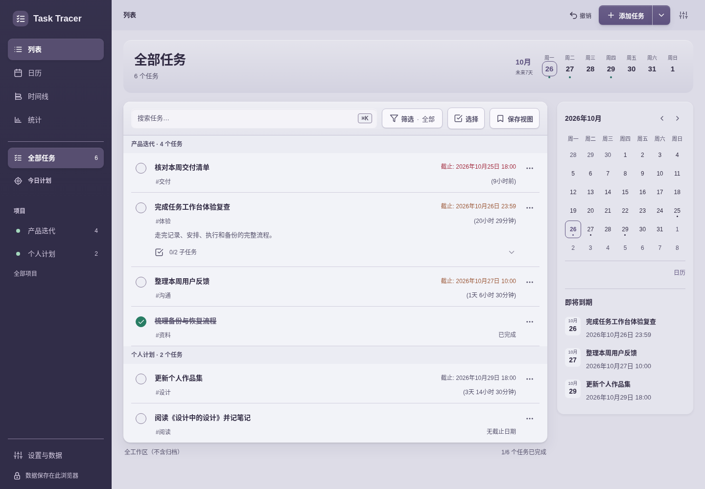
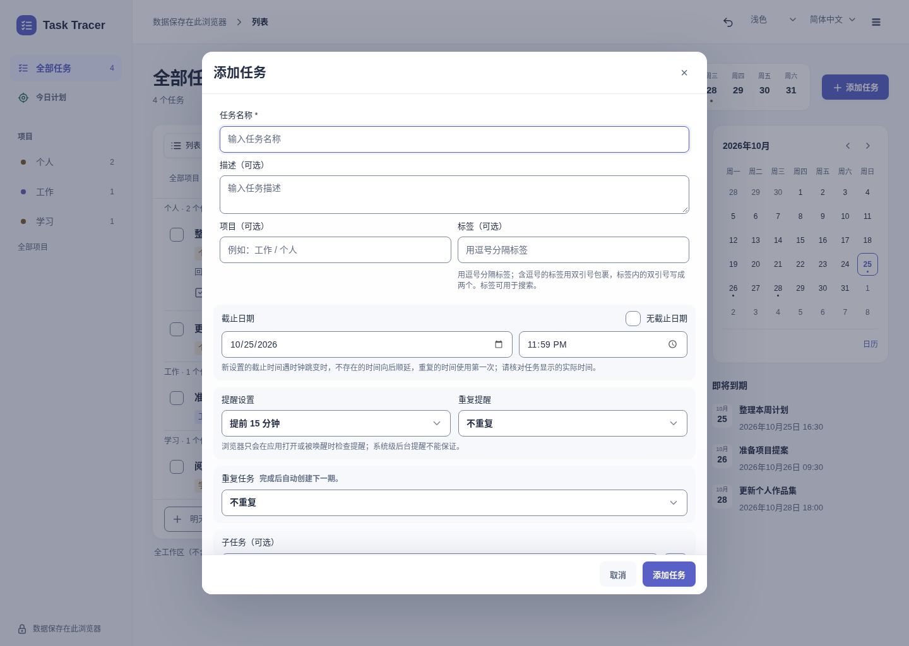

<p align="center">
  
</p>

<h1 align="center">Task Tracer 任务跟踪器</h1>

<p align="center"><strong>一个本地优先的个人任务工作台，用于记录、规划、例行事项、提醒和回顾。</strong></p>

<p align="center">
  <a href="https://todo.muquew.com/" rel="noopener noreferrer">在线体验</a> ·
  <a href="./README.md">English README</a>
</p>

<p align="center">
  <a href="https://todo.muquew.com/" rel="noopener noreferrer"></a>
  
  
  
  
  
</p>

Task Tracer 是一个运行在浏览器中的个人任务管理应用。任务数据保存在当前设备/浏览器配置内，适合想要完整日常工作台、但不想依赖账号、服务器或云同步的人。

持续开发的目标、验收条件与当前队列见 [GOAL.md](./GOAL.md)。

当前最新已发布版本为 **[4.10.1](./docs/releases/4.10.1.md)**。四视图常驻导航和独立“设置与数据”页面已上线，动态备份状态会随同屏语言切换更新。[验收记录](./docs/acceptance/2026-10-25/publication-4.10.1.json)保留实际本地与真实域名范围。

[4.10.0基线](./docs/releases/4.10.0.md)保留完整工程记录、单项测试导航补验及被4.10.1修复的线上语言遗漏；[4.9.0](./docs/releases/4.9.0.md)等旧结果继续保持原版本身份。

PWA 指 Progressive Web App。浏览器支持时，Task Tracer 可以被安装，像普通应用一样从系统入口打开，并在应用外壳完成缓存后离线加载。

## 能做什么

| 需求 | 内置支持 |
| --- | --- |
| 快速记录任务 | 完整任务弹窗、快速添加解析、URL 捕获、安装快捷捕获、分享捕获、Inbox 默认落点、描述、子任务、项目、标签、截止日期/时间和无日期任务。 |
| 组织当前工作 | 项目分组、多标签、保存的视图、手动排序、归档和批量操作。 |
| 从不同角度规划 | 列表、日历、时间线和统计视图。 |
| 推进今天要做的事 | 今日计划、任务操作、稍后提醒、跳过本次重复、完成/归档/删除和撤销。 |
| 管理例行事项 | 每天、每周、指定星期、每月、每月最后一天和自定义天数重复；重复规则可以暂停。 |
| 提醒重要事项 | 提前提醒、重复提醒、稍后提醒、错过提醒提示，以及浏览器提醒能力限制说明。 |
| 回顾个人进展 | 完成率、进行中任务逾期率、归档数量、今日完成数、连续完成天数和近期完成趋势。 |
| 保护本地数据 | 导出/备份、备份健康、导入预览、合并/替换冲突处理、完整性校验、替换前快照，以及存储受限时的紧急备份。 |

## 4.10.1 工作区入口

工作区把项目与保存视图放入侧栏，任务主区与截止日程概览分开呈现。“列表”“日历”“时间线”“统计”在桌面侧栏、窄屏底栏保持图标与文字常驻，收起搜索和筛选也不会隐藏这些入口。窄屏可通过“打开导航”展开项目导航，通过“查看日程”打开小月历。日期索引和小月历进入已有的日历／日期详情，不会更改任务截止时间。

- 在顶部“语言”选择简体中文或英文。任务名、项目名、标签等用户内容保留原文。
- 在顶部“外观”选择“浅色”“深色”或“跟随系统”。跟随系统会响应操作系统外观变化；手动选择不会被系统变化覆盖。
- 从顶栏或侧栏进入“设置与数据”，也可按 `Ctrl/Cmd + M`。它是独立工作区，集中提供外观与语言、备份与恢复、提醒与安装、任务清理及帮助与应用信息。“返回任务”回到原来的视图、搜索、筛选与快速添加文字；四个视图入口也可直接返回任务。
- 使用任务前方的完成控件标记完成，在“任务操作”菜单中编辑或执行该任务可用的其他操作，例如加入今日计划、稍后提醒、跳过本次重复、归档或删除。
- “今日计划”由用户主动挑选；“今天截止”和日程概览按保存的截止日期显示，今天截止的任务不会自动加入计划。

[设计规则](./DESIGN.md)说明工作区结构与组件原则。[4.10.1发布记录](./docs/releases/4.10.1.md)记录实际实现与已完成验收。

## 开始使用

新工作区默认保持空白。可以使用“添加任务（+）”或快速添加创建第一个任务，也可以在空状态选择“添加 3 个示例任务”。示例有明确的名称前缀、关闭提醒，可编辑、删除或撤销；刷新空工作区不会自动加入示例。可以补记过去的截止日期，也可以直接编辑逾期任务，不必先把日期改到未来。仅修改名称或描述时，会保留原有截止时间点和时区，包括夏令时结束时重复出现的钟面时间。

“设置与数据”或页脚的“使用帮助”提供快速添加、限定搜索、快捷键、提醒与离线限制说明，并可直接打开命令面板。本地存储受限时仍可进入设置和帮助；需要任务存储的操作继续检查存储状态。排查与反馈方式见 [SUPPORT.md](./SUPPORT.md)。

## 截图

| 任务列表 | 添加任务 |
| --- | --- |
|  |  |

## 快速输入

快速添加可以把轻量文本解析成结构化任务字段：

```text
明天 20:00 复习英语 #学习 /个人
```

这会创建一个名为“复习英语”的任务，截止到明天 20:00，标签为“学习”，项目为“个人”。

快速添加文本里没有 `/项目` 时，任务会保存到 `Inbox`，让还没整理的想法先进入固定入口。

存储故障时若快速添加中仍有文字，输入框会保持只读，可选中复制。“重试”在原页面保留原文与捕获的来源信息，再次失败也不清空。存储恢复后请自行重新提交，应用不会自动重放失败的添加。快速添加文字仅在内存中，不包含在完整表单的草稿下载里；刷新或离开前请先复制重要文字。

输入法组词期间，Enter、Escape 和方向键用于文字输入，不触发应用提交或选项切换。完成候选文字选择后，再使用应用快捷键。

命令面板使用 `Ctrl/Cmd + P` 打开，可以新建任务、聚焦快速添加、切换视图、打开保存的视图、进入今日计划、进入批量操作、撤销最近一次任务更改、导出/备份、搜索和跳转项目。

Task Tracer 也支持直接捕获链接：

```text
https://todo.muquew.com/?capture=1
https://todo.muquew.com/?add=买牛奶
https://todo.muquew.com/?add=买牛奶&save=1
```

`capture=1` 会打开应用并聚焦快速添加。`add=` 会预填快速添加并等待确认。`save=1` 会在应用打开后立即保存。捕获参数处理后会从地址栏移除，因此刷新页面不会重复创建任务。

安装为 PWA 后，系统入口会提供 `Quick Capture` 快捷方式，打开 `./?capture=1`。支持 Web Share Target 的浏览器可以把标题、正文和 URL 分享到 Task Tracer：标题会进入快速添加框供确认，确认后正文和 URL 会保存到任务描述。

## 项目、标签与搜索

项目是主要分组。一个任务属于一个项目，例如 `Inbox`、`工作`、`个人` 或某个具体计划。项目选择器可以收窄工作空间，全部项目列表会按项目分组展示可见任务。

标签是灵活的辅助标记。一个任务可以有多个标签，例如 `学习`、`设计`、`复盘`，用来连接不同项目里的同类任务。

搜索会匹配任务名称、任务描述、项目名称、标签和子任务文本。限定搜索可以和普通关键词一起使用：

| 输入 | 匹配内容 |
| --- | --- |
| `project:工作` | 项目名包含“工作”的任务。 |
| `tag:学习` 或 `#学习` | 拥有对应标签的任务。 |
| `status:active` | 进行中的未完成任务。 |
| `status:completed` | 已完成任务。 |
| `status:archived` | 已归档任务。 |
| `status:overdue` | 已过期且未完成的任务。 |
| `status:no-deadline` | 无截止日期任务。 |
| `status:repeat` | 重复任务。 |
| `due:today` | 今天截止的任务。 |
| `due:tomorrow` | 明天截止的任务。 |
| `due:week` | 未来七天内截止的任务。 |
| `due:2025-05-20` | 指定本地日期截止的任务。 |
| `due:no-deadline` | 无截止日期任务。 |
| `project:工作 tag:报告` | 同时满足两个限定条件的任务。 |

保存的视图会记录当前搜索、项目筛选、状态筛选、排序方式和视图。它适合固定工作范围，例如逾期工作、本周学习，或某个项目的日历视图。最多可保存 12 个不同条件的视图。达到上限后，新增会被拒绝并保留名称草稿，不会删除已有视图；保存条件相同的视图会原位更新。需要新条件时，请先删除一个不再需要的视图。

保存视图的删除控件会显示带有准确名称的确认，并默认聚焦“取消”；明确确认后才删除此视图，任务不变。视图删除无法撤销，需要副本时请先导出视图文件。

更换浏览器或设备时，可通过 **设置与数据 → 迁移保存的视图** 单独导出或导入视图 JSON。任务 JSON 备份不包含这些视图。新导出采用视图 JSON 1.1，导入同时兼容旧版 1.0。文件最多包含 12 个视图，大小不能超过 1 MiB；请先检查导入预览再添加。名为 `all`、`__none__` 的项目仍按真实名称精确选择，与“全部项目”和无项目任务区分。保存的项目暂时不存在时，视图保持空结果，不会扩大为全部项目。

在 4.7 或更新版本中修改保存视图前，请关闭或刷新所有旧版本标签页与独立应用窗口。4.7 之前的版本可能将新项目范围解释为“全部项目”，再次保存时还会写回该解释。降级前请在浏览器之外保留视图 1.1 导出文件；旧应用不能读取该文件，需要回到 4.7 或更新版本恢复这些视图。

视图导入按搜索、筛选和布局条件去重，保留已有视图及名称，并展示重复和容量限制导致的跳过数量，不会为腾出空间删除原有视图。另一窗口更改视图后，需要检查更新后的数量并再次确认。视图文件可能包含私密搜索词、项目名和标签，分享前请检查。此操作不会重置任务备份提醒。

## 视图

| 视图 | 适合做什么 |
| --- | --- |
| 列表 | 日常执行任务，包含任务操作、子任务、截止日期、提醒、归档控制、批量操作和手动排序。 |
| 日历 | 按真实月历规划，支持上一月/下一月、上一年/下一年、回到今天、日期详情和无日期分组。 |
| 时间线 | 按日期顺序浏览即将到来的任务和已完成历史。 |
| 统计 | 查看完成率、进行中任务逾期率、归档历史、今日完成数、连续完成天数和近期趋势。 |

## 今日计划、批量操作与撤销

今日计划是轻量执行层。把任务加入今日计划不会改变项目、标签、截止日期、归档状态或重复规则，只是把它标记为今天要处理的任务。

批量操作先显示 100 个匹配任务并提供“显示更多”。**全选匹配项**选择当前搜索、项目与状态范围的全部结果，包括尚未加载的页面；选中后可一起加入今日计划、完成、归档或删除。切换范围会移除范围外的选择。批量时间线/日历与任意批量排序也分页；非批量手动排序保留完整渲染。

“设置与数据”中的“归档已完成”和“删除已完成”作用于**整个工作区内已完成且未归档的任务**，不受当前项目、搜索或筛选影响。操作前请检查确认内容；需要处理特定范围时使用批量操作。

撤销用于还原最近一次任务更改。如果操作结束期间或点击撤销前出现较新的并发任务修改，撤销可能不再提供或被拒绝，保留较新数据；请检查当前任务后再发起新操作。可以使用顶部撤销按钮、命令面板，或在焦点不在输入框内时使用 `Ctrl/Cmd + Z` 执行。

## 未保存的任务表单

修改任务表单后，通过取消、关闭图标、Escape 或点击遮罩关闭时，会询问继续编辑还是放弃更改。“继续编辑”保留表单内容，“放弃更改”关闭表单；正常关闭需要等待正在执行的保存结束。

快速添加中有文字、任务表单有未保存更改或仍有待恢复草稿时，应用会请求浏览器离页提醒。浏览器规则可能限制该提醒，尤其在移动设备上。草稿不会自动写入浏览器持久存储或服务器；离开前请保存或复制重要文字，不能依靠提示应对浏览器崩溃。

若存储故障中断已修改的表单，提示栏会将草稿仅保留在当前页面内存。“下载未保存草稿”会将全部待恢复表单另存为 `task-draft` JSON 供查阅，不能通过任务“导入”恢复，也不是任务备份；请确认文件确实已保存。有待恢复草稿时，“重试”在原页面重连存储，不会刷新；“恢复编辑”打开下一份草稿，“放弃下一份草稿”需要确认。若已有任务表单打开，先完成或放弃当前表单；恢复后的编辑仍遵守并发修改检查。刷新、关闭或崩溃会丢失仅在内存中的草稿。

## 重复任务与提醒

重复任务支持每天、每周、指定星期、每月、每月最后一天和自定义天数周期。重复任务可以暂停，也可以跳过本次，而不需要删除重复规则。

重复任务按任务保存的时区推进，不受设备时区影响。新设置或更改的截止时间遇跳变时，不存在的时间向后顺延，重复时间使用第一次；日期/时间未变的编辑保留原时间点，不会批量修正旧截止。保存时间的边界见[日期与恢复支持](./SUPPORT.md)。

相对日期搜索、今日计划、逾期范围与统计会在每分钟/页面可见性检查时重新计算。弹窗、行内编辑、任务文字选择、拖动或已有批量选择期间可能暂缓重建，后台计时器也可能被暂停。逾期率分子为逾期进行中任务，分母为有截止日期的进行中任务，不含已完成、归档及无截止日期任务。

当浏览器支持通知且用户授予权限时，Task Tracer 可以在应用打开期间检查提醒、按设定间隔重复提醒、将提醒稍后处理，并在应用重新运行时提示错过的提醒。

浏览器提醒不是系统级闹钟。提醒是否准时投递会受到浏览器策略、操作系统行为、电池设置、标签页生命周期，以及应用是否处于打开或被浏览器唤醒状态影响。

## 导入、导出与备份

`导出/备份` 会发起任务 JSON 下载，文件包含导出 ID、完整性校验和版本说明，并记录这次导出操作。发起下载不代表文件已成功保存或仍被保留；请检查实际下载文件，并在浏览器之外保存副本。文件可恢复受支持的任务字段，包括子任务、项目、标签、截止日期、重复与提醒规则、今日计划；不包含保存的视图、应用设置或恢复历史。

备份提示会比较已记录的导出快照与当前任务。任务变化后需要再次导出；只有日期的旧导出记录会显示覆盖范围未知，不能据此认定当前任务已导出。新的导出记录也不代表文件已被实际保留。每次任务 JSON 或 CSV 导出都从一个一致的只读快照读取任务数据，不会刷新当前任务视图。浏览器本地的备份覆盖记录对应导出时的任务版本与日期，并非任务 JSON 新增字段；CSV 不计作可恢复的任务备份。启动时的可选备份提醒会避开已打开的弹窗或已有提示，“设置与数据”仍保留备份状态。

`导入` 会先显示可取消的文件读取弹窗，再预览任务 JSON，确认前不写入任务。取消读取或选择较新的文件后，较早的读取不会覆盖当前表单或预览。预览内容包括恢复检查、任务数量、导入差异、重复 ID、同名重复项、当前数据影响、完整性校验状态和同名冲突处理选项。

启用合并模式后才会创建同名冲突控件，初次显示 100 项，可按需“显示更多”。批量处理方式会将“保留两份”“跳过导入”或“替换本地”应用到全部同名任务，包括尚未显示的项；更改批量方式会重置单独选择，之后仍可逐项调整。关闭再开启合并模式会保留这些选择，直到再次更改批量方式。

替换导入会在覆盖现有任务前下载导入前快照。完整性校验失败时，替换导入需要显式风险确认；合并模式仍可用于更稳妥地恢复数据。后台任务刷新使打开的预览过期后，应用会重建预览并重置之前的安全确认。请重新检查；替换模式还需重新下载当前快照后再确认。若数据库冲突关闭了预览，请重新选择文件，开始新的检查。

如果浏览器存储被阻止或运行中变得不可用，Task Tracer 会进入存储不可用模式。只要页面内仍有任务内存快照，紧急备份按钮就可以在刷新或关闭页面前下载该快照。

### 表格报表导出

“设置与数据”的“导出 CSV”会下载全部已存储任务，包括已完成和已归档任务，不受搜索和筛选影响。UTF-8 文件包含任务内容、日期、重复规则，以及使用 JSON 单元格保存的标签和子任务。可能被表格软件当作公式的内容会添加前置单引号。CSV 用于报表，不能作为恢复备份导入；任务恢复请继续使用 JSON 备份。CSV 导出不会重置备份提醒。

## 恢复历史与多标签页

从 **设置与数据 → 恢复历史** 进入，按日期和任务数量选择恢复点，先查看其中的任务名称与状态。预览在独立滚动区先显示 100 项，可按需显示更多，并保留完整任务、已完成和已归档计数。切换恢复点会重置预览与替换勾选；恢复时勾选并确认，将替换当前任务列表。

“导出此恢复点”会下载可通过任务导入恢复的 JSON 2.4 文件，空恢复点也可导出，不改变当前任务的备份覆盖状态；请检查并保留实际文件。“清空恢复历史”需要单独确认，只删除本地已存恢复点。另一窗口改变历史后需检查刷新后的列表，再次确认。当前任务、视图、设置、下载文件与撤销保持不变；后续任务写入会建立新的恢复点。

同一浏览器最多保留 10 个恢复点：首次写入前及此后间隔五分钟的写入前自动保存；删除、导入/合并、撤销和恢复前会强制保存。空任务列表也可以恢复。恢复点和任务修改在同一个事务中提交，事务失败不会留下部分恢复结果。从当前列表删除任务，不会删除恢复点中保留的旧副本。这些恢复点无法抵御清除站点数据或设备丢失。

其他标签页修改任务后，过期页面的写入会被拒绝，并加载最新列表。如果正在编辑的任务已被修改或删除，草稿会保留在弹窗中：先复制需要保留的修改，取消，再打开最新任务编辑。重复提交旧弹窗不会覆盖较新的任务。删除任务、清空或归档已完成任务、批量删除和恢复历史也会在任务刷新后拒绝过期确认。请检查最新任务，再重新发起操作。这项保护适用于共享同一浏览器存储的标签页，不是跨设备同步。升级后，请先关闭或刷新所有旧版本标签页及离线窗口再编辑；旧缓存版本不参与修订检查。

## 数据安全与大任务集

使用**设置与数据 → 数据安全**查看本站点存储用量，并按需申请浏览器持久存储。拒绝或不支持该权限不会影响任务与导出；持久存储仍不能替代独立备份。普通列表和时间线首先显示 100 个匹配任务，可点击**显示更多任务**；搜索始终涵盖全部任务。时间线日期按时间顺序排列，无截止日期任务放在最后，已显示的日期组保留完整匹配数量。日历无日期任务区和选定日期的详情也分别先显示 100 项，提供独立的“显示更多”与完整匹配计数。非批量手动排序保留完整渲染；批量渲染分页，选择与动作仍覆盖全部选中的匹配任务。实测结果见[性能说明](./docs/performance.md)。

## 安装、离线与更新

可以从**设置与数据 → 安装应用**安装 Task Tracer。如果当前浏览器没有提供自动安装弹窗，同一个入口会显示桌面 Chrome/Edge、Android Chrome 和 iOS Safari 的手动安装方式。

应用外壳缓存完成后，Task Tracer 可以离线加载。当新的缓存版本准备好时，应用会显示更新提示，并提供刷新更新操作。HTML 内带有匹配版本的语言数据，可在独立翻译请求失败时用于启动。首次离线使用仍需先完成联网缓存；清理网站数据会移除该副本。旧窗口仍使用各自已安装的 worker 策略，升级后请保存草稿，并关闭或刷新旧窗口。

## 无障碍与语言

Task Tracer 提供中文和英文界面，同步页面语言，支持键盘友好的控件、有标签的图标按钮、弹窗焦点陷阱、读屏 live region 播报、减少动态效果和桌面/移动端响应式布局。

## 数据与隐私

任务数据保存在当前浏览器的 IndexedDB 中。Task Tracer 不需要账号，默认不会把任务内容上传到服务器。

更换浏览器、清理站点数据、重新安装应用或迁移设备前，请先通过 `导出/备份` 下载任务 JSON，通过“迁移保存的视图”单独下载视图 JSON，并在浏览器以外保留副本。本地存储和导出完整性校验不会加密任务内容。

“使用帮助 → 查看诊断信息”会先展示完整 JSON 预览，再由你选择下载。内容包括应用与浏览器版本、能力、权限状态和存储估计，不包含任务内容、保存的视图、应用设置、URL 或原始错误消息；不会自动上传。诊断文件不能用作任务备份。

捕获和分享链接可能在 URL 参数中包含任务文本；应用清理参数前，托管服务日志或浏览器历史可能已经记录这些链接。部署与数据边界见 [安全说明](./SECURITY.md)。

## 运行方式

直接访问在线地址：

```text
https://todo.muquew.com/
```

或本地运行：

```bash
git clone https://github.com/muquew/Task-Tracer.git
cd Task-Tracer
python3 -m http.server 8080
```

然后打开：

```text
http://127.0.0.1:8080/
```

## 开发与发布

应用无需构建。固定版本的浏览器测试依赖、验证命令与贡献约定见 [CONTRIBUTING.md](./CONTRIBUTING.md)。

```bash
python3 tools/check.py --static-only
```

当前[4.10.0候选](./docs/releases/4.10.0.md)使用独立验收队列，结果尚待记录；下列已完成记录分别属于其标明的历史版本。

[4.9.0正式版](./docs/releases/4.9.0.md)提供新工作区布局、固定语言入口、浅色／深色／跟随系统外观及统一中英文文案。干净应用提交 `e7d58e2` 冻结23项源码和70项验证输入；完整59项检查通过，程序耗时合计1645.602秒，Chromium154.0.8037.57、Firefox153.0和WebKit26.5各32个登记程序也全部通过。两次独立构建得到字节一致的24文件／797,361字节ZIP，SHA-256为 `197bc587145d65f986320ce4b69bd0a2937ce8d48ca3ceb3183a49dfc8849b7b`，`working_tree_dirty=false`。实际4.8.6旧包升级／回退／再升级及额外一万任务×6子任务完整工作区正确性补验通过。[输入与工件记录](./docs/releases/inputs-4.9.0.json)将结果绑定同一冻结候选，各程序保留实际视口范围及live-CDP未执行项。

应用提交已实际推送GitHub `main`。[生产验收](./docs/acceptance/2026-10-25/publication-4.9.0.json)确认15条HTTPS响应、五项配置安全头与CSP精确匹配，另核对四张PNG资源。真实域名三引擎各桌面／窄屏的六个完整核心组合均通过，记录错误为零，实际下载12份JSON。独立SHA绑定审读逐张检查了27张界面截图，四张发布PNG也已实际打开审读；原自动报告及其未人工检查标志保持原样。Chromium、Firefox使用正常离线API；WebKit通过完整停止已验证的不透明代理中继断网，由service worker返回页面，`navigator.onLine`仍为true，不计为WebKit离线API通过。

以上为Linux浏览器引擎及模拟视口结果，不冒充实机或Safari/iOS；远程CI与Vercel后台部署元数据未查。首次完整检查及矩阵失败、首次部署尝试在HTTP观测前的环境权限错误均保留。四张文档PNG来自相同应用HTML、早于最终smoke helper调整，保留旧验证工具身份，不称在新93输入上重新捕获。数据库／任务／视图格式保持兼容，商业价格、收款与售后条款继续待定。

[4.8.6 视觉修正版](./docs/releases/4.8.6.md)修复真实域名截图中发现的浅色主题已选中子任务勾号对比不足。专项回归的六个引擎/视口组合、36 个自动化状态通过，12 张代表图已逐张检查；静态 7 项、新三引擎各 31 项矩阵及实际 4.8.5 旧包升级/回退/再升级也通过。新冻结候选的完整 58 项也已通过，程序耗时合计 1427.981 秒；独立双构建字节一致、解压持久/离线验证通过，[新 91 输入来源记录](./docs/releases/inputs-4.8.6.json)绑定工件与 166 份原始证据。工程验收已闭合，应用提交 `f13d7e1` 已推送 GitHub `main`，14:14:33 [生产静态匹配](./docs/acceptance/2026-10-25/deployment-4.8.6/4960beeb-6e70-4e15-bd62-b4223711b771/summary.md)通过，14 条响应及安全头均符合候选；[真实域名浏览器验收](./docs/acceptance/2026-10-25/publication-4.8.6.json)也已完成：Firefox/WebKit 四个核心组合通过，另有 Chromium 两视口/12 个可见性自动状态及4张人工代表图通过，二者不合称六个相同核心程序；实机与远程 CI 仍按独立状态记录。该已发布版本的 app/cache/package 为4.8.6，资源为4.36。[本日 4.8.5 发布与浏览器记录](./docs/acceptance/2026-10-25/README.md)保留已发布事实和新发现的缺陷。

已完成的[4.8.5工程基线](./docs/releases/4.8.5.md)完成 [4.8.5 五项工程基线验收](./GOAL.md)：Chromium完整58/58项通过，程序耗时合计1301.444秒，一万任务×6完整视图九项、同规模九例故障恢复、[三引擎各31程序](./docs/browser-compatibility.md)及87条[受控性能测量](./docs/performance.md)全部通过。两次独立构建字节一致，解压持久/离线及实际4.8.4发行包升级/回退/再升级均过。[91输入来源记录](./docs/releases/inputs-4.8.5.json)绑定23文件/812,056字节包与314份原始证据。该基线app/cache/package为4.8.5、资源4.36；原失败与中断保留，真实设备、远程CI、生产部署与商业条款另记实际状态。

按贡献指南安装开发依赖和 Chromium 后，运行 `python tools/check.py` 执行当前登记检查。前版已本地验证的 [4.8.4 候选版](./docs/releases/4.8.4.md)通过 Chromium 56/56 项，包括可复现构建、解压持久/离线及 1,000 任务×6 子任务的 JSON 替换/恢复往返；[schema-2 机器报告](./docs/releases/check-results-4.8.4.json)与 [87 项输入来源记录](./docs/releases/inputs-4.8.4.json)绑定完整运行及未变化的源码/验证指纹。五个新增浏览器程序的专项也在 Firefox/WebKit 通过，不代表全部 56 项在每个引擎执行。该 4.8.4 历史记录未包含真实设备、远程 CI 或实际部署验收；4.8.5 的独立生产结果见上文，实机与远程 CI 仍按各自未验收状态记录。

历史 [4.8.2 记录](./docs/releases/4.8.2.md)分别保留其最终成功与首轮失败。[4.8.1](./docs/releases/4.8.1.md)、[4.8](./docs/releases/4.8.md)、[4.7](./docs/releases/4.7.md)和 [4.6](./docs/releases/4.6.md)保留各自历史结果。[产品路线图](./docs/product-roadmap.md)记录本地优先专业版的方向，规划内容不代表已经实现。漏洞报告方式见 [SECURITY.md](./SECURITY.md)。

## 许可

Task Tracer 采用个人非商业使用许可。个人任务管理、学习、研究和评估可以使用；商业使用、付费分发或集成到商业服务需要获得 `muquew` 的事先书面授权。

完整条款见 [LICENSE](./LICENSE)。

执行 `python3 tools/build_release.py` 可生成经过完整性验证的静态发行包，该命令不会发布应用。[商业发行方案](./docs/commercial-plan.md) 记录版权方可采用的分发方式及销售前仍需确定的事项。
