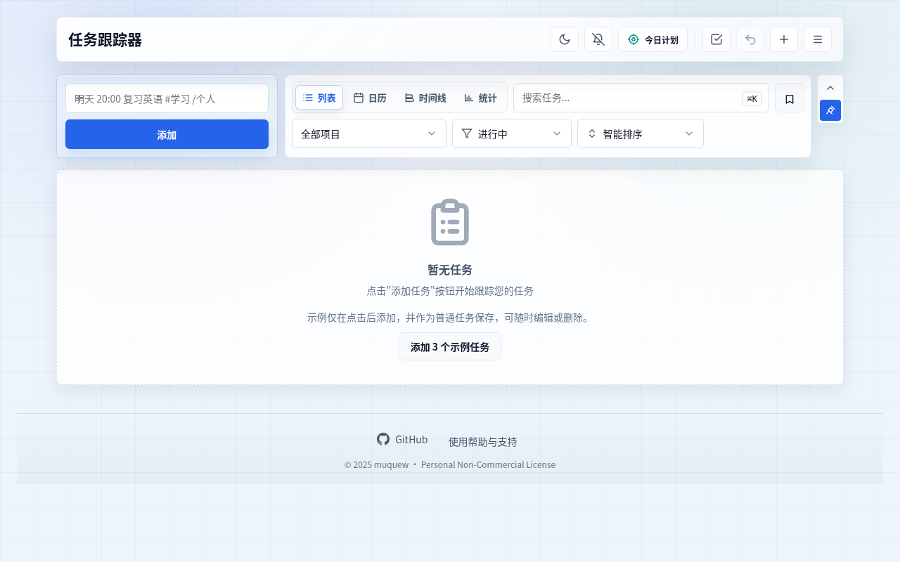
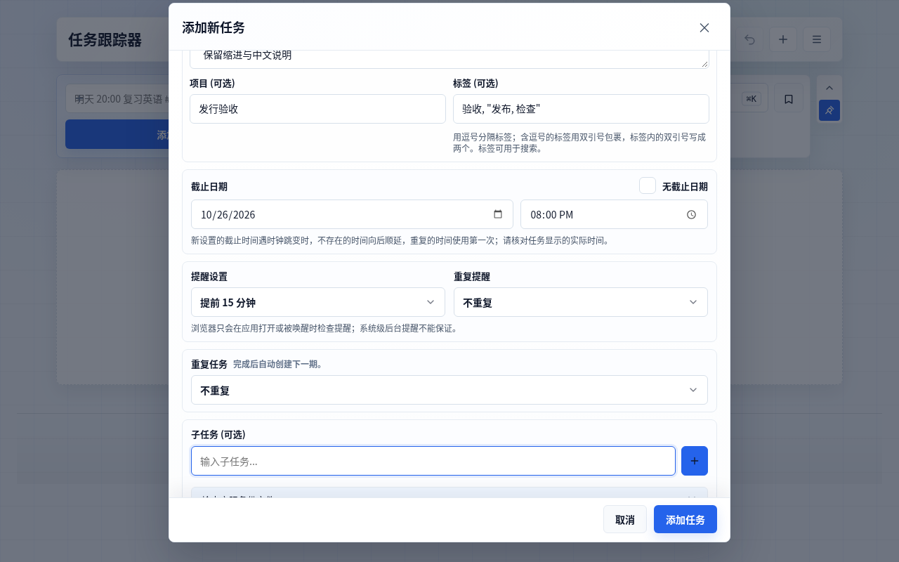
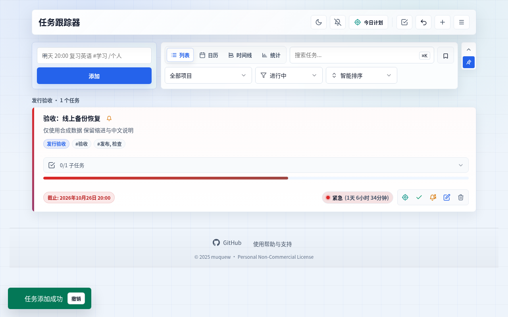
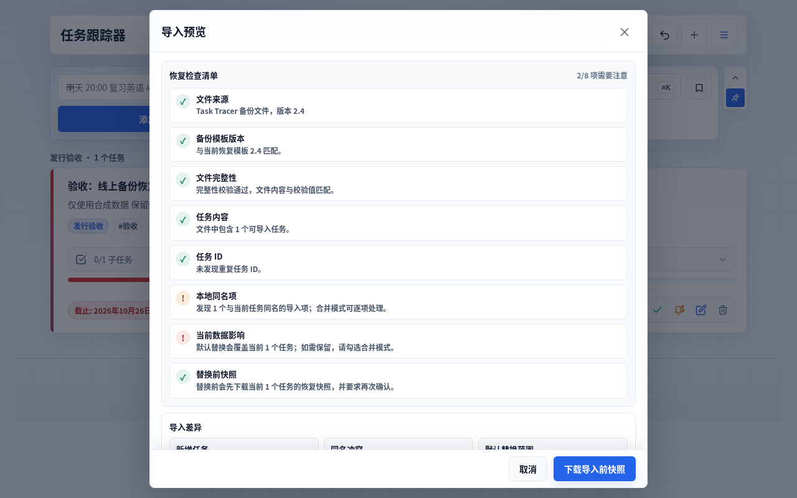
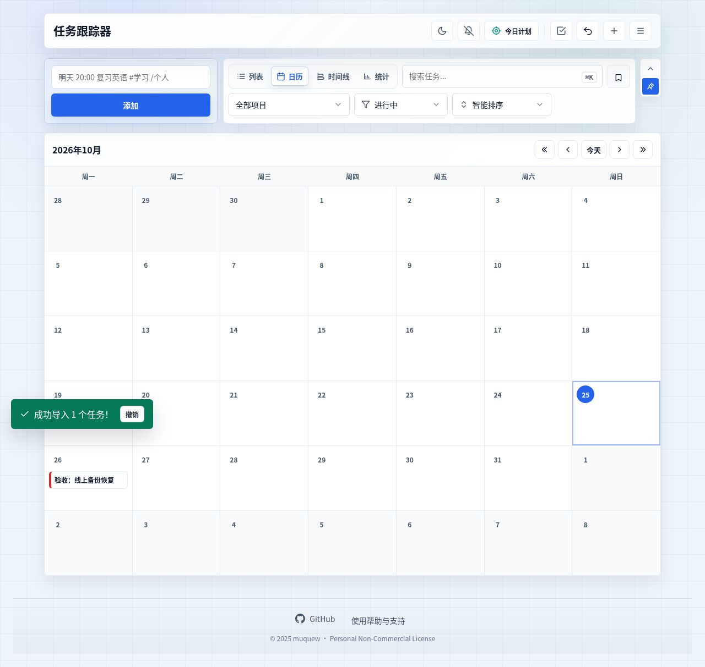
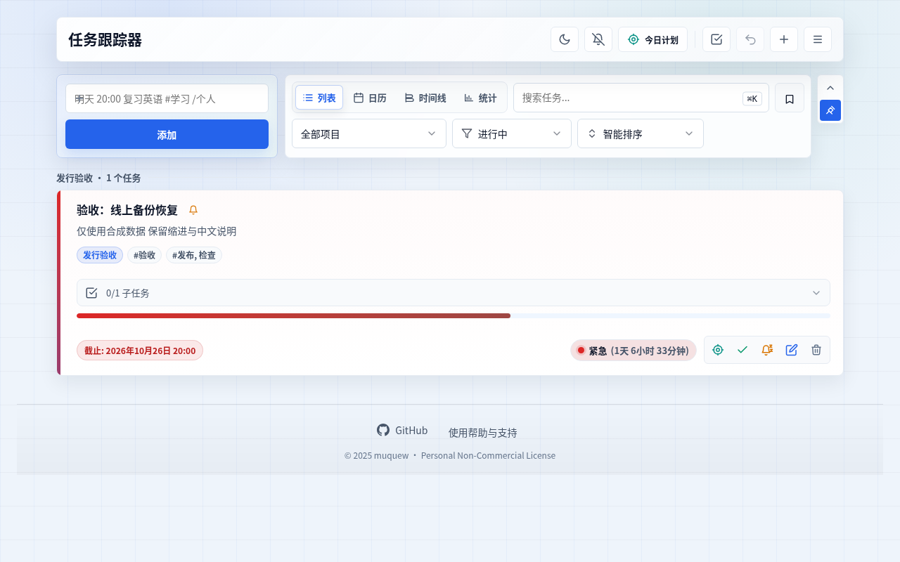
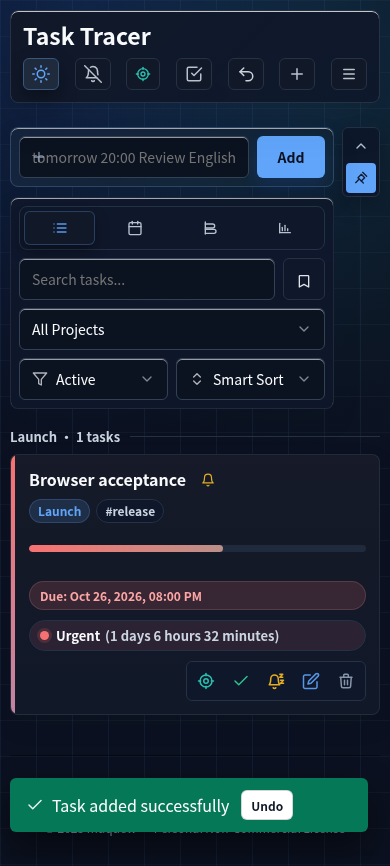
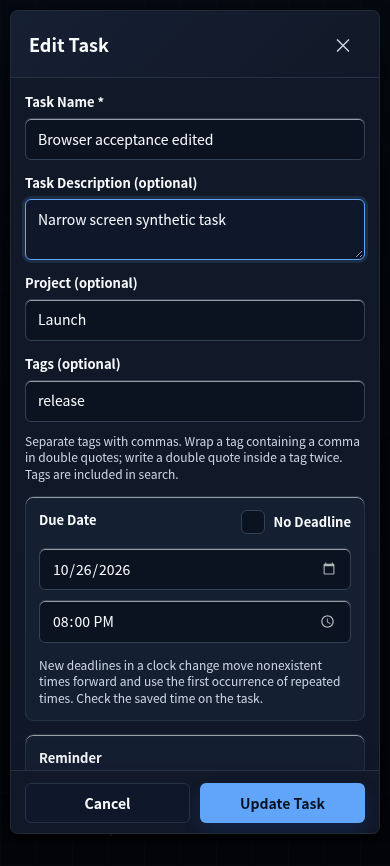
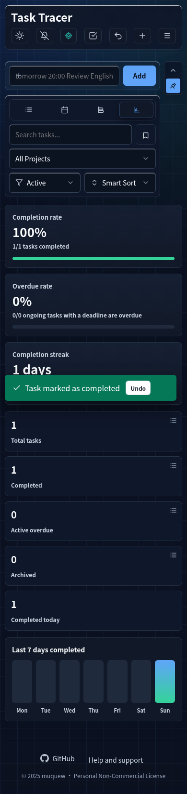
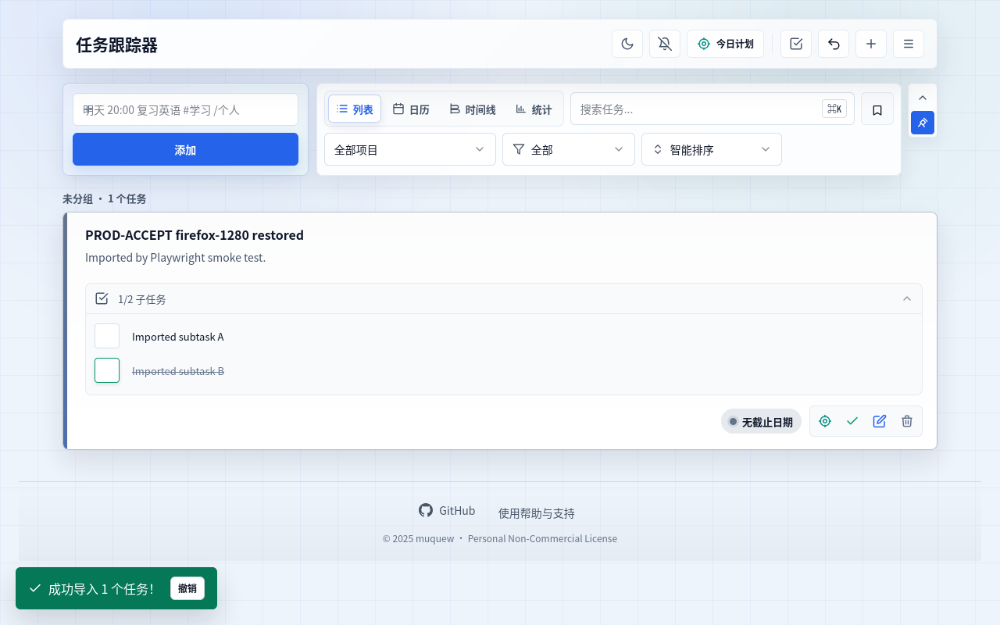

# 2026-10-25 发布后浏览器验收：4.8.5 阶段

日期和下述执行时间均按北京时间；原始 JSON 保留 UTC 时间。以下记录已发布的 **4.8.5** / 资源 **4.36** 阶段。本轮将已完成五项工程验收的候选推送到 GitHub，并实际确认域名更新；此阶段结束时 22 个发行源码与 69 个验证输入仍与原冻结一致。后续截图检查确认了已选中子任务的浅色主题对比缺陷，**[4.8.6 完整工程验收](../../releases/4.8.6.md)已通过，发布后验证仍待完成**，不以本页旧版结果替代新版验收。

## 发布与验证结论

应用提交 [`d9b2a58d8359aa27c087f3da809d7de27ee398f0`](https://github.com/muquew/Task-Tracer/commit/d9b2a58d8359aa27c087f3da809d7de27ee398f0) 已推送至 `main`。[部署原始报告](deployment-after-push/c0be17a7-96ee-4b85-a329-b59dbee06825/report.json)记录 13:23:39 首次原 CLI 完整通过，14/14 实际 HTTPS 响应均为 200，HTML、Service Worker、语言资源、图标和 manifest 与候选字节一致，CSP 与登记安全头原断言通过。这证明生产静态内容与候选一致；未读取 Vercel 后台 Git 元数据，也未把远程 CI 计为通过。

| 验收 | 本轮实际结果 | 原始证据 |
| --- | --- | --- |
| GitHub 推送后域名匹配 | 通过，4.8.5 / 4.36，14 条响应与安全头相符 | [部署摘要](deployment-after-push/c0be17a7-96ee-4b85-a329-b59dbee06825/summary.md) |
| Chromium 真实域名操作与截图 | 通过，中文 1280×800、英文 390×844，共 9 步；两上下文均无页面异常 | [完整交互报告](browser-flow/c05ce2d1-1459-4e93-81c6-f79a1f1aaec8/report.json) |
| 三引擎本地核心流程 | 通过，Chromium 154.0.8037.57 / Firefox 153.0 / WebKit 26.5，各 1280×800 与 390×844，共 6 组合 | [本轮核心复验](browser-compatibility/c69a45d3-0139-43c5-8a01-d81eb884ba40/verification-summary.json) |
| Firefox 原引导程序重复运行 | 5/5 轮通过，共 20 次重载，0.081741–0.326615 秒 | [重载复验](firefox-reload/afcca1a6-e6e1-4ec6-883f-f94d4285e034/verification-summary.json) |
| Firefox / WebKit 真实域名四组合补验 | 2 组合通过、1 组合失败、1 未执行；不是四组合通过 | [阶段原始报告](production-compatibility/e33926be-d2b4-467b-8d47-cb3f31510a11/verification-summary.json) |
| 实机、系统安装/通知、实际输入法与辅助技术 | 未执行，不由云端视口模拟代填 | [实机清单](../../manual-device-checklist.md) |

[发布身份与最后检查](publication.json)另存 GitHub `main` 的实际远端 SHA、当前 91 输入一致性及本次生产浏览器数据/截图核对。既有 `dist/task-tracer-4.8.5.zip` 是在基础提交 `1c3bacb0ca8015fb5840c6b5d1d5efa0937e6e28` 的 dirty 工作树上构建并验收的候选；其原清单与 SHA 不变，不重标为 clean `d9b2a58` 构建。已发布提交的这 91 个源码和验证输入字节与原冻结相同。

本日的 3 个原核心程序执行不等于重新运行全部 31 项专项或完整 58 项检查。此前完整工程验收及 314 份来源证据保持[原记录](../../releases/4.8.5.md)身份；本轮补验与其分开。

## 真实域名九步操作与截图

目标是用隔离配置中的合成任务完成首次使用、录入、规划、备份恢复、离线及窄屏编辑。浏览器实际为 Linux Chromium 154.0.8037.57，时区 Asia/Shanghai；13:24:35–13:28:31 执行，9 张保存的原始截图均经查看后接受。交互 JSON 记录操作及相关 DOM、焦点、视口、请求状态、下载信息和输入身份；原始下载文件一同保留。

| 步骤 | 操作 | 状态 |
| --- | --- | --- |
| 1 | 首次使用与空工作区 | 通过 |
| 2 | 填写完整任务表单 | 通过 |
| 3 | 任务保存后的列表 | 通过 |
| 4 | 实际备份文件与导入预览 | 通过 |
| 5 | 安全快照、恢复与日历 | 通过 |
| 6 | 禁网后的实际重载 | 通过 |
| 7 | 窄屏英文快速添加与暗色主题 | 通过；英文单复数待润色 |
| 8 | 窄屏编辑表单与重载保留 | 通过 |
| 9 | 完成任务与统计结果 | 通过；英文单复数待润色 |

### 1. 首次使用与空工作区

状态：**通过**。已查看保存截图：HTTPS 实际页面完整稳定，空状态明确，无横向溢出；控件有可访问名称。

### 2. 填写完整任务表单

状态：**通过**。保存截图显示已填写日期、项目、标签和子任务编辑区；滚动内容正常，取消和保存均可见。

### 3. 任务保存后的列表

状态：**通过**。HTTPS 域名中新任务正常保存；卡片中文、项目、标签、截止时间与子任务数量均可见，视口无溢出。

### 4. 实际备份文件与导入预览

状态：**通过**。文件校验、同名冲突、覆盖范围和快照保护明确；高影响提醒有文字和图标，不仅靠颜色；取消与快照按钮可见。

### 5. 安全快照、恢复与日历

状态：**通过**。已实际下载备份及导入前快照，替换后所有任务字段与下载文件精确相等；日历中26日条目正确且可访问，无横向溢出。

### 6. 禁网后的实际重载

状态：**通过**。已查看实际禁网重载截图：界面和合成任务完整，逐字段仍与备份一致；离线事实由上下文set_offline与reload记录支持，不单靠截图推断。

### 7. 窄屏英文快速添加与暗色主题

状态：**通过；英文单复数待润色**。390px暗色英文界面完整重排，无横向溢出；快速添加日期、标签和项目解析正确。发现非阻断文案细节：1 tasks / 1 days 使用复数，作为后续润色记录。

### 8. 窄屏编辑表单与重载保留

状态：**通过**。已查看窄屏暗色编辑表单，字段标签、项目/标签/日期和固定底部Update Task按钮可见，无横向溢出；真实软键盘与系统读屏仍未执行。

### 9. 完成任务与统计结果

状态：**通过；英文单复数待润色**。编辑保存和重载后字段保留，完成任务后统计100%、1/1及今日完成1正确，图表内容完整、无横向溢出；1 days复数文案列为非阻断润色。

## 数据与可访问性证据边界

桌面流程实际保存了 [1,962 字节任务备份](browser-flow/c05ce2d1-1459-4e93-81c6-f79a1f1aaec8/production-backup.json)和 [1,984 字节导入前快照](browser-flow/c05ce2d1-1459-4e93-81c6-f79a1f1aaec8/production-pre-import-snapshot.json)，不是只观察下载提示。替换导入后和禁网重载后两次读取全部任务字段，均与下载备份精确相等，包括中文缩进/换行、逗号标签、子任务及 Asia/Shanghai 截止时间。窄屏重载后的记录保留编辑后的名称、描述、项目、标签与原截止时间，完成后 `completed=true`、统计 100% 和 1/1 一致。

截图和 DOM 显示中文/英文标签、可访问名称、文本与图标并存的覆盖风险提示、固定底部保存按钮及无横向溢出。它们不构成完整 WCAG 合规、真实读屏播报或真实触控/软键盘验收；本轮没有实际 OS 安装、设备重启、锁屏/后台通知、真实输入法候选操作和浏览器驱逐。离线事实来自上下文禁网后真实重载和字段比较，不能只从画面推断，也不替代真实手机离线启动。

## Firefox / WebKit 真实域名补验与视觉缺陷

[原生报告](production-compatibility/e33926be-d2b4-467b-8d47-cb3f31510a11/report.json)为 `failed` / `completed: true` / `passed: false`，原始文件已[封存哈希](production-compatibility/e33926be-d2b4-467b-8d47-cb3f31510a11/sealed-evidence-sha256.json)。Firefox 153.0 的 1280×800 和 390×844 两组合通过 CRUD、四视图、实际导出/替换导入、删除及上下文禁网后的 Service Worker 重载。WebKit 26.5 的 1280×800 在线阶段通过并取得与候选相同的 HTML；之后 `context.set_offline(True)` 下的重载出现浏览器 API internal error，完整组合失败；390×844 未执行。旧页面仍显示的[失败截图](production-compatibility/e33926be-d2b4-467b-8d47-cb3f31510a11/webkit-1280/failure.png)不作为成功重载证明。最小 fixture 诊断另行保留，当前不把该 API 错误直接归因于应用或预写根因结论。

生产 HTTPS 使用继承代理和正常证书验证。此前的监听器适配错误及 Firefox `SEC_ERROR_UNKNOWN_ISSUER` 分别保留在[原 runner 失败](production-compatibility/d8a22b5c-1248-4dc3-9f61-874f6926acc9/report.json)和[证书信任失败](production-compatibility/15fda694-9b0f-4b7d-a695-f52c406c111d/report.json)中；后续只将平台已配置、经验证的公开代理 CA 导入临时 Firefox 配置，未关闭 TLS 校验、设置证书例外或改动全局信任。

[截图审读记录](production-compatibility/e33926be-d2b4-467b-8d47-cb3f31510a11/visual-review.json)同时发现真实视觉缺陷：浅色主题已选中子任务使用白色勾号和浅色/白色背景，勾号不清楚。划线与 `1/2` 数量显示不能代替勾选控件本身清晰的状态。该问题在 Firefox 和 WebKit 保存的在线截图中可见，已列为 4.8.6 修复事项；原 4.8.5 自动化通过记录不因此被重写，也不代替修复后的新证据。

## 发现与后续事项

- 步骤 7、9 中英文数量为 1 时仍显示 `1 tasks`、`1 days`。这是已观察到的非阻断文案问题；后续可按数量选择单复数，不改写本轮通过范围。
- 先前 Firefox 首次重载 30 秒超时本轮未复现。五轮成功不能确定旧超时原因或证明彻底消除；原断言与 30 秒限制未改，观察性 trace 本身有开销。
- 真实设备和正式销售价格、收款、私密售后及授权条款仍按各自状态记录。

## 保留的未完成与发布前记录

发布前[线上 4.1 差异记录](deployment/a8155697-f6ef-4eb5-908f-9cc6d23e6a57/summary.md)保留：HTTP 可达但与 4.8.5 候选不匹配，不能改记通过。首次网络沙箱未触达服务端的尝试另留，不归因于线上 HTTP 服务。

截图控制台初次因 stdin EOF 在创建浏览器上下文前退出的[外部记录](browser-flow/fe7fbc29-50b2-48c2-8dfd-edd0977b529c/external-completion.json)，以及本地三张截图后误写菜单选择器 `#menuBtn` 而超时的[外部记录](browser-flow/f756b0e1-15f6-49a3-bba2-cdc492a63c34/external-completion.json)，均保留原生未完成/未通过报告，不计产品失败或完整验收通过。上面的真实域名九步来自另一个完整新运行，使用实际存在的 `#openMenuBtn`，未拼接旧结果。
