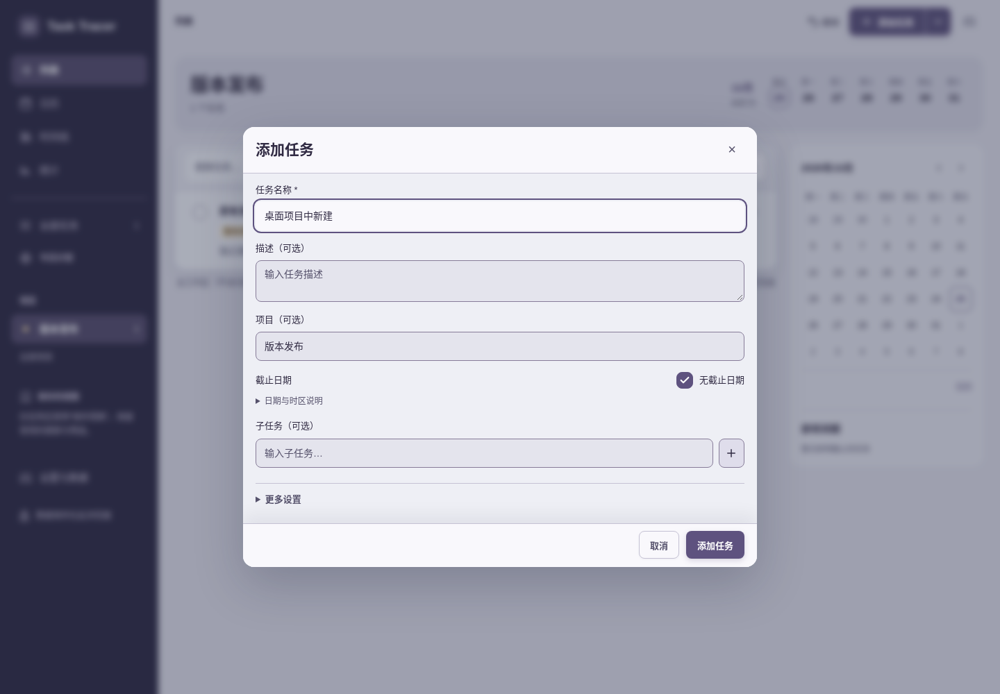
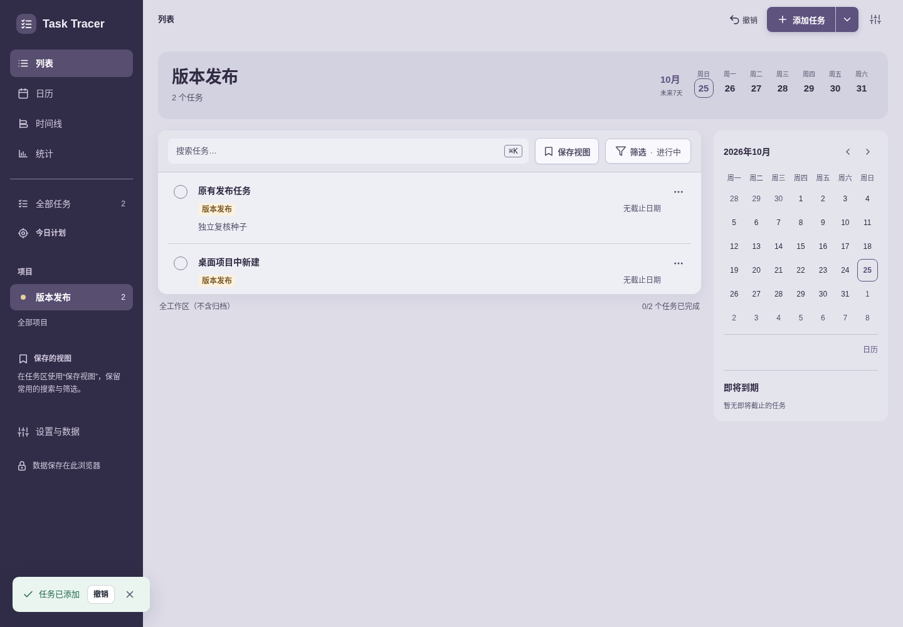
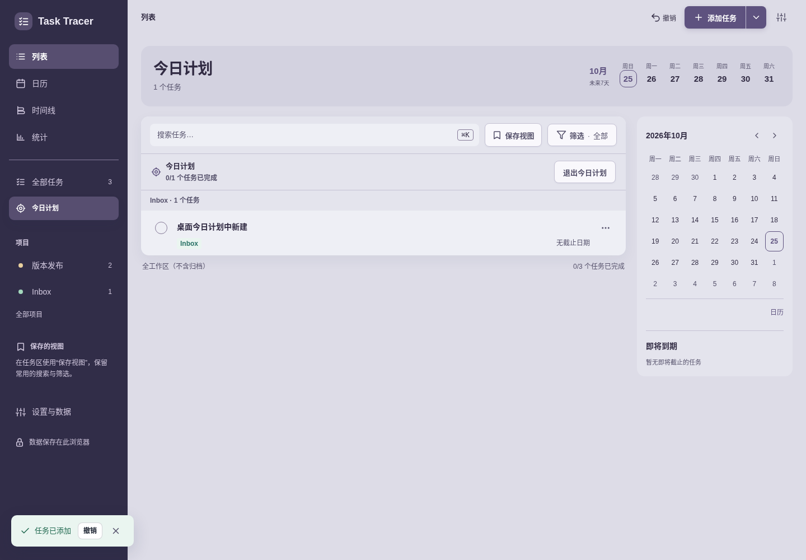
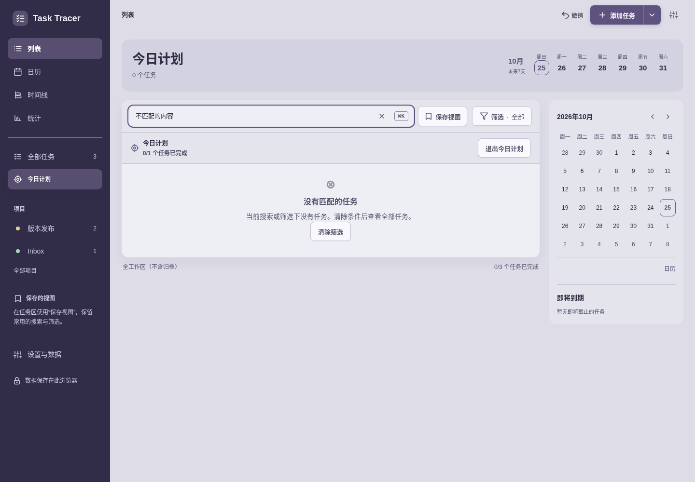
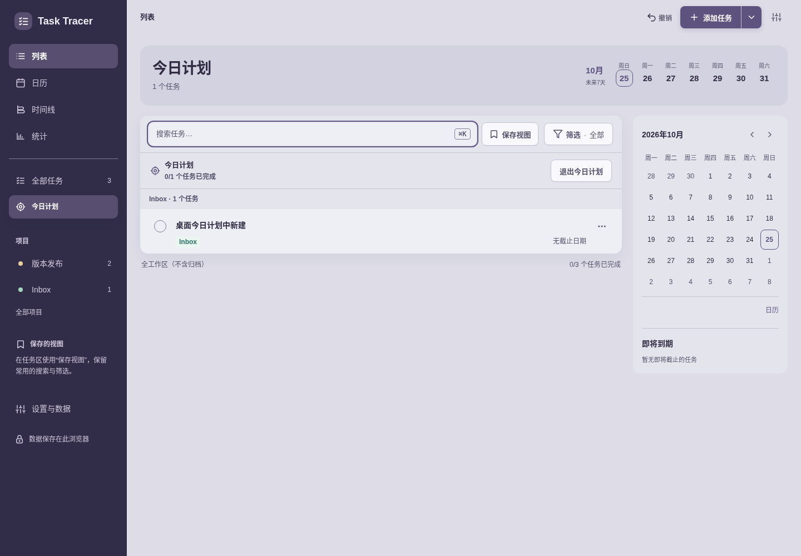
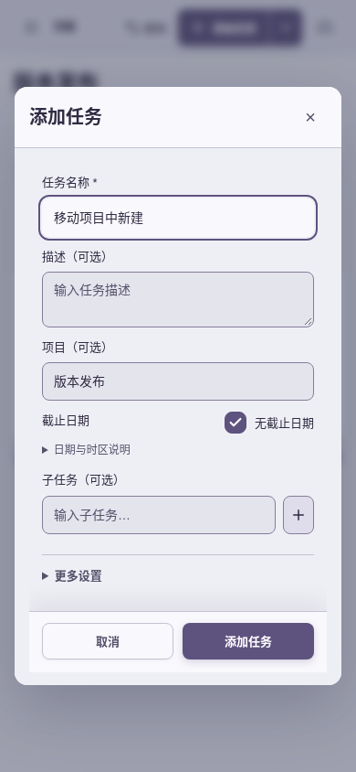
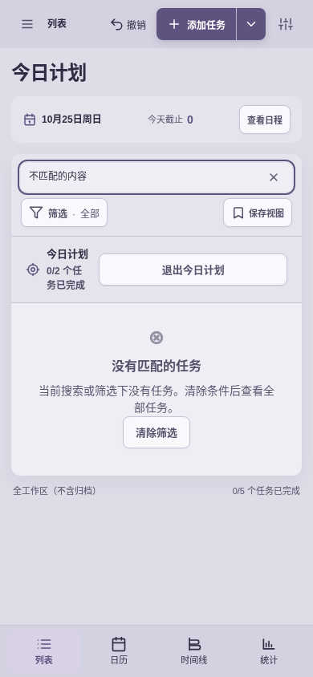

# 最终源的独立实用复核

**结论：先前发现的 3 项问题，桌面与 390px 均已复核通过。**

日期：2026-10-25。最终 `index.html` SHA-256：`e3a0d79e5c0eb044ee5c94207862117e1934bd8f21465793958792440f2a0de4`。APP 4.13.1 / resources 4.42。

使用新本地端口 `http://127.0.0.1:39729/`、全新 BrowserContext/profile 的独立存储、真实 `ProductionHeaderHandler` 部署 CSP、系统 `/usr/bin/chromium`。没有复用修复前页面或缓存。桌面 1440×1000，移动 390×844。仅复核下列已发现路径，没有新增审查范围、修改产品源码或运行自动测试套件。

| 步骤 | 操作 | 健康情况与实测结果 | 截图 |
| --- | --- | --- | --- |
| 1 | 桌面：项目“版本发布”中新建，只填写名称并保存 | 通过。项目预填“版本发布”；保存后新任务直接显示，项目从 1 项变为 2 项，存储归属正确 | final-01、02 |
| 2 | 桌面：今日计划中新建并保存 | 通过。新任务立即出现在今日计划；存储 `focusDate: 2026-10-25` | final-03 |
| 3 | 桌面：今日计划搜索不存在的内容 → 清除筛选 | 通过。显示“没有匹配的任务”与恢复按钮；点击后搜索为空，标题与选中范围仍为今日计划，原计划任务恢复 | final-04、05 |
| 4 | 390px：项目“版本发布”中新建，只填写名称并保存 | 通过。项目预填正确，新任务直接显示；存储 `project: 版本发布` | final-06、07 |
| 5 | 390px：今日计划中新建并保存 | 通过。新任务立即加入当前计划；存储 `focusDate: 2026-10-25`，计划从 1 项变为 2 项 | final-08 |
| 6 | 390px：今日计划搜索不存在的内容 → 清除筛选 | 通过。显示正确的无匹配文案；清除后保留今日计划，2 个计划任务恢复可见 | final-09、10 |

## 已接受截图

以下 10 张截图已逐张打开检查，均为最终源的稳定页面。

保存记录见 [final-records.json](final-records.json)，内容均为此次隔离复核创建的示例任务。浏览器 `pageerror` 记录为 `[]`。

[修复前报告](README.md) 保留旧行为与发现证据。此次复核没有检查完整无障碍合规、屏幕阅读器、原生移动键盘或后台通知；结论仅覆盖表格中的三条常用路径。
