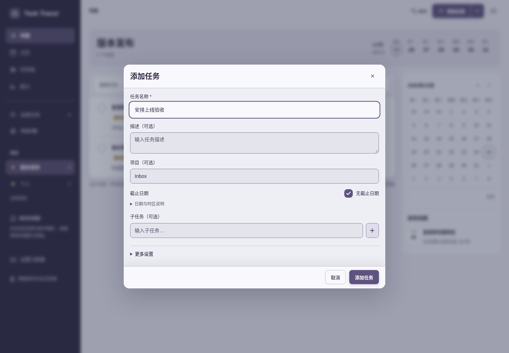
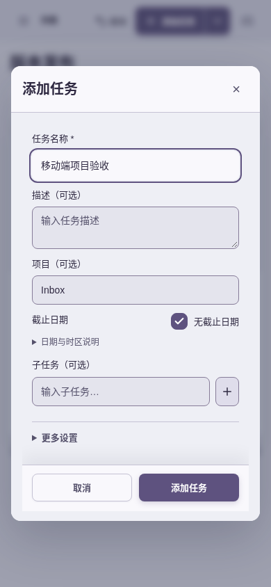
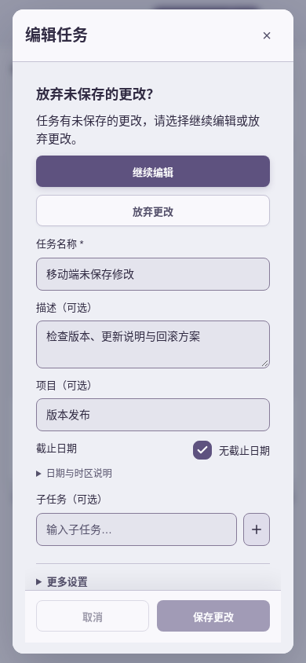
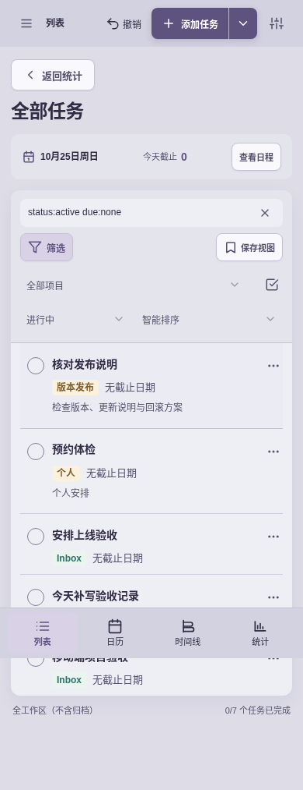
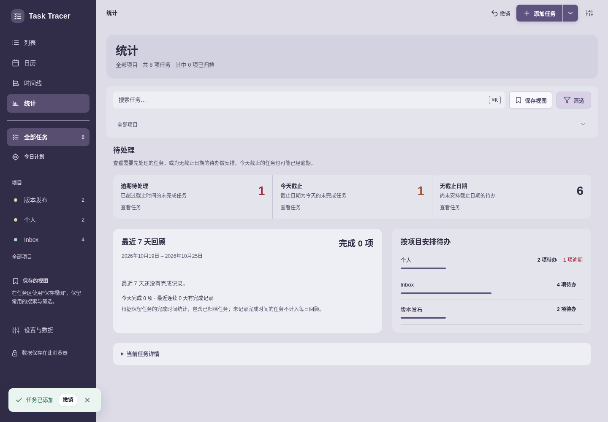

# Task Tracer 4.13.1：独立常用路径细节审查

审查日期：2026-10-25。以下是**修复前**的实测记录，页面在原始 `index.html` SHA-256 `48d729a29281135b0bb1fb756d6b2019b5025bfeedc89792db2a61cd7817859c` 上启动；APP 4.13.1 / resources 4.42。root 随后已修复三项，修复是否生效应看另行复核，不应把下列旧截图当作最终源仍有问题。

使用独立本地端口、`tools.security_playwright.ProductionHeaderHandler` 的真实部署 CSP、`/usr/bin/chromium` 全新 profile。桌面 1440×1000，移动 390×844，zh-CN，Asia/Shanghai。任务均在隔离浏览器中通过界面创建。未修改任何产品源文件，未运行全套自动测试。

## 3 个可复现问题

### 1. 项目中新增默认进 Inbox，保存后当前列表看不到新任务（中）

步骤：打开“版本发布”（2 个任务）→ 顶部“添加任务” → 只填名称 → 保存。

实际：项目字段预填 `Inbox`。保存“安排上线验收”后“版本发布”仍 2 个任务，新任务确实保存在 Inbox。只显示“任务已添加 / 撤销”，没有解释去向。390px 以“移动端项目验收”复现同一行为。

影响：用户在明确项目中创建工作，容易认为没有添加成功而重复新增，或之后找不到任务。

建议：明确项目范围下预填当前项目；显式输入或快速记录中指定的项目优先。若最终保存不匹配当前范围，成功反馈应说明归属并提供查看入口。

### 2. 今日计划里新增没有加入今日计划，保存后同样不可见（中）

步骤：把“核对发布说明”加入今日计划 → 打开今日计划（1 项）→ 顶部添加“今天补写验收记录” → 保存。

实际：任务保存到 Inbox，`focusDate: null`；今日计划仍只有原 1 项，只提示“任务已添加 / 撤销”。移动端以“移动端今日检查”复现，保存后也没有进入当前计划。

影响：当前工作上下文与新增结果脱节，用户需要退出计划、寻找新任务、再执行一次“加入今日计划”。

建议：在今日计划中新建，默认同时加入今日计划；如有相冲突的项目/搜索条件，应在成功反馈中解释去向。

### 3. 今日计划搜索无匹配，被误报为计划为空（中）

步骤：今日计划已有 1 项 → 搜索“验收”（移动端搜索“不存在”）。

实际：计划摘要仍显示“0/1 个任务已完成”，列表却显示“今日计划还没有任务”，引导用户从任务操作中加入今日计划。实际只是搜索不匹配，已有计划没有丢失。这里也缺少普通空结果页已有的恢复按钮。

影响：互相矛盾的反馈容易让人误判计划状态，空结果页没有直接恢复当前计划的操作。

建议：仅在今日计划实际 0 项时使用“今日计划还没有任务”；已有计划但被搜索/状态筛选排空时，说明“没有匹配的任务”，提供清除搜索/筛选按钮，并保留今日计划范围。

## 已检查的其余路径

| 步骤 | 路径 | 一般健康情况 | 当前证据 |
| --- | --- | --- | --- |
| 1 | 项目范围新增 | 有问题，见问题 1 | 01–03、19–20 |
| 2 | 普通搜索无结果 → 清除筛选 | 正常：搜索清空，任务重新可见 | 04、14 |
| 3 | 今日计划内新增 | 有问题，见问题 2 | 05–06、28–29 |
| 4 | 今日计划内搜索无结果 | 有问题，见问题 3 | 07、21 |
| 5 | 任务菜单 → 编辑 → 取消 → 继续/放弃 | 正常：继续保留输入并恢复名称焦点；放弃后存储名称不变，焦点回任务菜单 | 08、22–23 |
| 6 | 批量选择 → 全选 → 改项目筛选 | 正常：6 项全选；筛到版本发布后明确显示选中 2 项，没有保留隐藏选项 | 15–18 |
| 7 | 统计下钻 → 设置 → 返回任务 → 返回统计 | 正常：下钻条件保留，返回统计恢复原查询；桌面和移动均可完成 | 10–11、25–27、30–32 |

## 证据与范围限制

以上报告使用的截图均已保存并逐张打开检查。原 `09-desktop-stats.png`、`12-desktop-stats-return.png` 在渐入动画中截取，**拒绝作为证据**；桌面稳定截图以 30–32 为准。全页移动截图保留了浏览器对固定底栏的真实捕获结果。

检查包含 DOM 状态、保存记录、名称焦点和可见交互反馈；页面未记录未捕获 JavaScript 错误。没有用截图推断完整无障碍合规，没有检查真实屏幕阅读器、原生移动软键盘、系统 IME 或后台通知。不把个人视觉偏好列为缺陷。
