# 4.13.2 本地细节验收

本目录保留保存、反馈、日历定位、说明精简和侧栏调整的本地证据。受影响专项、原回归及最后完整 smoke 的实际结果见下表。本记录不证明 GitHub 发布或生产域名更新，发行与线上部分由另行维护的实际收据补充。

[机器摘要](local-summary.json)、[原始文件来源及 SHA-256](original-files.json)、[本地归档文件清单](manifest.json)均可复核。清单只绑定列出的本地验收文件，不覆盖另行维护的 `release/`、`canonical/`、`production/`、`production-browser/` 收据子目录，也不声称随后整个父目录只有这些文件。原报告和日志逐字复制，内部原 `/tmp` 路径、旧版本目录名、失败状态及各自源码哈希保留。来源清单负责把它们映射到本目录，未把旧报告改名为最终源码重跑。

## 源码阶段与保留范围

| 阶段 | `index.html` SHA-256 | 实际范围 |
|---|---|---|
| 受保护候选 FB | `fb59cc194636eba12251839860d4e42a1d1e60daf3b4b009a30ac68b91b1f1cd` | 子任务 14 项、日历/时间线 4 组合、反馈 10 项的最终专项 |
| 反馈避让 CSS 后 EC60 | `ec60ab40b209a15f7d86431d0599a4f8e200129f2909646323a17f531f41e508` | 侧栏四视口、草稿/IME、可访问性/国际化、日期原回归、主动更新；本地人工浏览记录 |
| 最终候选空白清理后 | `79693a476cd75b46df78b71890f9a3a89aef2eb08aa8a2af701c07c4b801c1ad` | 相对 EC60 仅删除六行 HTML 空白，scripts/styles 逐字相同；最后完整 smoke 在此源码上运行通过 |

[范围对照](scope/final-css-scope.json)记录 FB→EC60 的三条 CSS 调整：桌面提示移入主工作区，手机抽屉打开时隐藏背景提示与更新提示；全部 script 元素不变。对照另直接比较最终候选与原 FB 快照：移除 style 并规范仅含空白的行后，其余 HTML 一致。此对照不把早期专项的原生源码身份改成最终哈希。

本地归档精选 14 张 PNG 和必要报告、原始日志及字段快照，不复制 trace ZIP、完整源码快照或全部截图。公用四张截图的原阶段仍为 EC60，见[原截图清单](public-screenshots/final-images.json)与[捕获记录](public-screenshots/capture.json)；本地归档未另复制这四张 PNG。

## 本地步骤与结果

| 步骤 | 操作与结论 | 原生证据与边界 |
|---|---|---|
| 1 | 未点 `+` 的子任务随主保存写入一次；显式添加、编辑、验证、保留草稿、配额失败/中止后重试及 DOM composition，两宽度共 **14/14** | [结果](pending/20261025T161317Z-chromium-7cddb93d/results.json)、[摘要](pending/final-summary.json)、[原日志](pending/final-fb59cc19.log)。Chromium 154.0.8037.57，1280×900/390×844，新独立上下文及正常部署 CSP。每例保留初始/最终记录与浏览器事件。 |
| 2 | 日历保存、取消/放弃、跨月后原日期回退及桌面预览返回；紧凑时间线保留 AM/PM、完整可访问日期与精确原始时间字段，**4/4** | [报告](calendar/20261025T161310Z-64118a07/report.json)、[原视觉记录](calendar/20261025T161310Z-64118a07/visual-review.md)。1440/390 两宽度，各日历与时间线组合；全部 `page_errors` 为空。 |
| 3 | 筛选外保存后打开正确记录且不改条件；新提示替换旧 action、保留快速草稿、hover/focus 暂停余时、Undo 返回任务控件、输入框保持原生 Ctrl+Z，**10/10** | [结果](feedback/final-run/results.json)、[输入清单](feedback/final-run/input-manifest.json)、[原日志](feedback/final-run/console.log)、[方法](feedback/final-run/report.md)。实际 focus/hover 保持 7 秒后，余时分别约 4.267/4.240 秒；普通提示恢复约 2.039 秒。未伪造时钟或延长产品超时。 |
| 4 | 真实快速记录创建 40 个项目/任务、表单保存 4 个视图；所有项目、保存视图与设置可达，**4/4 视口** | [报告](sidebar/final-run/report.json)、[原复核](sidebar/owner-review.md)。1280×720、1280×500、390×844、320×640；每个视口键盘到达 40 个项目。桌面顶部/底部固定、中段单独滚动；手机恢复当前 scope 焦点。真实成功提示出现时，设置仍可直接点击；手机抽屉内背景提示隐藏但保留状态。`page_errors`/`console_errors` 均为空。 |
| 5 | 原草稿与 IME 两程序 exit 0；外区墙上时间 6 项通过；可访问性/国际化调用 exit 0 | [草稿/IME](regression/draft-ime/report.json)、[日期](regression/foreign-time/report.json)、[可访问性](regression/accessibility/report.json)。可访问性为 1280 px 流程与 390 px reduced-motion 流程的 49×2 状态观测，使用 `--skip-scaled`，不是 98 个独立程序，也未验证真实读屏。IME 是 5 个 DOM composition 用例，不等于实机输入法认证。 |
| 6 | 原日历导航通过；旧时区路径失败后，真实入口及 Apia handoff 合同适配，最终 run2 通过 | [原报告](regression/calendar/report.json)、[原失败日志](regression/calendar/calendar_timezone_playwright.py.log)、[中间失败](regression/calendar/entry-adaptation-ec60/run1/calendar_timezone_playwright.log)、[run2](regression/calendar/entry-adaptation-ec60/run2/report.json)。最终保留 skipped-day、闰日/月导航、三种实时 CDP 时区切换和 Today Plan 日期变化检查。未把原失败改为通过。 |
| 7 | 主动更新原生 **20/20** 通过，外层运行器随后错误地把 `--output` 当成第二程序并 exit 2 | [原生结果](manual-update/report.json)、[原范围说明](manual-update/scope.md)、[运行器报告](regression/manual-update/report.json)、[成功日志](regression/manual-update/manual_update_playwright.py.log)、[格式错误日志](regression/manual-update/--output.log)。这里只有一次实际主动更新执行；`manual-update/report.json` 是其默认输出的原字节副本，不是第二次重跑。报告中合成 `4.13.3` 是更新夹具，未发布该版本。 |
| 8 | 人工操作形成 **38 份观察记录**，每份 `pageErrors: []`；实际下载备份含 7 个任务、1 个未完成子任务 | [步骤索引](manual/steps.json)、[原驱动](manual/browser-final-review.py)、[实际下载](manual/final-review/task-tracer_backup_2026-10-25_16-28-10-898.json)。这些是观察，不计作 38 条独立测试断言。本文精选的 6 张人工流程图已实际打开查看；不声称全部 38 张都已人工审图。 |
| 9 | 最后完整 smoke **exit 0，96.16 秒**；最终源码起止一致 | [原报告](regression/smoke-final-tail-dialog/report.json)、[原日志](regression/smoke-final-tail-dialog/smoke_playwright.py.log)。日志最终两组 1280/390 px 任务菜单检查均通过：删除确认可直接点击，取消后 18 个任务字段不变，随后 `Smoke passed`。此前旧界面合同失败均独立保留在 [earlier/regression](earlier/regression)。 |

人工流程的 EC60 源码绑定来自执行者当时记录与确认；38 份原 JSON 本身不含源码哈希。[派生步骤索引](manual/steps.json)明确保留这一限制，不为原 JSON 添加原生哈希证明。

## 精选人工流程图

1. **06 保存未显式添加的子任务**：任务已落到列表且显示 0/1 子任务。完整文本与重载/失败恢复由步骤 1 的字段断言证明。

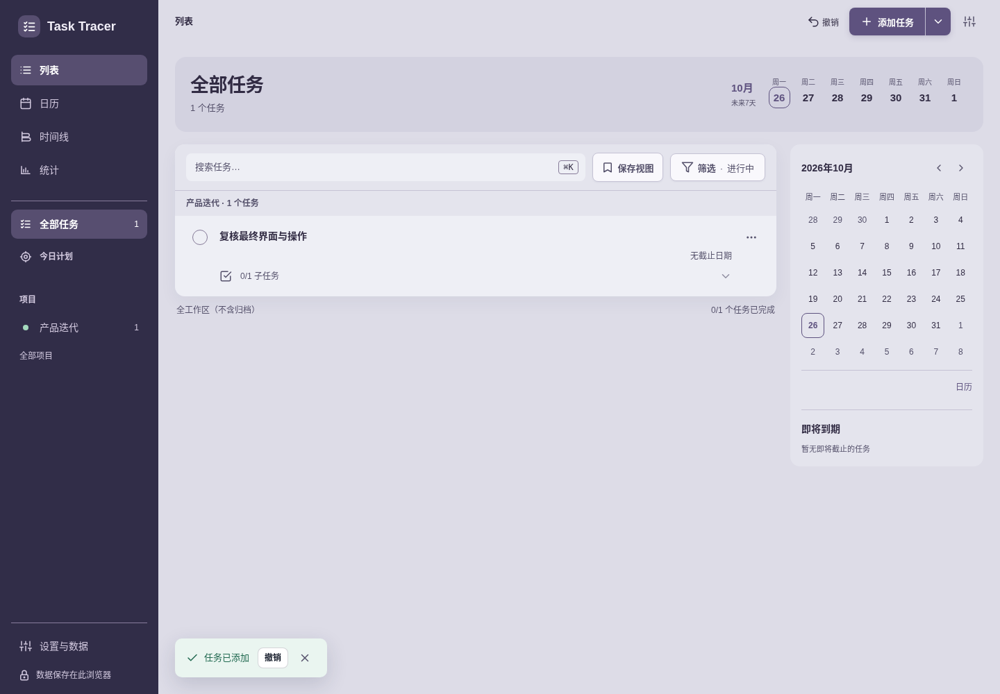

2. **09 320 px 外观设置**：当前主题预览与语言切换后的界面；页面按原观察位置保留，没有为截图重新排版。

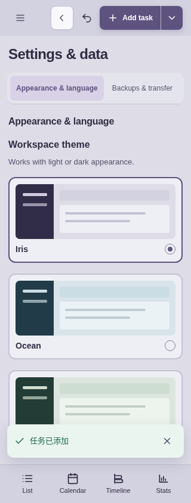

3. **11 320 px 帮助页**：更新入口、帮助和简短诊断入口可见；完整隐私披露仍由相邻第 12 步原 JSON 记录。

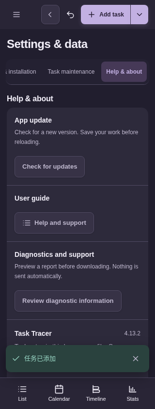

4. **18 320 px 时间线**：日期在分组，任务行显示短时钟和状态；跨项目浏览仍显示项目标记。

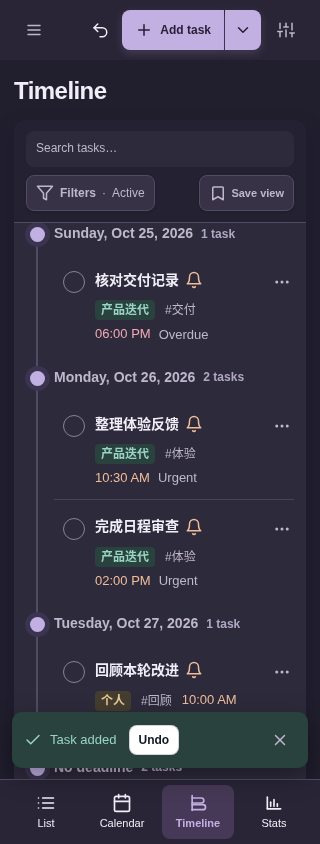

5. **26 筛选外保存**：原无匹配结果仍在，提示提供 Open task 和 Undo，两按钮横排。第 27/28 步 JSON 继续记录打开任务及返回后条件保持。

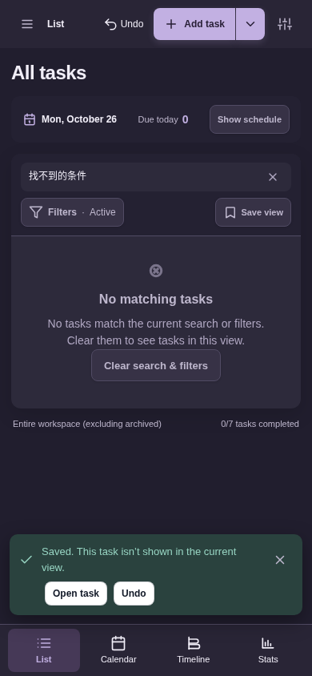

6. **34 日历保存后**：仍在当前日历日程区域；精确焦点、可见中心和字段保持由步骤 2 专项断言，不单凭这一截图推断。

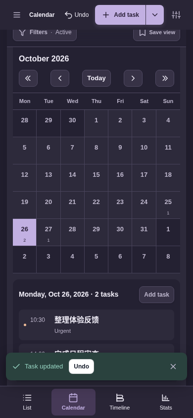

## 精选专项图

**子任务：桌面编辑与手机新建。** 桌面图属于 FB 阶段，左下提示仍是后续 CSS 修正前的位置。手机新建图的底部子任务行部分被短暂提示遮挡，完整内容以该例 `final.json` 和原 DOM 断言为准。

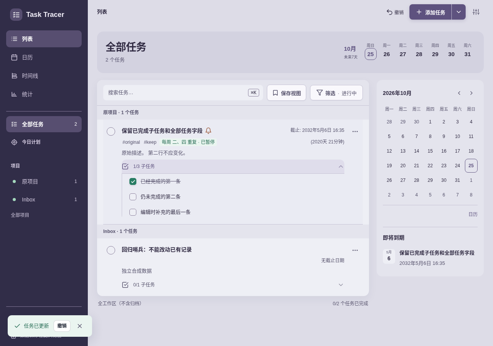

**日历与时间线：** 日期返回目标在日程区；两个来源时区的时钟保留 AM/PM。两图仍为 FB 阶段，不能拿它们证明后续提示避让。

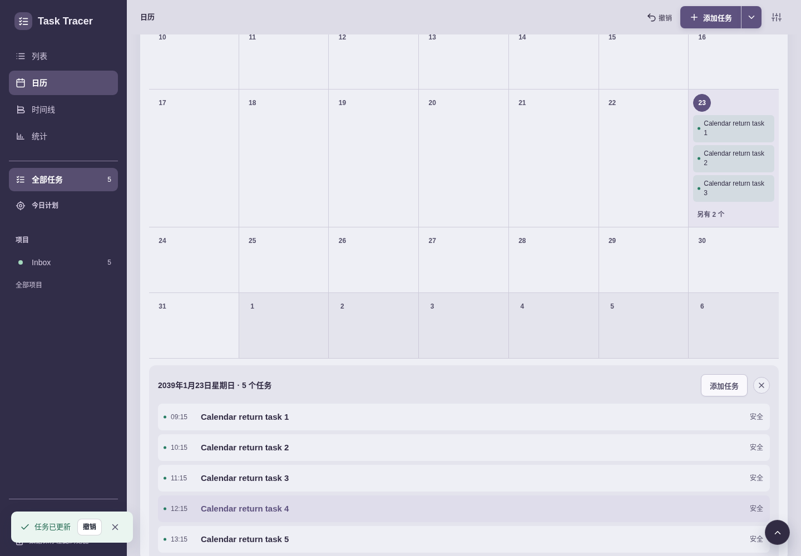

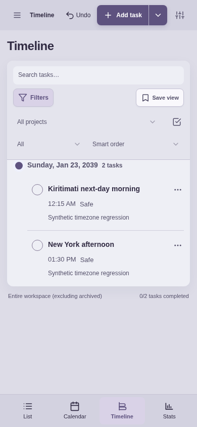

**反馈：** 320 px 完整消息和双 action；真实 focus 保持后提示仍存在。恢复余时来自原结果测量，不来自静态截图。

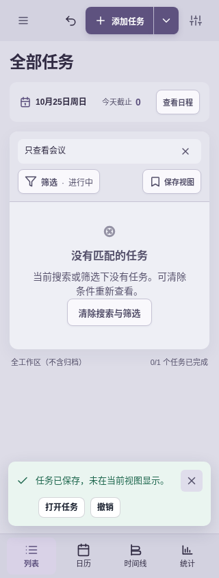

**侧栏：** 1280×500 桌面中段滚动至保存视图，成功提示在主列而设置保持左下；320×640 抽屉中设置固定底部，背景提示隐藏。这里测试的是真实保存视图成功提示，未伪造待刷新更新提示状态，也未声称打开抽屉会暂停计时。

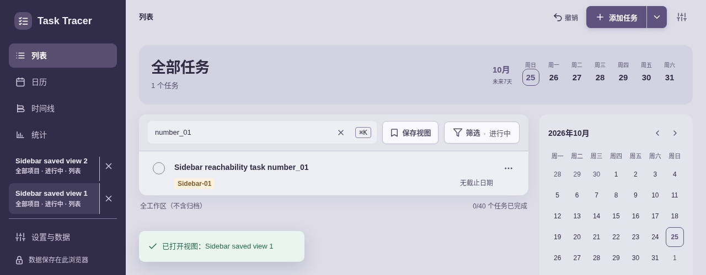

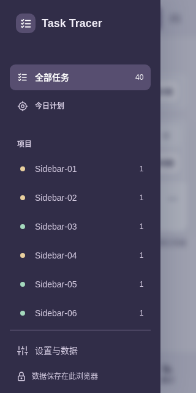

## 早期失败与结论边界

- 子任务最初 composition 用例点击保存导致输入失焦，未触达已有的活动输入 composition 保护；修正用例在输入保持焦点时调用原生 `requestSubmit()`。保留[原结果](earlier/pending/20261025T160622Z-chromium-c5e4d8eb/results.json)及[原日志](earlier/pending/candidate-b925a3b3-first.log)。后来 B925 和 FB 的通过结果各保留自己的身份。
- 日历首轮手机用例错误假定未来夹具月份已展示，未触达返回路径；之后经真实搜索定位日期，再完整重跑。保留[首轮失败](earlier/calendar/20261025T160603Z-dd5d206c/report.json)、[聚焦重跑](earlier/calendar/20261025T160703Z-d39ea590/report.json)及[B925 完整结果](earlier/calendar/20261025T160733Z-d96b019f/report.json)。
- 反馈首轮确实发现手机消息被双按钮挤成狭窄竖列，产品布局修正后重跑；保留[原失败](earlier/feedback/first-run/results.json)、[原 traceback](earlier/feedback/first-run/console.log)与[布局修正后结果](earlier/feedback/corrected-layout-check/results.json)。
- 侧栏早轮 Playwright `trial` click 在 wheel 前自动滚动了外层文档；[geometry 原报告](earlier/sidebar/geometry-run/report.json)和[原说明](earlier/sidebar/fb59-acceptance-review.md)保留诊断。后续用实际指针滚轮通过；最后新增真实提示/设置点击避让检查，以 EC60 报告为准。
- 原时区回归先因旧入口没有打开表单失败；适配第一轮又遇到 Apia capture 实际交接为 12-31 的合同差异。最终明确断言交接时间，再在日期输入中设置 12-30，验证既有 forward-gap 策略和精确 ISO；这不只是换一个定位选择器。
- 完整 smoke 的早期失败涉及旧布局、设置可见性与原生 select 抢焦点假设，原报告仍保留。之后 [700 px 结果](earlier/regression/smoke-native-preferences/report.json)在无重叠/溢出的四行控件布局上触发旧三行上限；[下一次结果](earlier/regression/smoke-layout-contract/report.json)走过视口布局后触发旧日历单行省略断言。日历/统计[工具适配记录](scope/smoke-calendar-statistics-tool-adaptation.json)只证明这两个函数的静态变更范围：按真实日程多行标题、日期→表单入口、当前统计结构及返回按钮保留或加强原数据断言；其本身没有运行浏览器测试。[后续 77.078 秒的尝试](earlier/regression/smoke-current-calendar-statistics/report.json)走过日历/统计函数后，在归档路径触发旧第五计数项断言；同一路径静态检查还发现“归档即排除完成历史”的旧假设，后续一并适配，但不把尚未触达的断言写成当次失败点。当前产品按既有设计保留归档完成历史。
- smoke 的后续原失败继续保留：[81.939 秒](earlier/regression/smoke-archive-history/report.json)在归档流程后等待旧的直接可见导入参考区，实际须展开原生 details；[85.017 秒](earlier/regression/smoke-import-reference/report.json)在该路径适配后遇到旧替换按钮文字，当前按钮包含实际任务数量；[100.5 秒](earlier/regression/smoke-confirmed-import-count/report.json)走过导入、兼容、恢复与归档路径后，在最后删除确认标题触发旧动作标签断言。当前标题中英文均带问号，提交按钮仍保留删除动作文字。安全确认、八项 checklist、快照/风险/冲突与任务字段断言保持；最终独立完整运行的 exit 0 见步骤 9，不回改这些原 exit 1 结果。

当前证据支持这些受影响路径的本地结论。它不是本版全功能/三引擎矩阵重跑，不覆盖实机软键盘、原生 IME、读屏、OS 安装和通知或完整 WCAG 符合性。大量项目用例由真实 UI 创建；配额、中止、更新失败与下一版本等故障条件是专项明确披露的合成夹具。
