# 4.13.2 真实域名浏览记录

本目录归档执行者在 [todo.muquew.com](https://todo.muquew.com/) 的一次真实亲用会话。原生 [source.json](source.json)记录 HTTP 200、Chromium 154.0.8037.57、正常 TLS、未绕过 CSP，以及响应 HTML SHA-256 `79693a476cd75b46df78b71890f9a3a89aef2eb08aa8a2af701c07c4b801c1ad`。会话于 UTC 2026-10-25 16:56:31–17:01:33（北京时间 10 月 26 日 00:56:31–01:01:33）进行，浏览器已关闭。

[会话原报告](session-report.json)包含 **67 份观察、0 个 page error 和 2 次操作脚本错误**。这是一次亲用记录，不是 67 个独立测试。执行者已实际查看本文精选的 11 张 PNG，未声称所有 67 张均经人工审图。

## 步骤与结论

| 原步骤 | 实际观察 |
|---|---|
| 02–08 | 顶部直接打开完整表单；未点加号的子任务随主保存保留。 |
| 05/06、21–24 | 两次错误发生在首个“保存子任务”表单：No deadline 开启，日期/时间隐藏且禁用，操作脚本填入超时；[原错误](session-report.json)与两份原观察保留。该任务最终仍无截止日期。21–24 是第二个“日程编辑”任务，真实取消 No deadline 后录入 2026-10-26 09:30，并非修正了首个任务的日期。 |
| 12–16 | 320 px 外观、简短帮助入口与完整诊断披露；未因精简入口删除诊断详情。 |
| 28–38 | 矮桌面与手机侧栏操作、底部设置入口和当前项目重开。29/30 两份原 JSON 的文档 `scrollY` 均为 0；线上材料不替代本地 40 项目专项。 |
| 41–48、62–64 | 真实完成一个任务；观察紧凑时间线、700 px 展开工具栏与统计回顾。 |
| 50–55 | 筛选外保存后打开的任务名为“筛选外新增”；返回后搜索仍为“不存在的过滤”。这里未逐项记录全部隐藏筛选字段。 |
| 59–61 | 修改日程任务描述并保存；61 的活动元素为 `calendar-detail-task`，文档 `scrollY: 55` 与编辑前后记录一致。未由原 JSON 推断具体任务 ID 或完整命中几何。 |
| 66/67 | 实际下载[备份](task-tracer_backup_2026-10-25_17-01-32-851.json)：7 个任务、1 个已完成、1 个未完成子任务。日程任务的 09:30、Asia/Shanghai、精确 UTC 时刻及“保存后仍回到同一天日程”描述均核对。完整性校验和重算一致。 |

[执行者派生核对](derived-checks.json)保持原字节，并明确其派生身份。[归档复核摘要](archive-summary.json)由 [verify-derived.py](verify-derived.py)重新读取全部 67 份原 JSON 和真实下载生成：每份 `pageErrors: []`、原响应源码哈希一致、观察时无文档横向溢出，并校验上述搜索、日程与备份字段。该脚本只读归档，不重新启动浏览器。

## 精选截图

**08 主保存保留输入中的子任务。**

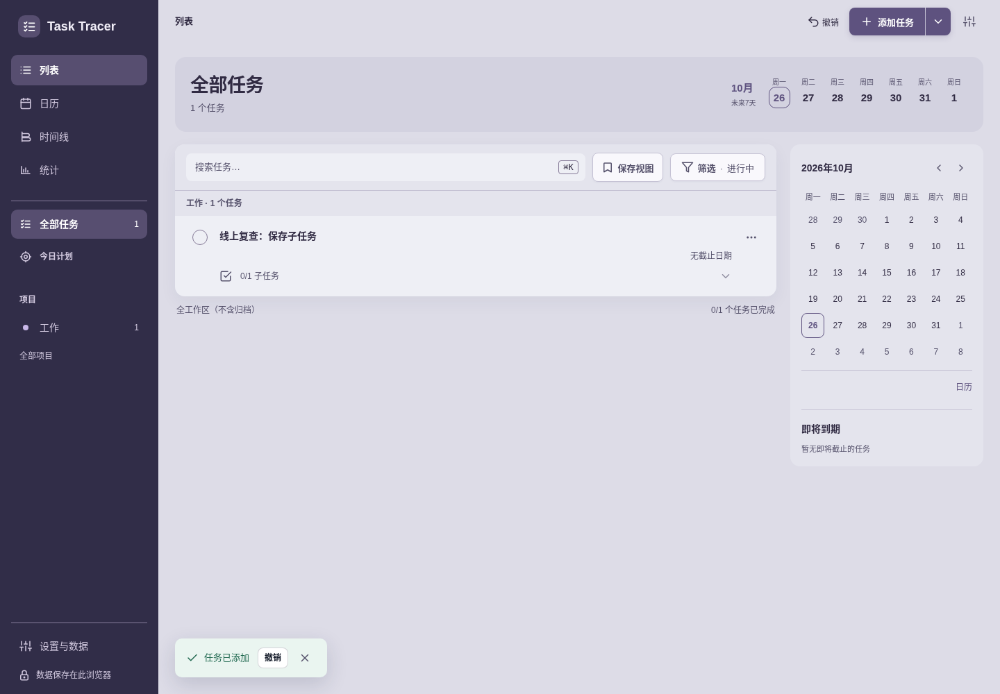

**12/13 手机外观与简洁帮助。**

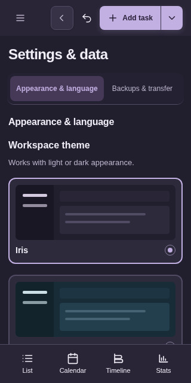

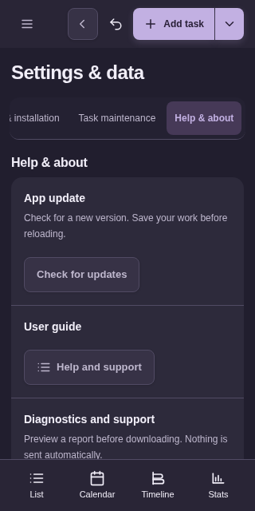

**30/34 矮桌面中段滚动与手机底部设置。**

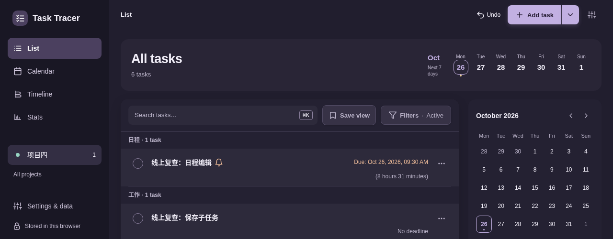

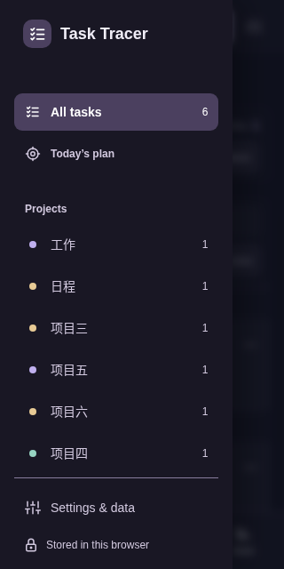

**42/47 紧凑时间线与 700 px 工具栏展开。**

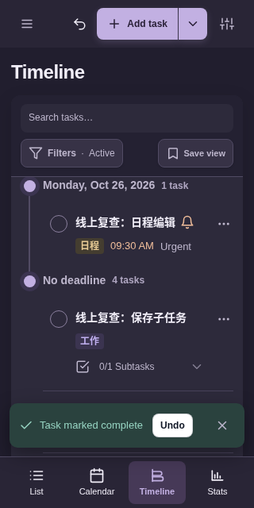

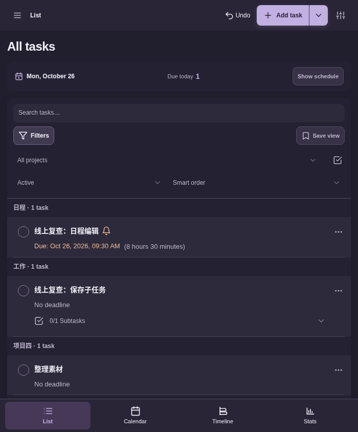

**53 筛选外保存，保留搜索并提供打开任务。**

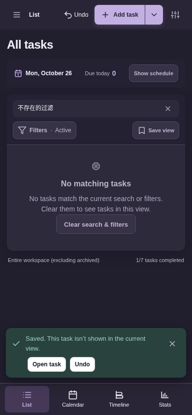

**61 日程保存后。** 短暂提示遮住日程下部；焦点类名和文档位置以原 JSON 为准，不凭这张图声称目标通过 hit-test。

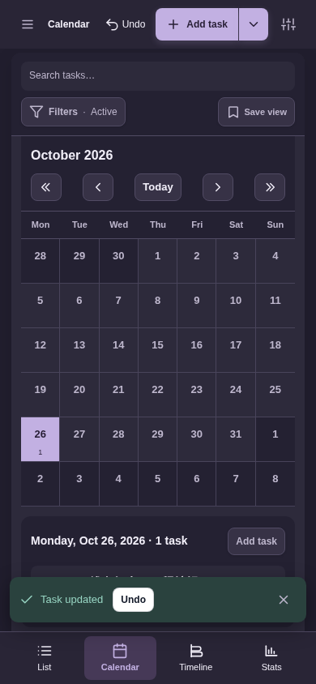

**63/67 完成历史回顾与实际备份下载。**

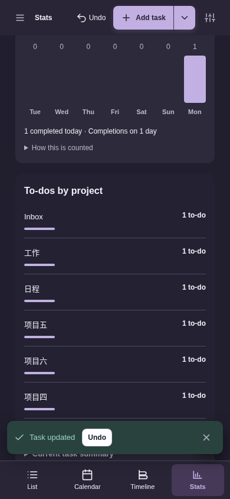

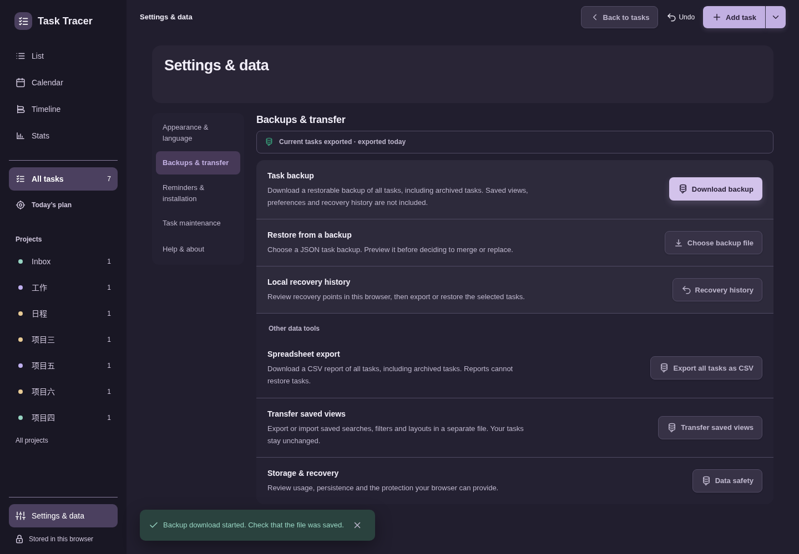

## 来源与限制

[原文件映射](original-files.json)记录 83 份原字节副本，其中包含 67 份观察、原生来源/会话报告、执行者派生结果、真实备份、原驱动及 11 张 PNG。[本目录清单](manifest.json)绑定这些文件与派生说明。原始绝对路径、日期和错误未重写；已冻结的上级本地清单保持不变，本子目录在其明确排除范围内。

这些记录覆盖一次 Chromium 桌面浏览器的视口模拟，不扩大为三引擎、实机软键盘/IME、读屏、离线更新或 OS 安装通知验证。下载校验和证明归档内容完整性，不等于实际重导入恢复、签名或真实性认证；域名 HTML 响应哈希也不等于 Vercel 后台 Git SHA 或远程 CI 证明。
