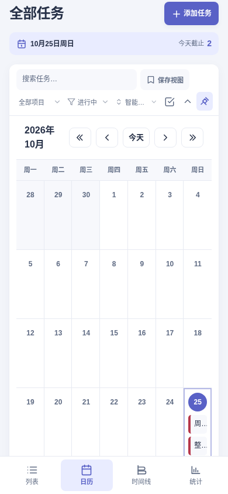
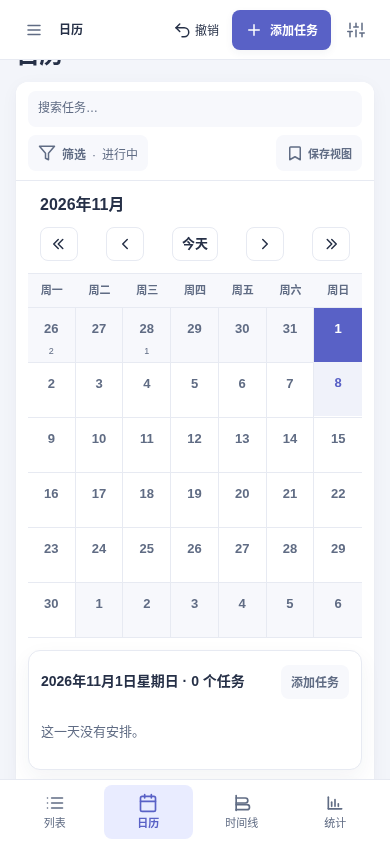

# 全站实际使用审查：4.11.0

先使用4.10.1，再沿真实操作路径逐项修改并复看画面。主要范围包括空白与已有任务工作区、快速添加与详情交接、编辑/完成/撤销、项目、保存视图、批量、搜索空结果、四视图、设置五分类、备份下载、导入预览、恢复历史、数据安全、通知与安装说明、帮助、命令面板和诊断。

| 实际问题 | 修复后的行为 |
| --- | --- |
| 每页底部常驻添加，长页中输入及反馈掉出屏幕 | 顶部统一入口，按需打开一次快速记录；反馈保持可见 |
| 设置是3207px长页，主题/语言又在顶栏重复 | 五个实际面板，偏好只在外观分类，顶部可返回任务 |
| 手机月历任务缩成单字，大格挤掉日程 | 紧凑月份与可读的选日日程，翻月后选择目标月内日期 |
| 统计沿用任务标题、排序/批量和日期索引 | 真实统计标题及适用工具，手机指标压缩、零数据说明明确 |
| 所有高级字段先铺开，子任务跨屏 | 常用字段及子任务在前，高级项按需展开，已有值不隐藏 |
| 清除条件后标签滞后、保存视图名字被挤掉 | 同步真实筛选摘要、就地清除空结果、名称优先 |
| 取消某日添加后普通新增继承旧日期 | 空白取消释放上下文；有草稿仍保留该日，详情交接保持预览值 |

## 手机画面对照

这些是浏览器实际截图，保留原始尺寸与当时内容。日期/任务不同属于各次合成工作区，不能当成数据迁移前后对比。

| 日历改造前 | 日历改造后 |
| --- | --- |
|  |  |

| 设置改造前 | 设置改造后 |
| --- | --- |
|  |  |

使用Linux Chromium、1440px桌面与390px/320px模拟视口，中英文、浅色与深色。完整过程截图和观察数据保留在本次工作区 `/workspace/design-research/task-tracer-whole-site-2026-10-25/`。这份记录描述实际亲用范围；真实设备及Safari不在本次范围。相关数据保护与发行验证单独记录在[发布记录](../../../releases/4.11.0.md)。
