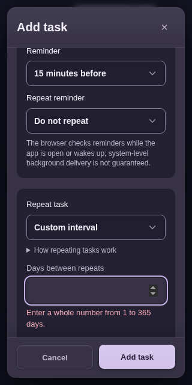
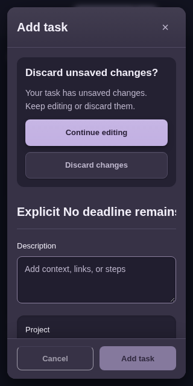

# 4.15.1 编辑与捕获修复复验（d70候选）

本目录只属于应用源码 **d70ce830caa7b35b034b9d213721d884fc207f1fa871124cfcc22517fe9d34c9** 与编辑工具 **805cc82…**。原4.15.0审查资料未改；root在本任务所有浏览器关闭后继续推进了其它确认按钮的源码，本结果不重标为之后的新源。

## 1. 原工具完整10组合

[原命令与起末身份](20261025T185759Z-cf0a2077/driver-summary.json)记录原 `tools/editor_safety_playwright.py --case all` 默认1280/390，**10/10通过、130.046秒、stderr0字节**。5项运行资产与10个传递本地helper起末15文件SHA完全相同。原stdout、stderr、来源快照、原JSON、浏览器事件及trace均保留。

旧date-roundtrip、empty-weekdays和subtask-delete六组合保持；新增missing-date和empty-custom-interval各两宽度，验证重复非法提交没有tasks/config/revision写入，raw安排、行内及待输入子任务均保留；真实invalid input获得焦点和aria-invalid，错误在操作栏之上且中心可命中；纠正后custom5天、60/15提醒及文本/子任务精确保存。切为不重复时空inactive间隔仍可保存。

## 2. 英文桌面与320px深色亲用

[手工原会话](manual/session.json)共50观察，正常CSP/动态；页面和动作错误为空、无整页横向溢出，已关闭。实际核对空日期及间隔空值、0、366、1.5均保持编辑器并聚焦相应输入，没有提前保存。0/366原JSON被核对，未把这两张PNG写成人工逐张看过。

上述六图均实际打开审读。真实下载备份由原完整性helper校验：2个任务，纠正后的custom5任务保留2032-05-06截止日期；显式勾无截止日期时，空日期仍可合法保存为无日期/不重复，并保留待输入子任务。详[执行者核对](review.json)。

## 3. 保存中状态的真实界面

使用原 `task_draft_playwright.hold_next_task_completion` 临时暂停真实已提交IndexedDB事务的完成回调，观察应用自身生成的保存中状态，**不插入假DOM或CSS**。因此是受控测试，不是实际慢磁盘延迟的声明。

两图均实际打开。状态可见且获得焦点，保存/取消/关闭按钮禁用；释放原回调后弹窗正常关闭。两份真实下载备份各1任务，待输入子任务与校验和正确。5运行资产与3个直接helper起末SHA相同，两个context、browser和server均关闭，见[原状态摘要](saving-status/summary.json)。

## 4. 证据边界

只把上述**8张PNG**记为本执行者人工审读；其他图是原工具或动作捕获。原10案例、50次观察、2个保存状态context是不同计数，未相加为测试数。均为Chromium154与模拟视口，不代填真实设备、原生IME/软键盘、系统通知或多引擎验收。

额外的aria-describedby语义脚本在root有意推进源码后，被启动前SHA守卫停止，未启动server/browser、未运行UI；[停止记录](description-semantics-preflight.json)明确为not_run，既不冒称通过，也不当作产品失败。按root指示不再扩大测试。全部活动浏览器、服务和本任务进程已结束。
