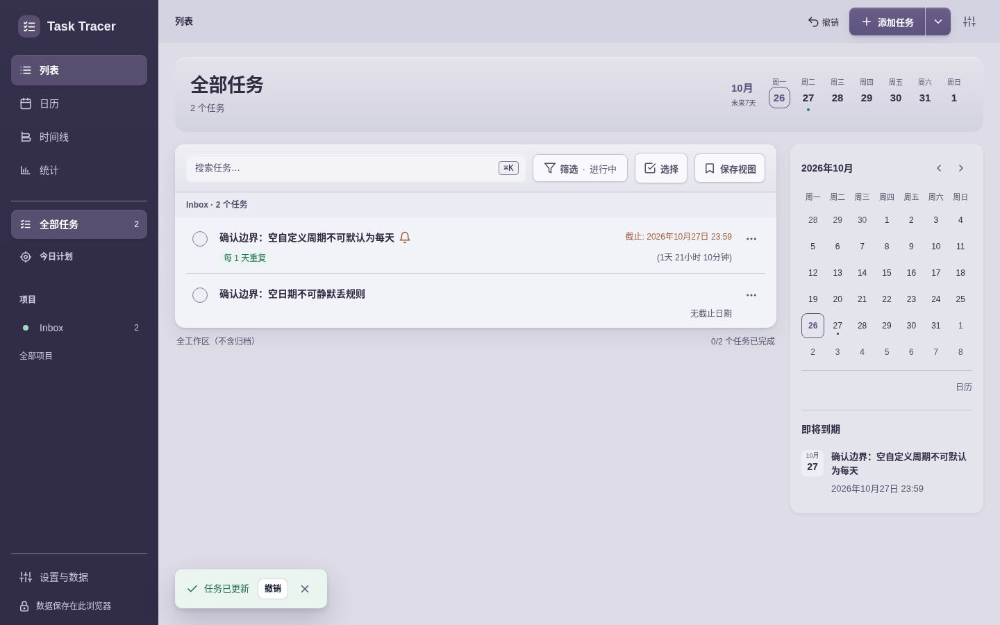

# 最终交付：编辑与捕获亲用审查

当前4.15.0基线 **bfb0a142…** 仍有两项P1表单验证缺口，不能凭上一轮材质验收当作最终整体验收。已把准确复现与修正建议交给root；本审查只读，不修改应用或工具。

正常部署CSP、正常动画、Chromium154，全新两份浏览器资料；63份中文桌面/390观察，加21份英文深色320×500观察，0页面/动作错误，整页无横向溢出。两会话、浏览器与server均已关闭。第一页首次载荷bfb后未reload；英文短高从隔离基线worktree读取，避免混入root正在实施的新源码。原来源、会话与逐步JSON保留，不能将观察数当作独立测试数。

## 逐步结论

|步骤|实际用途与健康结论|
|---|---|
|1|直接完整添加、无日期下提醒/重复说明可用。|
|2|**P1**：空日期仍保存并清掉规则；空自定义间隔仍保存成每天。|
|3|快速记录→完整表单保留名称、交付项目、优先标签和18:20。|
|4|删除A后保留C行内文字，主保存一并收纳尚未点＋的D，实际备份三条子任务准确。|
|5|继续编辑保留草稿；明确放弃描述更改不落库。确认块左右贴边是**P2**视觉细节。|
|6|390px编辑与滚动正常；完整保存后快速记录输入清空，不重复提交。|
|7|320×500英文深色长内容、焦点与待输入子任务可操作，英文自然日期解析正确。|
|8|实际下载四份任务备份并调用原完整性helper；中文3任务和英文2任务字段逐项核对。|

## P1：空日期静默清掉已选安排

实际动作：新建→明天→08:45→自定义5天→清空日期（仍未勾“无截止日期”）→保存。保存成功但变无日期，提醒变-1、重复变none。原始JSON有checkbox checkedfalse、date空、custom5和提醒15；真实下载文件也证明结果。

实际文件：[首份备份](task-tracer_backup_2026-10-25_18-46-49-132.json)。源码getFormDueFieldsForSave遇空日期直接clearDueFields。应在显式日期模式下先拒绝空/无效日期，保留字段、聚焦并原地提示；显式勾无日期才归一。

## P1：自定义5天被空输入改成每天

实际文件：[第二份备份](task-tracer_backup_2026-10-25_18-48-16-745.json)。空number没有required，Number空串变0再clamp为1。应在启用custom时明确要求1–365整数，禁用规则仍可不填写。

## P2：放弃提示的内边距

继续/放弃功能本身正确，问题来自taskForm改为padding0后动态prepend提示未获独立内边距。建议该块和保存状态使用明确的响应式承载。

## 保持的健康闭环

[中文最终备份](task-tracer_backup_2026-10-25_18-50-29-524.json)保留多行描述、交付/优先、27日18:20及确认B/修订C/待输入D，明确放弃的描述没有写入。[英文最终备份](mobile-dark-baseline/task-tracer_backup_2026-10-25_18-51-48-925.json)保留900字以上描述和待输入子任务；Final follow-up为27日14:30、Personal与review。

## 工具补例与证据边界

[机器报告](report.json)给出完整21张实际审读清单、八步健康、两P1/一P2与真实数据核对。其余PNG只是动作捕获，不写成逐张审读。短高保存后的toast临时盖住部分列表，因此不拿该帧证明整个长任务首屏可见。未进行真实手机、原生OS输入法/软键盘、通知或安装验收。

[外部补例patch](editor_safety.patch)只增加missing-date和empty-custom-interval，保留原6组合，默认成为10组合；包含无写入、原字段/行内/待输入保留、错误可见与焦点、纠正后精确规则、关闭重复后空inactive间隔仍可保存。已AST编译，**未执行**，root将在其新实现后应用/验证；详[test-patch-scope](test-patch-scope.json)。
