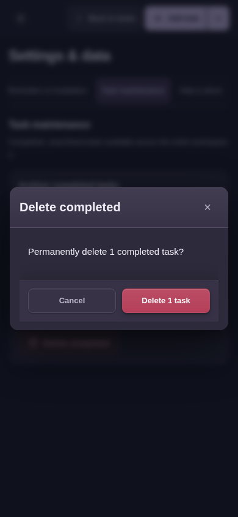
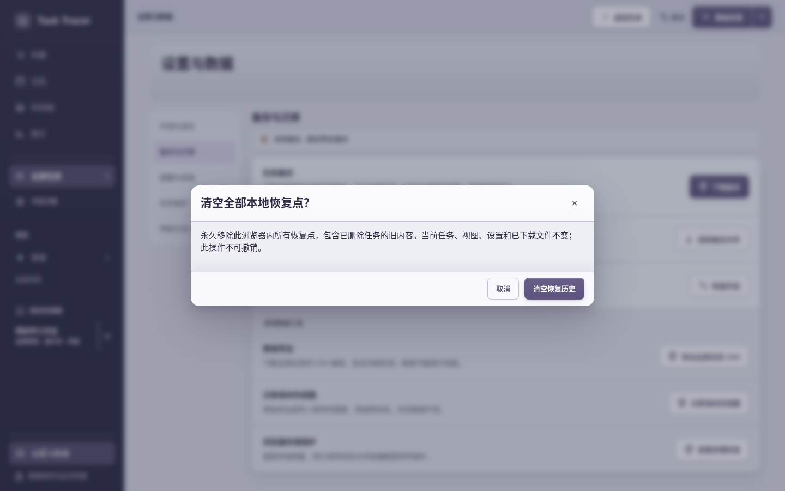

# 最终交付：设置与数据亲用审查

本材料属于本次新审查的 **4.15.0 / bfb** 基线，不冒充后续4.15.1最终验收。范围为五个设置分类、备份/合并/替换/恢复/CSV/视图迁移、维护、更新、帮助、诊断与平台能力说明。Chromium 154，新资料，正常部署CSP和动态效果，本地HTTP；没有请求OS通知或持久存储权限、没有进行真实安装。

[机器报告](report.json)与[42张实际审图名单](manual-review.json)保留语义核对和限制。两会话共148份观察，页面异常和整页横向溢出均未记录到；观察数量不是独立测试数量，未查看其余106张PNG。

首会话117观察访问primary的bfb，期间不reload；root同时修复primary，结束时文件已变为d70，因此不称该会话五资源冻结不变。补充会话31观察使用独立 `/workspace/task-tracer-final-baseline`，bfb五运行资源起末一致，完成前会话因驱动状态误判而没走完的两项。

## 发现

1. **SET-01 / P2：任务删除被写成永久删除。** “任务维护→删除已完成”确认写 `Permanently delete 1 completed task?`，实际执行4→3、Undo精确回4；恢复历史仍保留旧内容。建议任务删除说明可撤销，只有真正清空恢复历史保留永久措辞。对应 `messages.clearCompleted.confirm/confirmOne`；`batch.confirmDelete/confirmDeleteOne` 的同类措辞仅经源码核对，批量执行由工作区审查负责。

2. **SET-02 / P2：真正不可撤销的清空恢复历史仍是普通主按钮。** 该确认有正确的不可撤销范围说明，但紫色 `btn-primary` 与普通动作同权，而任务删除/替换使用危险色。建议复用既有危险样式，同时检查存储受限清历史入口；取消后tasks/config逐字不变。

两项已即时发给root，本代理没有修改应用或文案。没有在本负责范围发现P0/P1；这不代表整个产品没有P1。

## 步骤与健康结论

|步骤|实际路径与结论|证据|
|---|---|---|
|1|外观/语言和五分类桌面入口清楚；320/390英文深色可滚动，不遮固定操作栏|02、37、supplement20/21/24/27/28|
|2|空数据与空历史说明准确；无符合条件完成任务时维护动作禁用|03/04/08、supplement27|
|3|存储状态准确解释任务/恢复共用浏览器存储、配额与独立备份，未冒称获得持久权限|05、supplement29|
|4|通知拒绝后的开启方法和桌面/Android/iOS安装指引可达；未进行系统投递或安装|07/15/17、supplement24/25|
|5|主动检查更新明确返回已是4.15.0；帮助快捷键与按需说明可读，诊断预览后才下载|09/10/11/12、实际diagnostics JSON、supplement22|
|6|真实3任务备份及4任务替换前快照校验通过；预览不改tasks/config，快照下载后仍未替换，第二次才精确还原3任务|26/28/29/32/33/44/45；before/after JSON、实际backup/pre-import文件|
|7|同名策略可保留两份/跳过/替换，全跳过变0新增并禁用提交；真实合并4→7，Undo精确回4|29/32/80；after-real-merge/after-undo-merge JSON|
|8|恢复初始未勾禁用，换恢复点重置勾选；真实导出恢复点4任务并精确恢复3→4|49/53；actual recovery-backup和after-recovery-four JSON|
|9|维护归档/删除均先确认，取消无写入；归档后4条中1归档，Undo还原；删除1条后3条，Undo精确回4|60/61/70/73；after-archive/after-delete/before-real-merge JSON。删除措辞见SET-01|
|10|真实CSV含全部4任务，视图JSON独立导出含1视图且校验正确；重复预览0新增1跳过无写入|84/85/94/98、实际CSV/视图文件|
|11|隔离补充资料实际新增导入1视图，任务逐字不变；清历史取消保留所有tasks/config|supplement09/14与前后JSON。危险样式见SET-02|
|12|视图删除有具名确认，说明只删快捷视图不删任务，且使用危险色|103、final-records JSON|

## 驱动错误与限制

首会话保留12个操作错误：先在归档确认尚未提交时尝试Undo/背景维护按钮；后在手机导航抽屉仍打开时尝试背景设置入口，导致后续一串依赖动作未执行。这些遮挡/不可用控件被正确拦截，不是页面异常，不抹成通过。最后的新增视图导入与清历史取消在独立补充会话实际完成；补充31观察操作错误为零。曾有两次查看图片时写错步号，已按真实文件更正，不作为产品问题。

`checkVisibility()`、隐藏表单缓存值和背景控件列表不能证明当前可操作，实际页面/动作/截图及存库结果才是证据。没有把当前模拟视口当真实手机、当前CSP/语义检查当完整WCAG/读屏认证，也没有多引擎、真实系统通知、PWA安装或大规模性能通过结论。初次响应哈希不等于每一观察都重新下载HTML。
