# 4.15.0 材质改进：本地审查与回归

本清单只绑定本轮本地材料，**排除 `release/`、`canonical/`、`production/`、`production-browser/`**；这些子目录可由发布流程另行新增，不属于本地文件数量或目录快照。原件与来源 SHA 见 [original-files.json](original-files.json)，派生统计见 [local-summary.json](local-summary.json)，精选图片的审读执行者见 [selected-images.json](selected-images.json)，本地文件清单见 [manifest.json](manifest.json)。本页不声明上线完成。

## 1. 来源与改动边界

本轮重新访问的4.14.0线上基线为 `e5741f88…`；首次材质候选为 `673c2c81…`，正常材质审查候选为 `3aa235f5…`，最终4.15.0源码为 `bfb0a142fb4c813e17af52267062c6faa63a7a56bd5e41feb335728c1999e9c5`，资源版本4.44。

[第一份原范围证明](scope-proof.json)记录：基线至3aa，四个script块和style外HTML在仅归一化版本后相同，任务DOM与持久化逻辑未改。[最终原范围证明](scope-proof-final.json)记录：3aa至bfb仅增加强制系统色原生select箭头规则，并将桌面日期／时间列从 `1.35fr 1fr` 改为 `1.1fr 1fr`；script逐字相同。中间d442未作为受测最终源。以下3aa结果均保留原身份，不改标为bfb重跑。

## 2. 本轮基线：保留健康结构，改善表面层级

桌面原会话14观察，root实际打开7图；手机原会话47动作、9图全部打开，接受8图。手机01新建toast盖住末行，09已安静重拍；原JSON与0动作空会话仍保留。健康边界包括稳定添加入口、连续任务列表、原生控件、聚焦轮廓、固定表单操作区和浮起菜单，不把这些改成装饰卡片。

桌面列表的内容面／画布分离和深色表单的层级，是本轮调整依据：

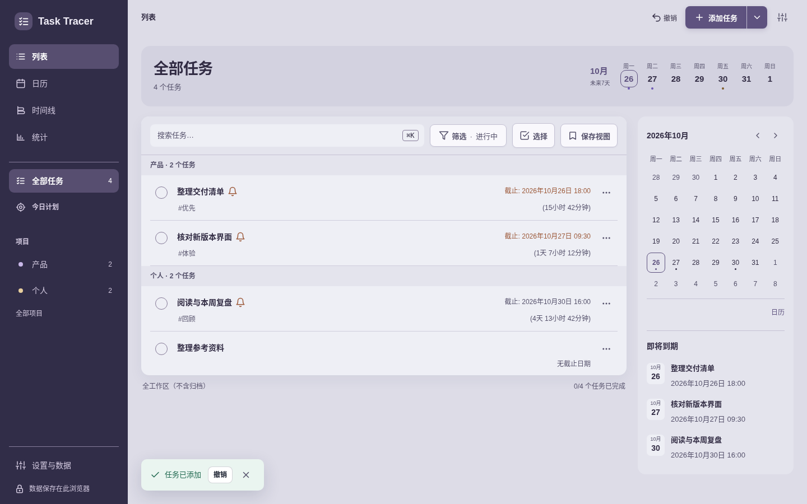

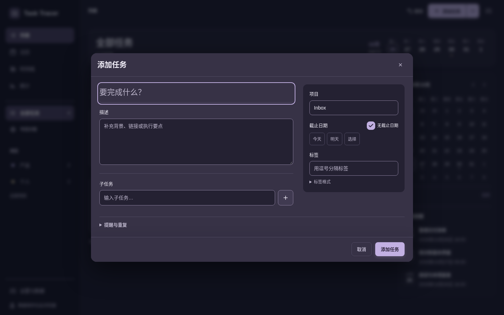

320浅色表单靠较重描边区分输入和属性面；手机设置中的普通边缘与选中主题权重也接近：

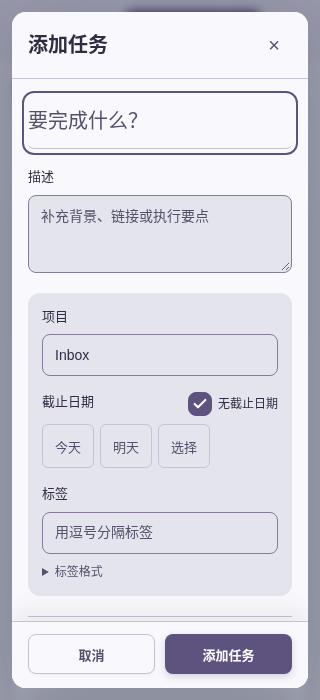

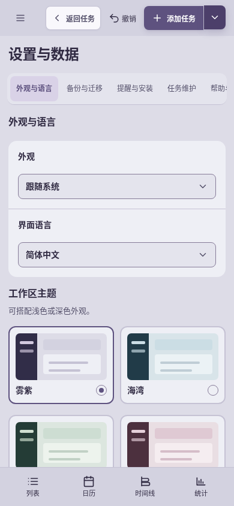

详见 [桌面原审读名单](before/desktop/review.json) 与 [手机原报告](before/mobile/report.json)。首次673c候选root实际看8图，搜索框描边偏重后收敛；[原审读记录](preliminary/candidate-1/review.json)不改写为最终结果。

## 3. 3aa正常材质候选：实际编辑、列表与日期视图

root会话34观察，页面／动作错误为空，整页没有横向溢出；root只实际打开原名单中的8图，本地精选6图。真实创建并下载备份5任务，待添加子任务、日期时间和标签经原审查核对，备份校验通过；依据是[原review](candidate-final/review.json)，不是只看关闭表单的缓存值。

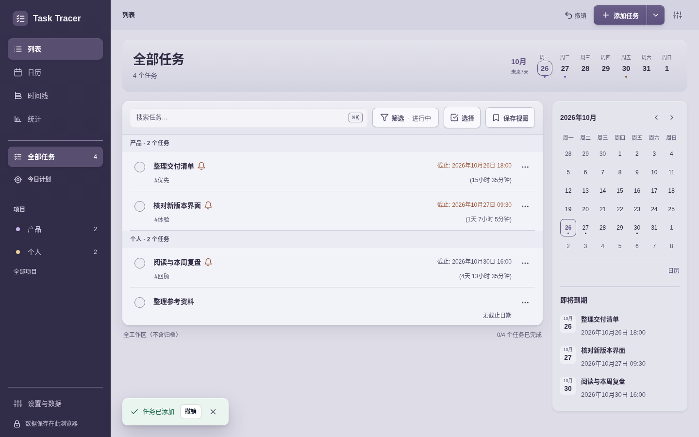

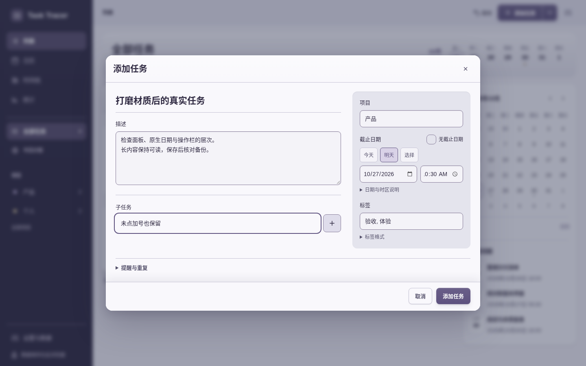

上图正常编辑与待保存子任务有效，同时暴露了桌面原生时间首位裁切；该视觉问题进入bfb收尾修正，见第6步。

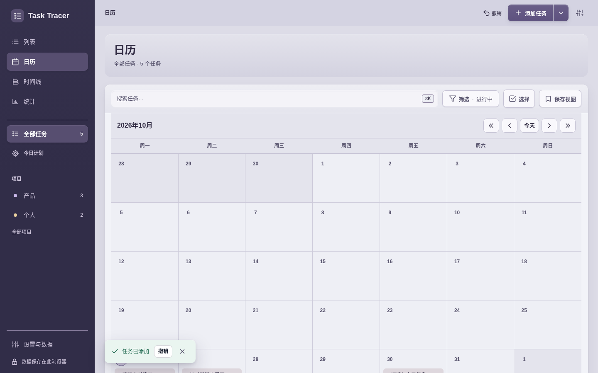

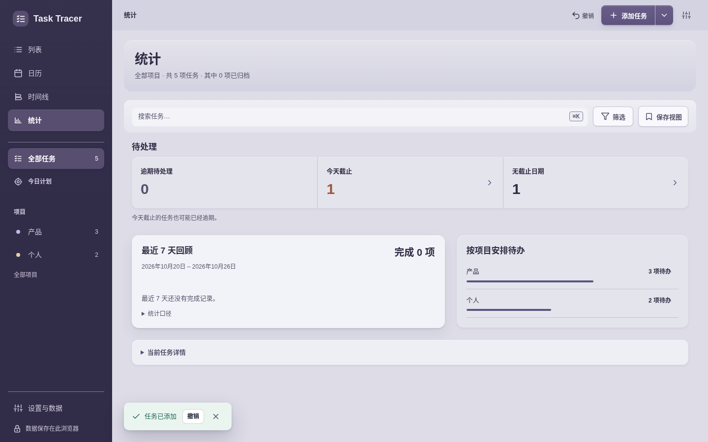

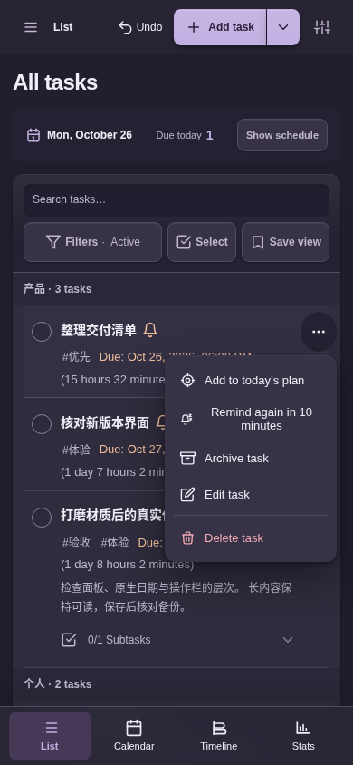

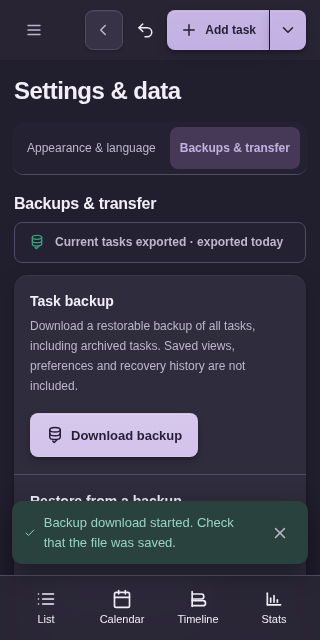

## 4. 3aa手机四主题／明暗材质

[原手机报告](mobile-final/report.json)：390×844的四主题×明暗×列表／编辑器16图，另有320×500短高表单、外观、菜单与统计4图。执行代理逐张打开全部20图；89动作、3个UI任务前后逐字段相同，页面／动作错误为空，正常部署CSP与动画，本地HTTP。这里精选8图，不能据此声称root又看完20图。

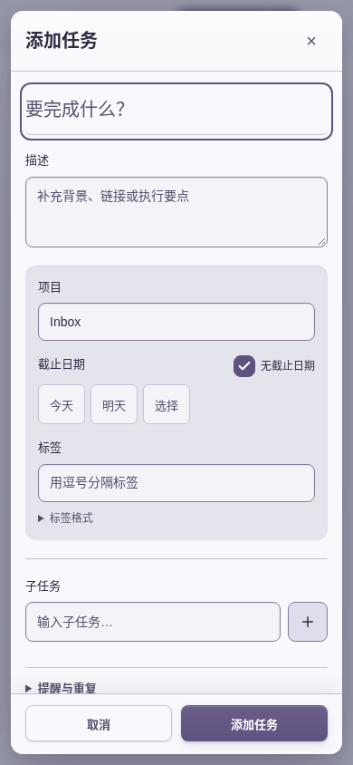

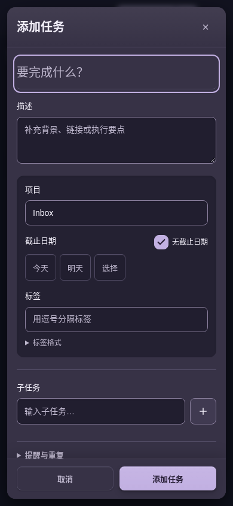

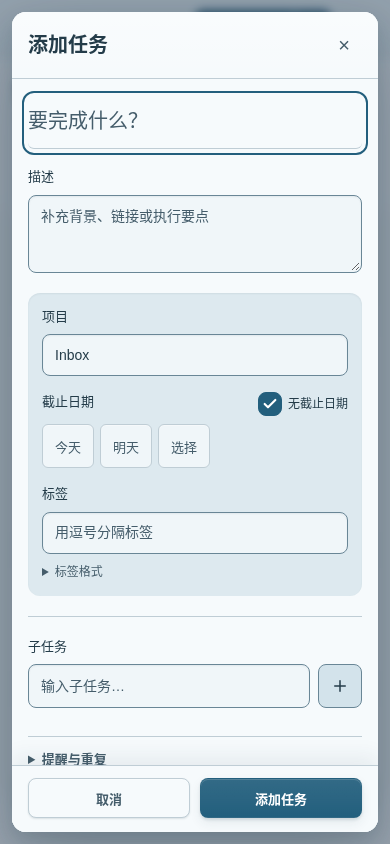

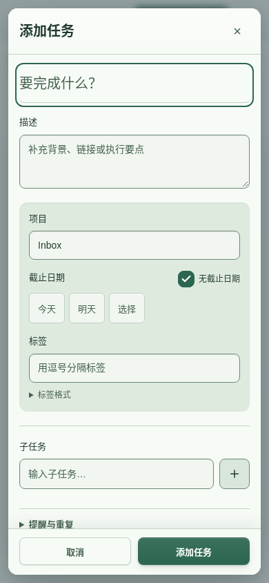

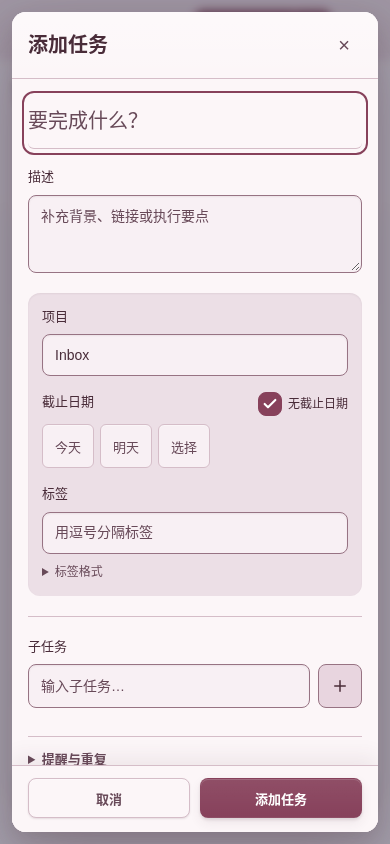

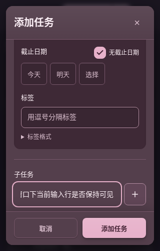

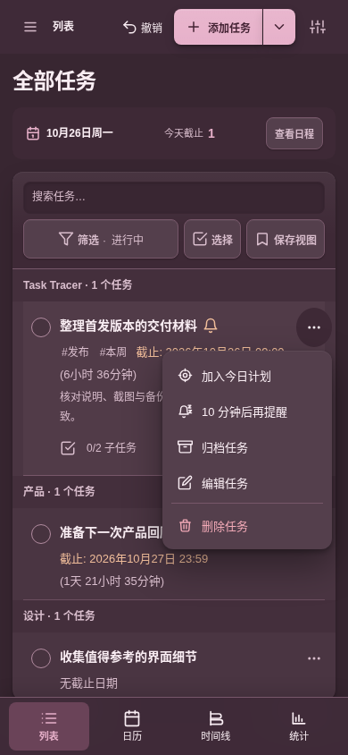

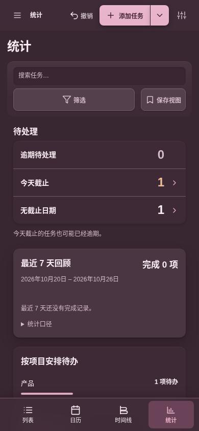

外观图库原18图是Tab后自然滚入卡片的画面，不据此声称页标题也在视口中。RGB不同支持表面分层，不等同于WCAG对比度结论。

## 5. 材质回退：保留视觉问题与修复后的独立结果

[原3aa检查](mobile-final/material-check/report.json)运行断言通过，4张图实际审读后仍发现强制颜色白底上的自定义淡箭头（原记录1.758:1），因此保留 `visual_followup_required`，没有改写为全面通过：

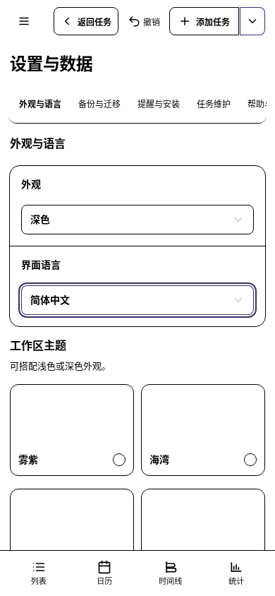

[bfb独立复查](mobile-final/material-check-final/report.json)以真实CDP媒体偏好检查4状态：减少透明／动态、强制颜色编辑器、系统select箭头、恢复正常主题；执行代理实际打开4图。两个select强制色时 `appearance:auto` 且无SVG，恢复正常主题后原主题SVG逐字恢复。1个真实UI任务前后相同，页面／运行错误为空，浏览器／服务器关闭。

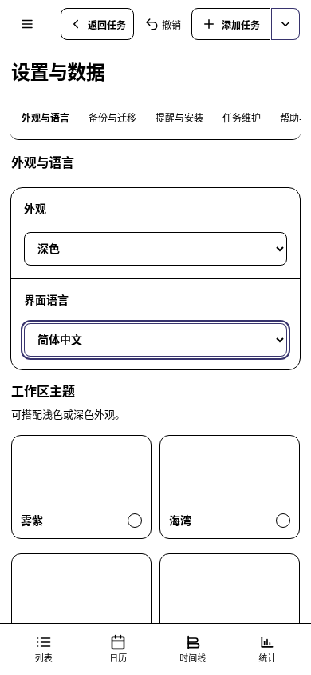

系统箭头的可见性由截图与原生样式证明，没有虚填浏览器原生箭头的像素对比度。这是Chromium模拟媒体检查，不能替代实际OS辅助功能验收。

## 6. bfb桌面收尾：完整原生时间与真实保存

[最终root审读记录](final-bfb/review.json)：16观察，root实际看4图，页面／动作错误为空且整页无横向溢出，浏览器关闭。日期128.84px、时间117.16px；实际图中的 `10/27/2026` 与 `10:30 AM` 完整。真实备份1任务、待添加子任务、2026-10-27 10:30／Asia/Shanghai及校验均通过原root核对。

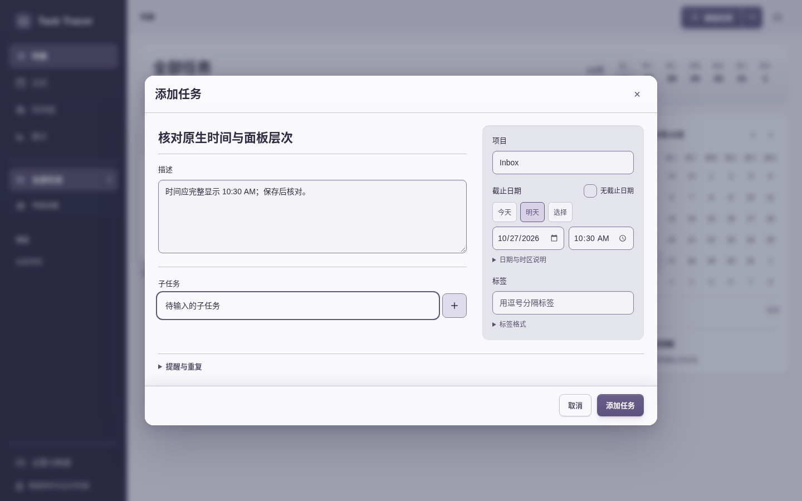

## 7. 原程序回归及失败链

|阶段／程序|实际结果|范围|
|---|---|---|
|3aa editor＋settings|6例＋4例通过；60.216s／24.879s|原正常CSP、正常动画；editor1280／390，settings1440／390；人工仅看14图中的6图|
|3aa accessibility/i18n|exit0，132.801s，98状态观察＋12checkbox观察|原1280默认动画、390减少动态；`--skip-scaled`，不是完整无障碍认证|
|3aa craft首次|exit1，70.547s|原helper只期望2个子任务，实际正确保存第3个pending子任务；原失败报告／stderr不抹除|
|3aa完整smoke|exit0，101.375s|该原完整程序通过；不标为bfb重跑|
|bfb craft全部6原case|exit0，82.113s|40个主题表面／axe检查观察；只给helper增加第3个精确期望值，其余断言不变|
|bfb editor6例|exit0，50.856s|1280／390，正常CSP与动画；settings未再次运行|

[3aa editor／settings原汇总](regression/editor-settings/20261025T182354Z-dd28bd59/summary.json)、[a11y原命令报告](regression/a11y/report.json)、[原theme失败与smoke通过](regression/themes-smoke/5ae66dd1-57d8-475b-90fa-2cdfbc6856e3/report.json)、[bfb theme原报告](regression/themes-smoke/ba73433b-7fc1-439b-9924-f40dce02e566/report.json)、[bfb editor原报告](regression/editor-settings/final-bfb/20261025T183232Z-de6c8f09/driver-summary.json)保留命令、原日志、起末指纹和清理状态。外部包装只选择原部署头handler、把表达式等待编译成函数谓词，未绕过CSP／修改超时或原数据断言。

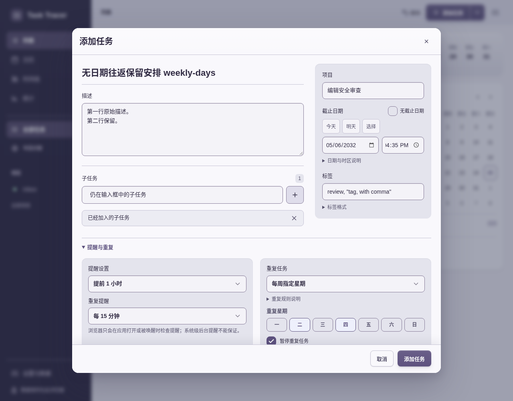

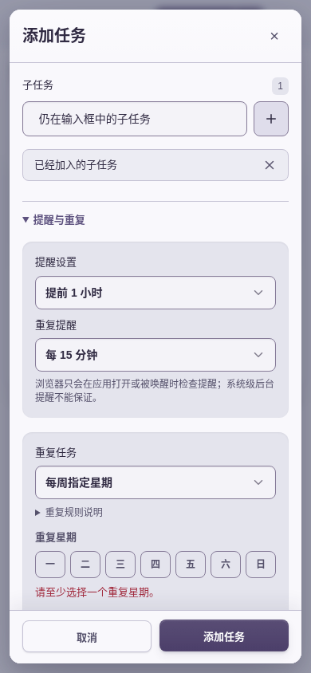

最终公开中英列表／添加面板4图的原采集信息另见 [bfb公开截图索引](public-screenshots/final-bfb/final-images.json)。其中 `screenshots/` 以原仓库为路径基准；本地归档只保留这组采集元数据，不重复复制4张发行PNG。前一组3aa元数据仍在上一层，身份不变。

## 8. 可复核结论与限制

本轮范围支持接受最终bfb材质修订：正常内容面层级、四主题明暗、短高聚焦、强制色回退与桌面原生时间均有对应阶段证据；已列原回归给出数据保护范围。原失败、视觉followup和旧候选身份同时保留，不能把观察数量相加称为测试总数。

所有浏览器证据来自Chromium154模拟视口；未声称多引擎、真实软键盘／IME、读屏、OS安装／通知、大规模性能或WCAG完整符合。基线为真实域名正常TLS；候选为本地HTTP部署CSP，二者分开。关闭或隐藏表单的字段缓存、`checkVisibility`、容器rect本身均不等同于视口内可见或命中检查。初次响应SHA绑定来源，不代表每帧重新抓取HTML。

原报告内可能引用未选PNG、trace或完整源码快照；本地有意不复制这些大文件，只保留必要JSON／字段／日志、runner、原指纹清单和23张精选PNG。原Markdown以 `.md.txt` 保持字节，其内部链接按原证据目录解释。本地清单不证明远程CI、Vercel后台GitSHA或部署已完成，后续发布资料属于排除的独立子目录。
