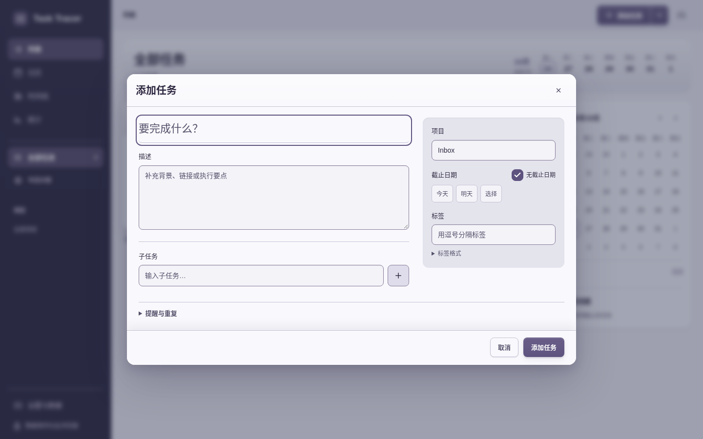
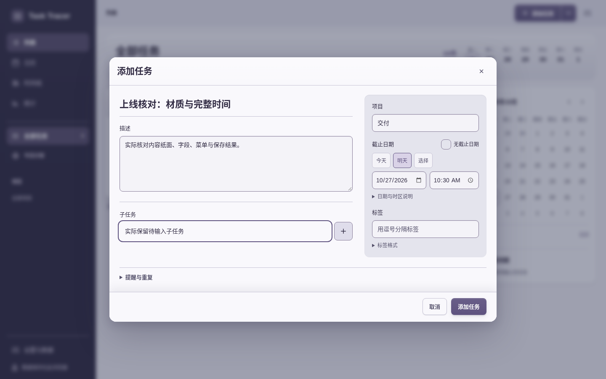
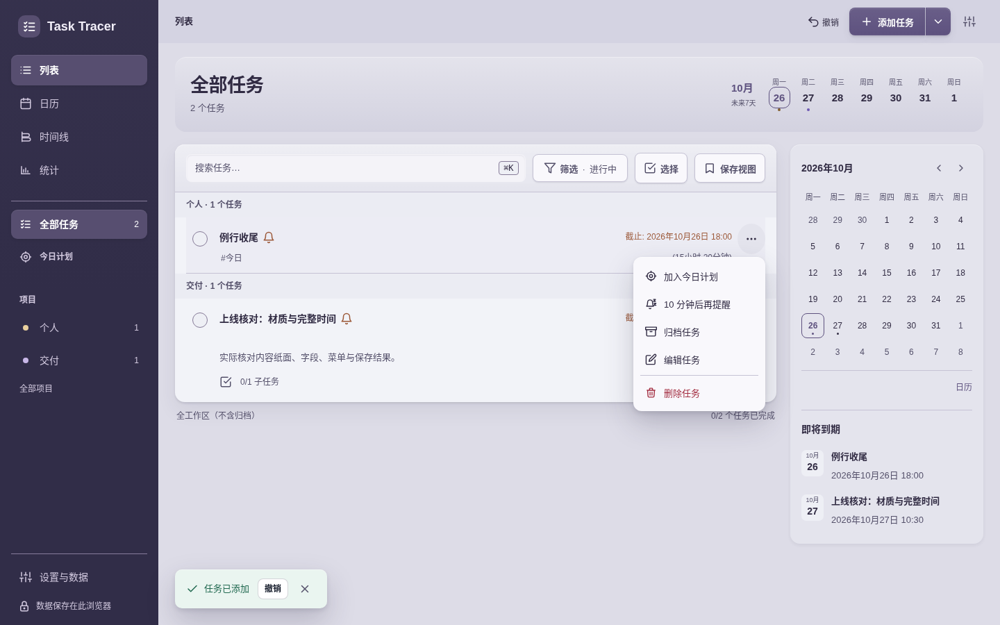
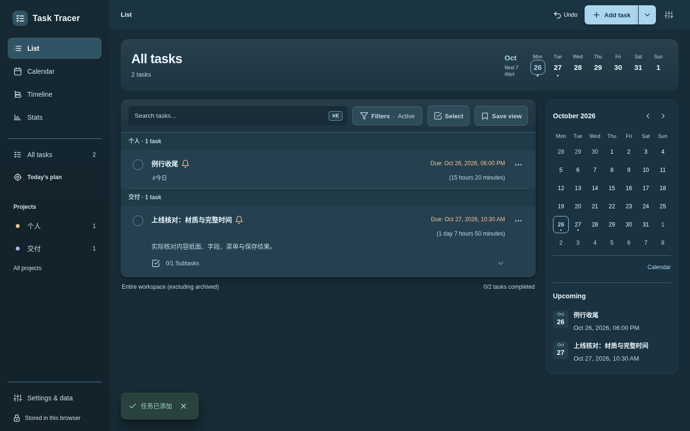
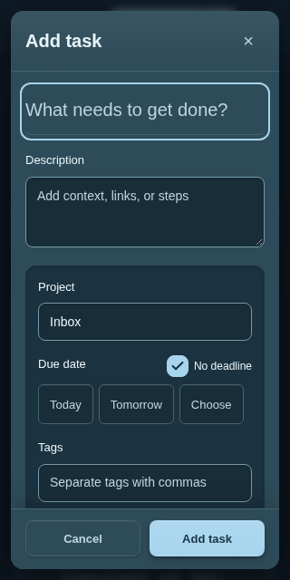
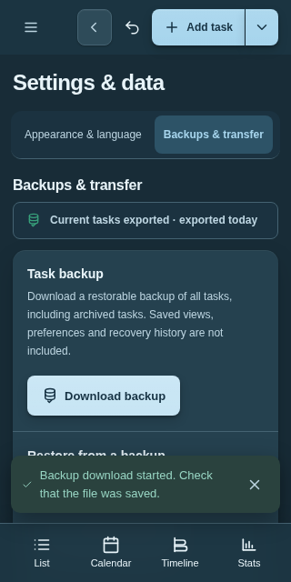
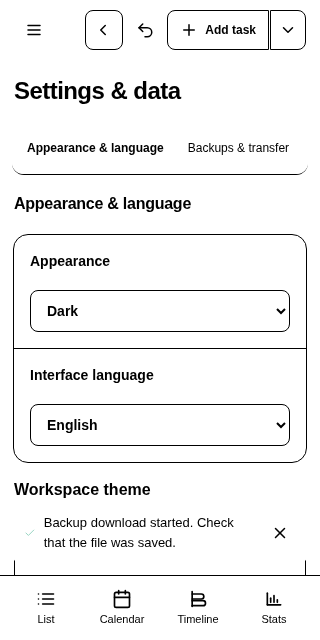
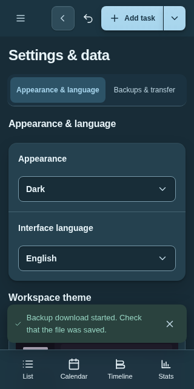

# 4.15.0 线上浏览器验收

本子目录只归档本次 `https://todo.muquew.com/` 的线上实际操作，不修改上层已冻结的本地清单。原件来源、字节及SHA见 [original-files.json](original-files.json)，派生复核见 [archive-summary.json](archive-summary.json)，本子目录文件清单见 [manifest.json](manifest.json)。

[初次响应](source.json) HTTP200，HTML SHA为 `bfb0a142fb4c813e17af52267062c6faa63a7a56bd5e41feb335728c1999e9c5`；新Chromium154.0.8037.57资料，正常TLS及CSP（`bypassCSP:false`）。[会话](session.json)已关闭，29份连续观察均为该来源，页面／动作错误为空，`docWidth ≤ viewport.w`。实际分布：320×640：8观察、390×844：2观察、1440×900：19观察。初始动画正常，第28步模拟强制颜色并减少动态，第29步恢复正常媒体偏好。

## 实际步骤与精选画面

1. 01–09：打开完整任务面板，录入说明、明日10:30、项目与待输入子任务后保存。原生日期／时间完整可读。

2. 10–14：快速记录第二任务，打开并关闭不透明任务菜单。

3. 15–23：切换英语、深色与海湾主题；查看手机列表及390／320编辑器后返回。

4. 24–26：从数据页真实下载 [JSON备份](task-tracer_backup_2026-10-25_18-39-11-667.json)。原root使用原checksum helper核对通过，实际2任务：`上线核对：材质与完整时间`为2026-10-27 10:30／Asia/Shanghai，保留子任务“实际保留待输入子任务”；`例行收尾`为2026-10-26 18:00、项目“个人”、标签“今日”。备份数组按自身顺序保存，不将数组首项等同于第一创建任务。归档检查文件SHA与字段一致，没有再次执行浏览器或checksum helper。

5. 27–29：查看原生偏好select，模拟强制颜色后使用系统箭头；恢复正常主题后SVG箭头返回。可见的language select原DOM记录为 `backgroundImage:none → url(...)`；没有给原生箭头编造像素对比度。

## 结论与边界

[root原派生核对](root-verification.json)列明实际打开的8张PNG、备份核对及提交上下文；只有这8张图声明root人工审读。归档编辑者仅复制原件和复核记录，没有代替root审图。29观察覆盖上述流程，不是29个独立测试或29次HTTP抓取；来源SHA来自初次导航。提交字段不等同于Vercel后台GitSHA或远程CI证明。

原JSON会保留关闭表单／隐藏表面的字段缓存，不能据此宣称屏幕可见或数据丢失；`checkVisibility`也不是视口命中检查。此会话仅Chromium模拟视口，未验证多引擎、真实软键盘／IME／读屏、OS通知安装、全套WCAG、导入恢复或离线。原UTC25时间与上海26用户日期均保持原样。上层本地清单继续排除此发布子目录。
