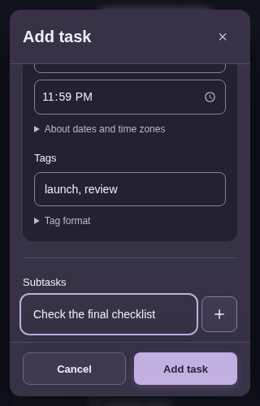
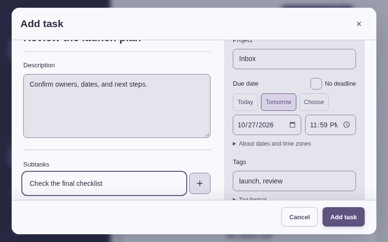

# 4.14.0 主动改进：本地审查与验证

本目录保留本轮新审查发现、修复及本地验证。它不证明 GitHub、Vercel 或真实域名的发布状态。`release/`、`canonical/`、`production/`、`production-browser/` 由独立收据维护，明确排除于[本地文件清单](manifest.json)；清单不声称随后整个父目录只有这些文件。

[机器摘要](local-summary.json)、[原文件来源与 SHA-256](original-files.json)、[24 张精选图](selected-images.json)可复核。原报告、字段、日志、失败状态和源码哈希逐字保留。原 Markdown 叙述以 `.md.txt` 保存，内部未入选截图或原绝对路径保持原样，不能当成本目录完整文件集合。没有复制 trace ZIP 或整套源码快照，也没有借用上一轮截图。

## 源码阶段

| 身份 | `index.html` SHA-256 | 对应证据 |
|---|---|---|
| 本轮基线，APP 4.13.2 | `79693a476cd75b46df78b71890f9a3a89aef2eb08aa8a2af701c07c4b801c1ad` | 新表单、编辑、工作区及设置审查 |
| 首个整合候选 | `8fae3e3ec52666741213dfa92e7672297dbd854128d9952e3529cf19b6415b0e` | 工作区亲用、设置 4 组合；编辑器 6 功能组合通过，但手机错误提示仍有遮挡 |
| 原回归与人工表单阶段 | `765c354ba6e0c2eb00c01e7dc0bc9e841af11a1fe7eaa6e66537f9058a38f672` | 编辑器 6 组合、原数据 7 程序、草稿/捕获、原 smoke/a11y/calendar/foreign、18 步人工表单及公用截图 |
| 最终表单候选 | `e5741f889cb3c8e74d7f5885f36d5030922afa948b397579b759839ffd827f48` | 最后编辑器 6 组合、12 个表单 axe/几何状态与实际保存 |

[最终范围对照](scope/final-ui-scope.json)记录 765→e574 仅一条表单 body 的 `padding:0` 规则与一个 resize 后揭示当前编辑控件的监听；精确去掉该监听后，其余 scripts 与 765 逐字相同。较早报告保留原身份，没有改写为 e574 重跑。[公用四图元数据](public-screenshots/final-images.json)仍明确绑定 765；未在这里重复复制公用 PNG。

## 步骤、问题与实际结论

| 步骤 | 实际发现与修复 | 证据及健康边界 |
|---|---|---|
| 1. 完整添加面板 | 基线桌面空白/分区失衡、移动纵向堆叠；调整为内容与属性分区、直接可见备注/标签、日期预设与按需提醒重复 | 基线 [02](before/forms/02-new-task-desktop.png)、[04](before/forms/04-advanced-desktop.png)、[20](before/forms/20-basic-mobile-320.png)；765 人工 [桌面](forms-765/14-filled-desktop-dark.png)、[320 初屏](forms-765/07-final-editor-dark-320.png) |
| 2. E1 日期草稿 | 基线来回切换无截止日期会重置日期、时间及重复草稿；修复为当前编辑会话保留原始安排 | [原三项发现](before/editing/findings.json)、[E1 图](before/editing/05-schedule-after-toggle-top.png)、原 `schedule-toggle-db.json`。最终 date-roundtrip 两宽度通过，包括自定义导入值与其它字段保持 |
| 3. E2 空星期 | 基线清空所有星期仍静默保存为周一三五；修复为明确验证、保留草稿且不写库 | [原错误保存](before/editing/08-weekdays-none-saved-mwf.png)、原 before DOM/保存记录。最终桌面/390 错误提示均在 footer 上方且中心可命中；空选不写入，纠正为周四后保存 |
| 4. E3 子任务 | 基线编辑后项再删除前项会丢掉草稿，并发生一次 `Cannot set properties of undefined` | [原图](before/editing/10-subtask-c-edit-after-delete-a.png)、[原 page error](before/editing/page-errors.json)、前后 DOM/保存记录。修复按幸存子任务身份保留文字、ID、完成状态与有效焦点，最终两宽度通过 |
| 5. 工作区 | 窄屏批量工具挤走任务上下文，统计三列小字碎行；改为直接选择入口、紧凑操作条/弹出更多，以及窄屏统计行 | before [批量](before/workspace/12-small-mobile-batch-more.png)/[统计](before/workspace/14-small-mobile-stats.png)，8fa after [选择上下文](workspace-8fa/03-320-selection-context.png)/[统计行](workspace-8fa/06-320-stats-rows.png)。[原报告](workspace-8fa/report.original.md.txt)/[观察](workspace-8fa/observations.json)另保留真实移动与完整 Undo、搜索裁剪、下钻返回及菜单命中记录 |
| 6. 设置与恢复 | 明确 native 合并/替换 radio；恢复确认先可见且未勾禁用；外观/语言先于图库；维护标题先于数量；统一存储保护名称 | before [模式](before/settings/17-tasks-import-default-en-390.png)/[恢复](before/settings/20-recovery-history-en-390.png)/[外观](before/settings/08-appearance-zh-320-top.png)/[维护](before/settings/24-maintenance-after-undo-en-390.png)。after [两种模式](settings-flow/corrected-run/390-import-modes-and-settings/01-replace-default.png)/[确认与禁用](settings-flow/corrected-run/390-recovery-consent/01-unchecked-disabled.png)；[4/4 原报告](settings-flow/corrected-run/report.json)验证 3→2/5 数量、双向切换、全 tasks/config 无写预览、精确恢复/旧状态 checkpoint 和新编辑器无 ARIA 泄漏 |
| 7. 编辑安全最终复核 | 1280/390 × 日期往返、空星期、删除前项保留后项编辑，共 6 组合通过 | [e574 原结果](editor-safety/20261025T175401Z-chromium-f512cc8e/results.json)、[最终范围与几何](editor-safety/final-summary.json)。正常 CSP/动画，page error 为空；全部字段/DOM 副本保留，仅精选 3 图 |
| 8. 原数据回归 | 原 recovery、recovery_management、craft_import_summary、import_conflicts、import_preview_concurrency、imported_text_edit、imported_reminder_edit 共 7 程序，全部首次 exit 0，158.395 秒 | [汇总](regression/import-recovery/summary.json)及各原命令/日志。每项 5 资产 bytes/hash 起末同 765；原 CLI Static HTTP 未附部署 CSP，原运动设置未改，不能扩大为正常 CSP 亲用 |
| 9. 草稿与捕获 | 6 个唯一程序、7 次调用；5 项首轮通过，task_draft 原空星期契约失败后，只适配 `check_weekday_recovery` 并完整重跑通过 | [lane 原汇总](regression/draft-capture/lane-summary.json)、[函数范围](regression/draft-capture/weekday-adapter-scope.json)、原两次 report/stdout/stderr。保留从拒绝空星期到明确选择周四的验证；pending 14/14，context/direct 各三宽度观测，不能与程序数相加 |
| 10. 原基础回归 | smoke、a11y、calendar focus/timeline、foreign wall-time 四程序均 exit 0 | [765 原报告](regression/root-765/report.json)和四份原日志。分别 111.307/107.405/24.708/17.909 秒；a11y 为 98 状态观测且 `--skip-scaled`，不是完整 WCAG 或读屏认证。日历原生目录含旧版本名，但[原结果](regression/root-765/calendar-native/20261025T175054Z-c50e1c68/report.json)自身绑定 765 |
| 11. 最后表单几何与保存 | 移除手机双重 padding，缩至 500px 高度后揭示当前子任务输入；320/390/800 三宽度各新表单、短高度焦点、空星期、保存后，共 12 状态通过 | [e574 原报告](final-form/8e482985-7152-4903-a410-017e1d46a75a/report.json)、原 runner、12 份状态 JSON 和 3 份实际保存记录。使用原 axe 严重级别/WCAG tags、accessibility baseline/layout，另加 resize/focus 中心命中、空星期无写入与纠正周四后保存 |

## 最后视觉与焦点

765 人工流程保留 18 份观察和[真实备份](forms-765/task-tracer_backup_2026-10-25_17-49-44-636.json)，含一个任务、子任务、标签及日期。[13 的 500px 高度原图](forms-765/13-short-height-editor.png)中当前输入行没有完整显示，不能当作最终可用性通过；该问题与双重 padding 经最后窄改处理。

最后编辑专项的[桌面星期错误](editor-safety/20261025T175401Z-chromium-f512cc8e/1280-empty-weekdays/invalid-weekdays-feedback.png)、[390 星期错误](editor-safety/20261025T175401Z-chromium-f512cc8e/390-empty-weekdays/invalid-weekdays-feedback.png)和[E3 编辑保留](editor-safety/20261025T175401Z-chromium-f512cc8e/390-subtask-delete/editing-preserved-after-delete.png)均为 e574 原图。错误到 footer 分别留约 14.11/12.14px，中心命中由原 JSON 断言，未只凭截图猜测。

## 保留的失败与限制

- 8fa 编辑器曾有 6 功能组合通过，但 390 星期错误部分落在 sticky footer 后，见[当时复核](editor-safety/candidate-8fae3e3e-review.json)。之后 765 的六组合与几何通过、e574 又独立跑六组合；三个阶段未互相改名。
- 设置首轮[原报告](settings-flow/first-run/report.json)中两项恢复通过，两个导入/设置组合在新工具 JS 表达式多余括号处停止。修正工具后独立 4/4 通过；原失败没有变成产品缺陷或改为 passed。
- 草稿首轮原报告仍为失败，旧 M/W/F 回退假设与新增明确星期验证冲突。仅目标函数适配后重跑整个草稿程序，五个已通过的原程序保留原 helper 身份。
- 最后表单[首轮原结果](final-form/a4eb6e36-826a-49fd-a7c4-51c429c56d79/report.json)仍为失败。其两个 axe 状态通过后，`audit_page_state` 自带 Tab 检查先把焦点移到 Submit，runner 随后错误要求焦点仍为子任务输入。原 [scope](final-form/a4eb6e36-826a-49fd-a7c4-51c429c56d79/scope.original.md.txt)/runner 保留；后续用相同原 axe/baseline/layout，加独立几何取证的 12 状态完整通过。
- 本轮基线 E3 的一条产品 page error、设置审查的一次旧 `#modal` 操作定位超时均如实保留。最终专项/亲用各自的零 page error 不会抹去这些早期记录。
- 基线 forms driver 的 `editor.modalVisible` 使用旧 `.show` class，`visible` 只用 `getClientRects()`，不能证明 inline-display 弹窗或 closed details 子项的真实可见性。基线结论仅依据已实际查看的稳定 02/04/20 PNG 和实际动作；不采用原 14 图的 capture paint 异常。较后候选改用 `checkVisibility()` 与 form 滚动，原 JSON 不改。设置原 driver 的便利字段限制也保留在其原报告中。

本目录按客户端上海时间 2026-10-26 归档；原报告中的 UTC 25 日、浏览器时区及文件名逐字保留。本材料是 Chromium 154 的本轮本地证据，观察、axe 状态、专项组合与原程序调用是不同计数。没有本轮三引擎、真实软键盘/IME、读屏、OS 安装通知、规模性能或线上发布的通过结论。正常 CSP/动画仅适用于明确记录该方式的人工或专项；原 CLI 的 HTTP/motion 范围按各原报告说明。必要的备份范围、覆盖数量、替换前快照、恢复历史共用存储与诊断隐私披露均保留。
