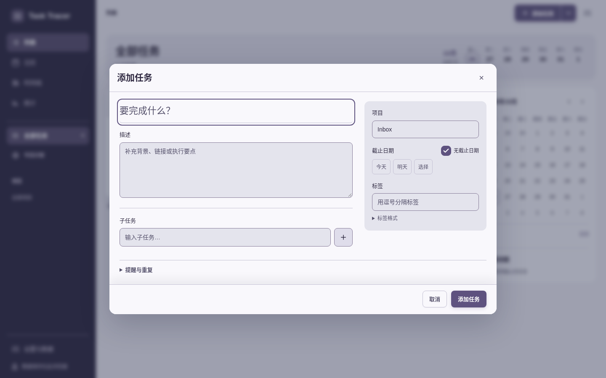
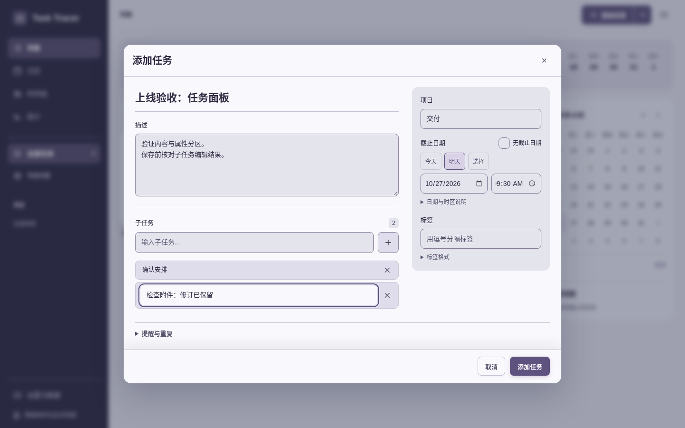
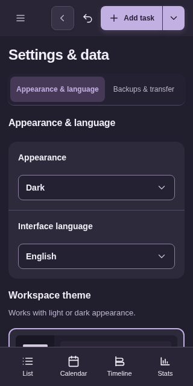
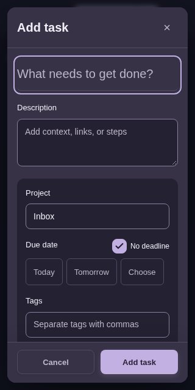
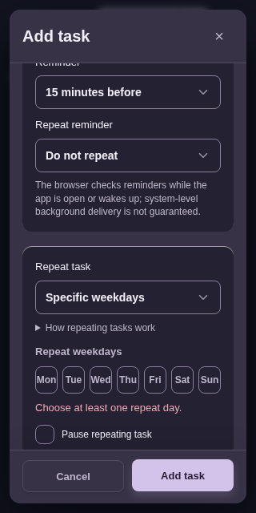
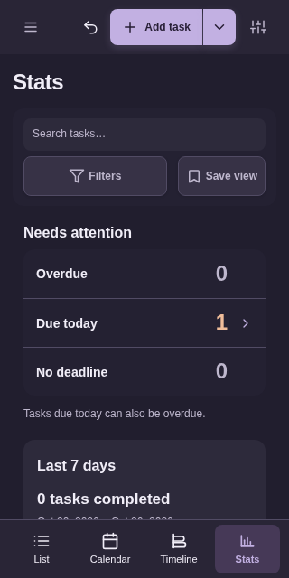
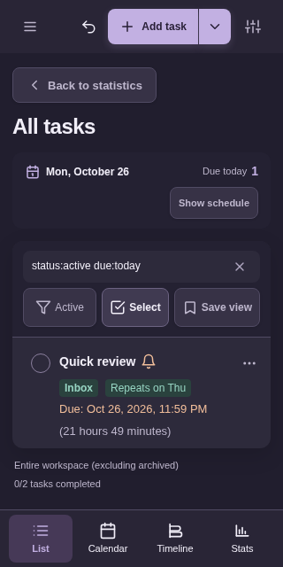
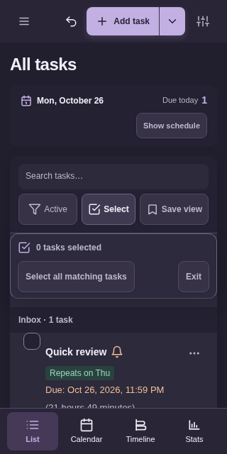
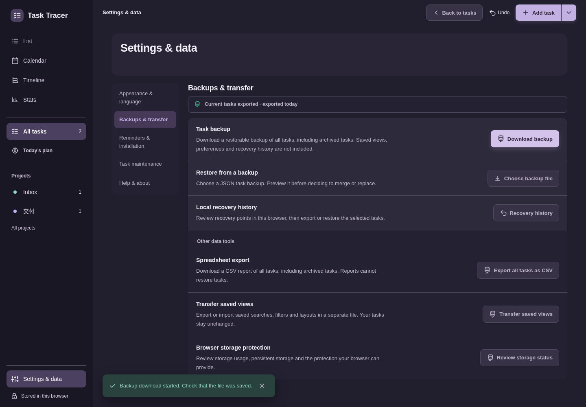

# 4.14.0 真实域名亲用归档

本次新会话实际访问 [todo.muquew.com](https://todo.muquew.com/)，使用 Chromium 154.0.8037.57、新 profile、正常 TLS/CSP 和正常动画。[原来源](source.json)记录 HTTP 200，初次导航 HTML 的 SHA-256 为 `e5741f889cb3c8e74d7f5885f36d5030922afa948b397579b759839ffd827f48`。[原会话](session.json)已关闭，48 份连续观察的 page error 与操作错误均为空；整页 `docWidth` 均未超过当时视口宽度。

[归档分析](archive-summary.json)复核全部观察；[执行者核对](root-verification.json)保留原派生身份。48 是观察数量，不是 48 个独立测试或 HTTP 获取。实际视口为 1440×900（20 份）、320×640（24 份）、1440×1000（4 份）。归档采用上海 10 月 26 日目录，原 UTC 25 日时间戳、文件名和时区不改。

## 实际步骤

| 步骤 | 行为与结论 |
|---|---|
| 01–17 | 打开新完整面板，填写说明、项目、明天日期与 09:30；创建 A/B/C 子任务，编辑 C 后删除 A，再保存。最终备份保留两项幸存子任务及 C 的修订文字。 |
| 18–23 | 在设置切英文、深色，320 px 外观与语言控件先于图库；返回任务并打开 320 px 新表单。 |
| 24–38 | 新建 Quick review，选择今天，清空每周星期后保存被阻止、焦点回到星期组；明确选择周四后保存。最终备份的 `repeatWeekdays` 为 `[4]`。 |
| 39–41 | 观察紧凑统计，进入今日待办，下钻查询为 `status:active due:today`，随后返回统计。 |
| 42–44 | 返回列表，直接进入任务选择，保持筛选未展开，随后退出选择。这里没有声称线上完成批量移动或删除。 |
| 45–48 | 返回桌面与备份面板，实际下载 JSON；执行者使用原完整性 helper 验证校验和，并核对任务和字段。 |

## 执行者实际查看的 9 张图

以下名单与原 `root-verification.json` 完全一致；不把其余截图写成人工已审读。

## 数据与边界

[真实备份](task-tracer_backup_2026-10-25_18-09-07-190.json)包含两个任务。第一个任务的两条幸存子任务为“确认安排”和“检查附件：修订已保留”，日期时间为 **2026-10-27 09:30 Asia/Shanghai**；第二个任务日期为 **10 月 26 日**，每周星期为 `[4]`。归档副本 SHA 与执行者核对记录一致，校验和通过来自执行者实际调用的原 `assert_backup_payload_integrity`，不等同于这次线上执行过恢复导入。

原 driver 即使关闭表单也采集 `editor.fields`，其中隐藏或 reset 后的默认值不能说明已存任务数据，更不能写成当前可见字段。`checkVisibility()` 不证明位于视口内或无遮挡，buttons 仅保留前 65 个；`editor.body` 的矩形与滚动指标分别来自 `.modal-body` 和 `#taskForm`，不能混用。生产截图与动作支持这里列出的路径，精确状态守卫和事务边界另见本地专项。

没有从本次会话推出 390/700 px、三引擎、真实软键盘/IME、读屏、OS 安装通知、规模性能或完整无障碍符合性。所有逐步哈希绑定的是初次真实导航响应，不是 48 次独立 HTML 请求，也不证明 Vercel 后台 Git SHA 或远程 CI。

[原件映射](original-files.json)及[本子目录清单](manifest.json)记录来源、bytes/SHA。旧本地 README/manifest 与其他发布子目录未修改。
