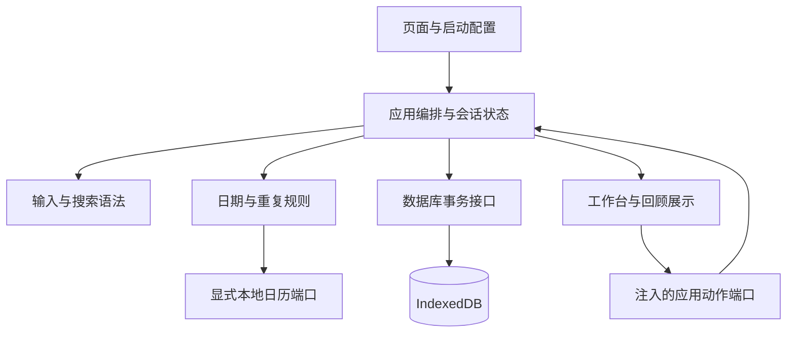
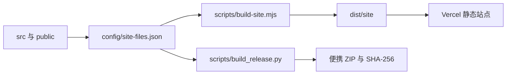

# 架构与职责

Task Tracer 是浏览器本地优先的静态应用。浏览器原生加载 JavaScript；没有后端服务，也没有运行时框架或打包器。

## 目录边界

| 位置 | 职责 | 不应放入 |
| --- | --- | --- |
| `src/index.html` | 页面结构、预绘制外观设置、启动配置与依赖装配 | 任务算法、数据库事务、页面业务实现 |
| `src/app/application.js` | 应用会话状态、操作编排、导航、编辑与列表流程、焦点和弹窗生命周期 | 新的输入语法、日期算法、底层数据库实现 |
| `src/app/domain/` | 输入解析、任务日期与重复规则；通过参数接收名称、时间、时区等上下文 | DOM、存储、翻译、应用全局状态 |
| `src/app/platform/` | 本地日历和浏览器平台语义适配 | 任务业务规则、页面状态 |
| `src/app/infrastructure/` | IndexedDB 连接、事务、版本冲突、恢复点和原子读写 | 页面提示、翻译、应用状态修改 |
| `src/app/features/` | 工作台和回顾展示，通过快照、模型与动作端口和应用层协作 | 直接数据库访问、整个应用 state 对象 |
| `src/styles/` | 可编辑的样式、主题和布局变量 | 编译产物、测试截图 |
| `public/` | 翻译、图标、截图、离线入口和公开下载等站点资源 | 开发脚本、测试、研究报告、私有配置 |
| `config/` | 站点文件清单与便携发行包的部署配置 | 浏览器业务代码 |
| `scripts/` | 构建、校验、打包、测试调度和 CI 报告 | 应用运行逻辑、实际测试场景 |
| `tests/browser/` | 实际用户流程和浏览器回归 | 被其他测试当作公共库导入的辅助函数 |
| `tests/unit/` | 日期、构建边界、安全、发行和测试调度器的隔离验证 | 浏览器操作脚本 |
| `tests/support/` | 浏览器驱动、HTTP 服务、夹具、故障注入与共享断言 | 可独立执行的测试入口 |
| `tests/registry.py` | 默认检查和跨浏览器覆盖范围的唯一登记表 | CI 中另外复制的测试名单 |
| `dist/` | 自动生成的站点、发行包和验证输出；不提交 | 可手工维护的源码 |

`public/resources/workspace.css` 和 `public/fav/` 中的 PNG/ICO 是受校验的生成资产。样式源为 `src/styles/workspace.css`，品牌源为 `public/fav/task-tracer.svg`；修改源后通过构建命令生成产物。

## 运行时依赖

模块挂在 `window.TaskTracer` 命名空间，启动配置显式装配依赖。领域模块在加载时不访问页面或存储，计算所需的当前时间由调用者提供。展示模块接收已计算的数据和有限端口，不自行取得应用状态。

数据库接口接收连接和调用者观察到的 `expectedRevision`。只有任务写入事务成功提交后，应用层才更新其观察版本；读取快照、提醒后台写入和应用当前模型的版本不可混为一谈。任务与相关配置的原子变更必须处于同一事务中。

回顾模块负责生成分离的 DOM 树。统计范围、完成趋势模型、点击后的筛选、导航与返回焦点由应用层负责。工作台采用同样的快照与动作端口边界。

## 构建和发布

`config/site-files.json` 是源码到公开 URL 的唯一文件清单。构建只复制清单中的文件，拒绝越界路径和符号链接；不会把仓库根目录整体发布。`src/`、`scripts/`、`tests/`、`config/` 和依赖目录不进入站点。

根 `vercel.json` 配置仓库构建并发布 `dist/site`。`config/standalone-vercel.json` 随 ZIP 发行，部署根为解压目录，不要求源码或构建工具。两种配置由同一个安全策略生成器同步 CSP。

页面、离线缓存和语言资源的版本须保持对应。外链运行模块必须同时存在于站点清单、页面加载顺序和离线缓存中；校验器会检查它们的对应关系。公开下载文件由 `public/downloads/` 承载，新的临时构建只进入 `dist/`。

## 开发和验证

用户使用方式见根 README；开发命令、测试范围和发布操作见 [贡献指南](../CONTRIBUTING.md)。修改代码只改对应职责的源文件，不直接编辑 `dist/site`。

测试入口统一从登记表调度。共享支持代码不导入实际测试模块；开发构建工具也不依赖测试场景。CI 报告只消费有完整性校验的检查结果，不直接回显任务内容或未验证的日志文本。
