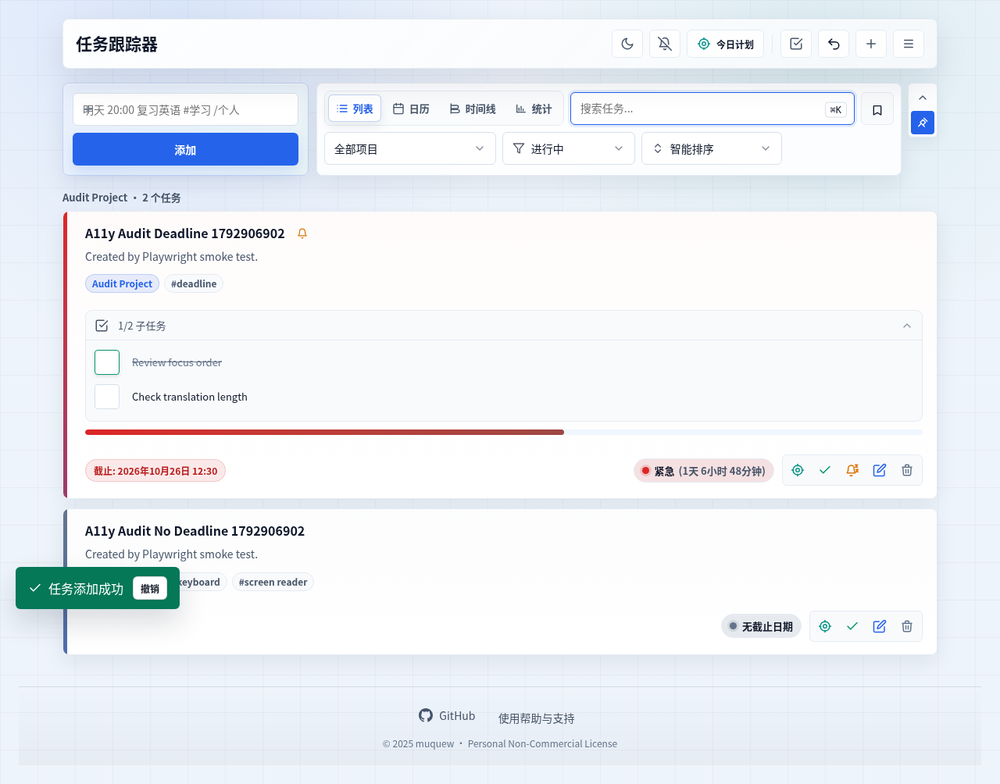
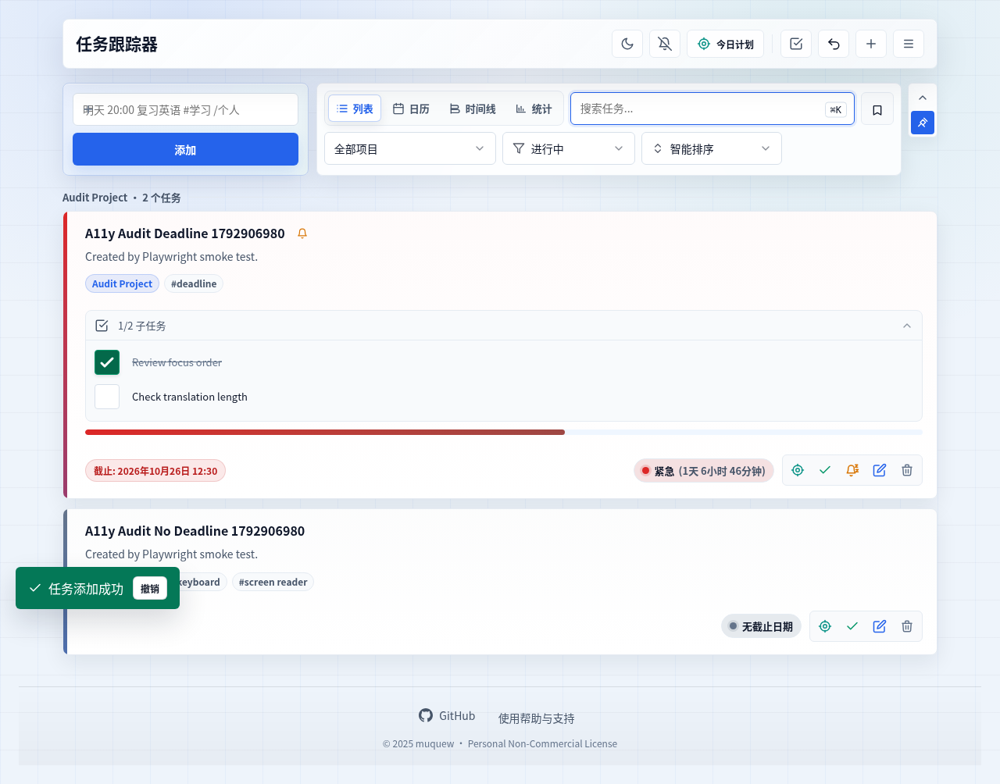
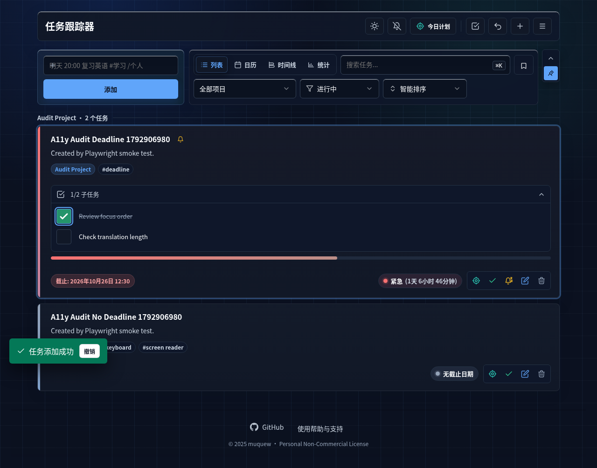

# 4.8.6 — engineering and published-browser acceptance complete

Prepared on 2026-10-25 (Beijing). This candidate addresses a visual defect found during real-domain inspection of the published 4.8.5 app: a checked subtask used a white check glyph on a pale/white background in the light theme. The checkbox's visible state needs a clear contrast of its own; a task strike-through or `1/2` count does not replace it. The [4.8.5 screenshot review](../acceptance/2026-10-25/production-compatibility/e33926be-d2b4-467b-8d47-cb3f31510a11/visual-review.json) and [original Firefox image](../acceptance/2026-10-25/production-compatibility/e33926be-d2b4-467b-8d47-cb3f31510a11/firefox-1280/01-online-restored.png) remain unchanged.

Engineering acceptance is complete for the new frozen 4.8.6 candidate: targeted visibility checks, seven static programs, the complete 58-program checker, 31 programs in each of three engines, actual 4.8.5 archive upgrade/rollback/re-upgrade, two byte-identical independent builds and extracted persistence/offline all passed. The [new provenance record](inputs-4.8.6.json) binds the same 91 inputs, local artifact and 166 original evidence files. The candidate was pushed as application commit `f13d7e11111a1ee321363dec875c8899146dffa6`, and production static matching passed at 14:14:33 Beijing. Post-publication real-domain browser checks are complete under their declared scopes: Firefox/WebKit four core combinations and separate Chromium visibility checks at two viewports. The [immutable publication summary](../acceptance/2026-10-25/publication-4.8.6.json) binds the actual push, static deployment and browser results. The [current GOAL](../../GOAL.md) tracks the remaining work.

## Scope and version boundaries

Static validation confirmed app, cache and package version 4.8.6; language resources remain 4.36. IndexedDB 2, task JSON 2.4 and saved-view JSON 1.1 retain their contracts. This correction is limited to checked-subtask visibility and regression coverage; it does not intentionally change persistence, recurrence, backup formats or pagination. The checked selector now supplies an explicit success-colored fill, darkened with `color-mix(in srgb, var(--color-success) 70%, #000)`, behind the existing white SVG check; its placement after the hover rule keeps the checked fill present while hovering.

English singular-count wording such as `1 tasks` and `1 days` remains a separate non-blocking polish item from the [4.8.5 dated review](../acceptance/2026-10-25/README.md). It is outside this patch.

## Completed acceptance and actual scope

| Acceptance | Current status | Evidence to retain |
| --- | --- | --- |
| Checked/unchecked subtask visibility in three engines | Passed: 6 engine/viewport combinations, 36 automated states; 12 representative images inspected | [Native GREEN report](checkbox-visibility-4.8.6-green/f9f4d20d-19e4-4ae6-9a28-21e148836ccc/report.json), [inspection record](checkbox-visibility-4.8.6-green/f9f4d20d-19e4-4ae6-9a28-21e148836ccc/inspection.json) |
| New source and verification freeze | Captured before the integrated checker/matrices; source 22 + verification 69 | [New input map](frozen-inputs-4.8.6.json); preflight fingerprints match it |
| Seven static programs | Passed 7/7 with unchanged source/verification maps | [Native report](check-results-4.8.6-static.json), [original output](check-output-4.8.6-static.log) |
| Complete registered 58-program checker | Passed 58/58 in Chromium, summed 1427.981 seconds | [Native report](check-results-4.8.6.json), [original output](check-output-4.8.6.log), unchanged input maps |
| Current 31-program registry in Chromium, Firefox and WebKit | Passed 31/31 in each engine, 93 programs total | [New per-program matrix and native reports](../browser-compatibility.md); 96 referenced logs and 102 native files verified |
| Actual 4.8.5 archive upgrade, rollback and re-upgrade | Passed all three phases with the retained 4.8.5 archive | [Original output](upgrade-4.8.5-to-4.8.6.log), baseline identity and exact task/view assertions |
| Two independent builds and extracted persistence/offline | Passed: independent ZIP bytes identical; extracted persistence and offline reload passed | [Complete checker output](check-output-4.8.6.log), [artifact identity](inputs-4.8.6.json) |
| GitHub push and production static matching | Passed: `f13d7e1` pushed to `main`; original CLI first passed at 14:14:33 Beijing | [Push record](../acceptance/2026-10-25/publication-4.8.6-push.json), [14-response deployment verification](../acceptance/2026-10-25/deployment-4.8.6/4960beeb-6e70-4e15-bd62-b4223711b771/summary.md) |
| Real-domain Firefox/WebKit core flows | Passed 4/4 engine/viewport combinations, 8 inspected screenshots and 8 actual JSON downloads | [Native summary](../acceptance/2026-10-25/production-compatibility/59393473-b285-4544-ba78-3b7d8ad8e3da/verification-summary.json), normal TLS, real unavailable-network cached reload |
| Separate real-domain Chromium visibility | Passed 2 fresh contexts / 12 automated states; 4 representative images inspected, other 8 automated only | [Native report](../acceptance/2026-10-25/production-visibility-4.8.6/c071d6ed-aa90-4e37-b019-8592ef1f8221/report.json), [inspection record](../acceptance/2026-10-25/production-visibility-4.8.6/c071d6ed-aa90-4e37-b019-8592ef1f8221/inspection.json); not another full-core program |

The accepted previous archive is `task-tracer-4.8.5.zip`, 23 files / 812,056 bytes / SHA-256 `08bf9fafc2ebeb7bf905ebc105a7d08ad571ba91eb65eaf8a3b2a3cdcbff5a0d`. It retains its real `1c3bacb0ca8015fb5840c6b5d1d5efa0937e6e28`/dirty-tree build manifest; it is not relabeled as a clean `d9b2a58` build. The newly built local `task-tracer-4.8.6.zip` contains 23 files / 812,059 bytes / SHA-256 `7a54122aae730cc566ef7e7b4040183842e02b8aa4f27d1b73ddd3bddafff895`. Its manifest records base commit `d9b2a58d8359aa27c087f3da809d7de27ee398f0` and `working_tree_dirty: true`; it is a local review candidate, not a clean artifact built after a new release commit. The final checker subsequently confirmed two independent builds with those same bytes and verified persistence/offline behavior from the extracted package. The ZIP and sidecar match the preserved manifest and input record.

## Targeted regression and frozen identity

The new assertion first failed against the uncorrected 4.8.5 styles: the [native RED report](checkbox-visibility-4.8.6-red/2d333d40-bba7-4c24-9660-1522f0a88020/report.json) records a white mark on a white fill with 1.0:1 marker and state contrast. Its failed status, original screenshot and native traceback remain unchanged; the retained assertion traceback is not relabeled as reconstructed first-run stdout.

The [GREEN summary](checkbox-visibility-4.8.6-summary.json) records Chromium 154.0.8037.57, Firefox 153.0 and WebKit 26.5 at 1280×800 and 390×844. Each combination checks light/dark resting, hover and keyboard-focus states, for 36 automated observations, and checks Space completion followed by a second Space to return the subtask to unchecked. The observed white-mark/fill contrast was 6.7264566–6.7292384:1 in light theme and 3.8020867:1 in dark theme. Checked and unchecked fills were distinct, keyboard focus remained visible and all page-error lists were empty.

Twelve representative saved images were individually inspected: light-resting and dark-keyboard-focus in each of the six engine/viewport combinations. The remaining 24 images retain automated paint assertions and are not claimed as individually viewed. This targets the actual marker/fill and checked-versus-unchecked fill difference; existing unchecked-border contrast and complete WCAG conformance are outside this narrow result.

| Uncorrected 4.8.5 light theme | Corrected 4.8.6 light theme | Corrected 4.8.6 dark keyboard focus |
| --- | --- | --- |
|  |  |  |

The external [91-input freeze](frozen-inputs-4.8.6.json) was captured at 13:44:58.471 Beijing (05:44:58.471Z): source aggregate `fe5c092570424d57b6bd68a2cee2303bd7972d013c7b075f1cc01248feefb665`, verification aggregate `4bfb7094e01db67b4f0e69c172cfe3e24fdd64a55fc003698c94be9f4169f9dc`. Static and targeted preflights had captured their own inputs before their checks and verified them afterward; both maps match this subsequent external freeze exactly. The external freeze precedes the formal integrated checker, actual-old-archive lane and new matrices; it is not described as predating those earlier preflights.

The actual 4.8.5-archive lane completed at 13:45:35 Beijing with exit 0. Its original output verifies baseline SHA `08bf…5a0d` and separately reports 4.8.5 → 4.8.6, rollback to 4.8.5 and re-upgrade to 4.8.6: fields/views, CRUD and offline reload passed, with exact task/view checks on re-upgrade. The complete integrated lane then finished with exit 0 after all 58 checks and its final input verification. The full run ended at 14:09:24 Beijing; this timing and the summed per-program duration are execution records, not controlled performance comparisons.

## Completed new three-engine matrix

[Chromium 154.0.8037.57](browser-matrix-4.8.6-chromium.json), [Firefox 153.0](browser-matrix-4.8.6-firefox.json) and [WebKit 26.5](browser-matrix-4.8.6-webkit.json) each passed all 31 programs. All native start/end maps and current files matched the new freeze; no errors, integrity failures or unexecuted programs remain. The [collection record](browser-matrix-4.8.6-integrated-validation.json) verifies exact program order, actual versions, logs and portable UUID paths across 102 original report/console/log files, including all 96 referenced probe/program logs.

Core alone repeats 1280×800 and 390×844. Specialized programs retain their individual scopes. Four Firefox/WebKit engine/program live-CDP groups stay `not_run`; these are coverage groups, not four individual assertions, and are not passed live-override coverage. This new matrix does not establish all 58 checker programs in every engine or 4.8.6 production publication. The separate complete 58-program run used Chromium 154.0.8037.57.

## Complete checker and delivery provenance

The [schema-2 complete report](check-results-4.8.6.json), run `f57bdf5d-42da-4d7c-85db-376358c3bd06`, finished `passed` / `completed: true` / `passed: true`, with all 58 exit codes zero, no current program, no error or integrity errors, and unchanged source/verification maps. Program durations sum to 1427.981 seconds. Its SHA-256 is `ecf7b600f48a6430d5f24de144062d928642d22053bbe24d116ec4d8cd2f7bd5`.

The [immutable input/delivery record](inputs-4.8.6.json) binds 166 retained raw evidence files to the 91-input freeze, 93 matrix program executions, 36 targeted visual states, actual old-archive upgrade and the 23-file/812,059-byte local ZIP. Two independent builds matched SHA-256 `7a54122aae730cc566ef7e7b4040183842e02b8aa4f27d1b73ddd3bddafff895`; extracted persistence/offline passed. Its real build context remains `d9b2a58…` with a dirty working tree. The subsequent application publication and production verification are recorded separately below; they do not rewrite this pre-publication manifest or evidence.

## Published application and production static matching

The [push record](../acceptance/2026-10-25/publication-4.8.6-push.json) records the successful ordinary fast-forward push of application commit [`f13d7e11111a1ee321363dec875c8899146dffa6`](https://github.com/muquew/Task-Tracer/commit/f13d7e11111a1ee321363dec875c8899146dffa6) to GitHub `main`. Its committed 91 source/verification blobs match the accepted freeze exactly. That record was captured before deployment verification, which has its own later native report.

At 14:14:33 Beijing, the unchanged deployment CLI passed on its first attempt against `https://todo.muquew.com/`. The [native deployment report](../acceptance/2026-10-25/deployment-4.8.6/4960beeb-6e70-4e15-bd62-b4223711b771/report.json) is passed/completed with unchanged input maps; its SHA-256 is `c6319ba610face151373c4498cdf36b879509db141ea56d83f6728346136cfe5`. A second observational call to the same original verifier retained 14/14 actual HTTPS 200 bodies with bytes/SHA equal to the candidate, including the HTML, Service Worker, manifest, icons and versioned/unversioned translations. CSP and all registered security-header assertions passed. Actual app/cache version is 4.8.6, resources 4.36. [The deployment summary](../acceptance/2026-10-25/deployment-4.8.6/4960beeb-6e70-4e15-bd62-b4223711b771/summary.md) links the 21 original retained files.

The static verifier establishes production correspondence, not Vercel backend Git metadata, remote-CI success or browser interactions by itself. Those browser interactions subsequently completed under the independent reports below. WebKit used a validated owned CONNECT relay for unavailable transport; the earlier `context.set_offline` API failure remains failed and is not relabeled as a pass. The local ZIP retains its original `d9b2a58` dirty-tree manifest rather than being renamed a clean `f13d7e1` build. Any later documentation/evidence commit and its publication will be recorded only after execution.

## Completed actual-domain browser acceptance

The [Firefox/WebKit production summary](../acceptance/2026-10-25/production-compatibility/59393473-b285-4544-ba78-3b7d8ad8e3da/verification-summary.json) records all four fresh combinations passed in Firefox 153.0 and WebKit 26.5 at 1280×800 and 390×844. Initial HTTPS HTML was 200 and byte-identical to the new index in each context. Original business helpers covered CRUD, all four views, actual task-backup and pre-import safety downloads, replacement import/delete and cached navigation with network unavailable. Eight screenshots were saved and actually inspected, eight JSON downloads were saved and checked, and all page/console/request-error lists were empty. Completion was 14:15:46.689 Beijing; all four cached reloads returned 200 from the Service Worker.

Firefox retained normal TLS verification using only the provisioned public CA in temporary NSS profiles and its normal offline API, with `navigator.onLine=false`. WebKit's validated byte relay forwarded only to the inherited proxy, then closed every listener/socket/worker before reload. A new connection was refused, upstream counters did not increase after cached reload and the response was 200/from-Service-Worker. Its `navigator.onLine` stayed true: this proves unavailable transport/cache fallback, not a successful retry of the known-failing offline API or a physical device's disconnected radio.

The independent [Chromium 154.0.8037.57 visibility report](../acceptance/2026-10-25/production-visibility-4.8.6/c071d6ed-aa90-4e37-b019-8592ef1f8221/report.json) passed two real-domain contexts and 12 light/dark interaction observations, with initial HTML matching the frozen index and unchanged 91 inputs. [Four representative saved images](../acceptance/2026-10-25/production-visibility-4.8.6/c071d6ed-aa90-4e37-b019-8592ef1f8221/inspection.json) were actually viewed; eight other images support automated assertions only. White-mark/fill contrast was 6.7264566:1 light and 3.8020867:1 dark, with visible keyboard focus. This focused visibility run is not an identical fifth/sixth full-core combination.

The [final publication record](../acceptance/2026-10-25/publication-4.8.6.json), SHA-256 `0e4261a1d36fb11e302977d097ccd0a99666a6eef3ef121fa5deeb33ed24398c`, keeps these scopes distinct and links the actual native evidence. It records the completed application publication/browser acceptance, while the later documentation/evidence commit and its separate on-site byte check remain future delivery actions at this record's capture time; no future commit or deployment time is prefilled here.

## Historical evidence and limits

The [4.8.5 engineering baseline](4.8.5.md) passed its complete 58-program checker, three engines × 31 programs, complete 10,000-task/six-subtask round trip, nine same-scale storage cases and 87 controlled performance observations. Those native reports keep their own 4.8.5 identity. The visual correction does not change persistence or pagination, so the explicit 10,000-task fault suite and 87-observation workload are not scheduled again for this patch; their old results are baseline information, not new 4.8.6 measurements. New routine-size coverage within the full checker must still complete.

The 4.8.5 application commit `d9b2a58d8359aa27c087f3da809d7de27ee398f0` was pushed to `main`, and its [production static matching](../acceptance/2026-10-25/deployment-after-push/c0be17a7-96ee-4b85-a329-b59dbee06825/summary.md) passed at 13:23:39. Its nine-step Chromium domain flow and subsequent [partial Firefox/WebKit supplement](../acceptance/2026-10-25/production-compatibility/e33926be-d2b4-467b-8d47-cb3f31510a11/verification-summary.json) remain separate: Firefox's two viewports passed; WebKit 1280px completed online checks but failed at driver-level context-offline reload, and WebKit 390px did not run. The offline-API diagnosis is separate from the confirmed checkbox contrast defect; no root-cause conclusion is inferred here.

Neither Linux browser engines nor narrow viewports establish physical Safari/iPhone, real IME/soft-keyboard behavior, OS installation, assistive technology or system-notification acceptance. The historical Firefox timeout remains unexplained, and successful repeats do not prove it eliminated. Remote CI, actual browser eviction and commercial price/payment/private-support/license terms retain their independently recorded states.
